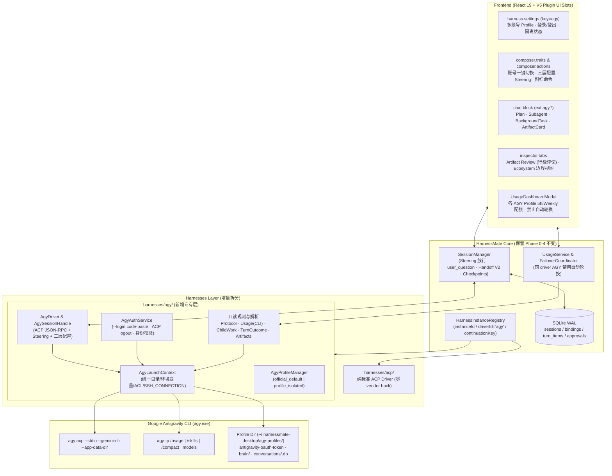
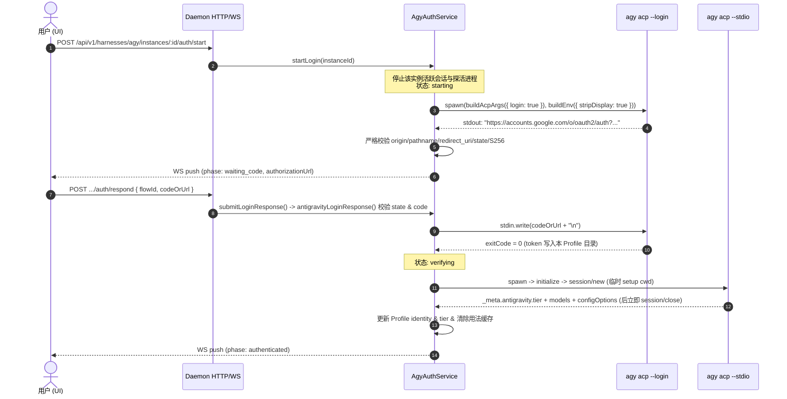

# 03 · Phase AGY 增量架构与接口设计规范

---

## 一、总体增量架构设计

Phase AGY 不改动 HarnessMate 既有核心主干（Plugin SDK V5、Canonical Event、TurnBlock V2、Context Handoff V2、HarnessInstanceRegistry、Git Checkpoints、Multi-Harness Orchestrator），而是通过**将 AGY 从 `acp-adapter.ts` 解耦为独立的第一方 Driver 包 `harnesses/agy/`**，并通过统一 `AgyLaunchContext` 与 `HarnessInstanceRegistry` 对接多账号 Profile、官方认证与原生体验。



---

## 二、核心数据模型与 TypeScript / Zod 接口设计

### 2.1 账户 Profile、隔离模式与 `AgyLaunchContext`

建议在 `packages/protocol/src/canonical.ts` 增量新增 AGY Profile 与认证状态 Schema，并在 `packages/daemon/src/harnesses/agy/agy-launch-context.ts` 实现统一上下文构造器：

```ts
// packages/protocol/src/canonical.ts (增量扩展)
export const AgyAuthMethodSchema = z.enum([
  'oauth-personal',
  'oauth-business',
  'gemini-api-key',
  'agent-platform',
]);
export type AgyAuthMethod = z.infer<typeof AgyAuthMethodSchema>;

export const AgyIsolationModeSchema = z.enum([
  'official_default',   // 保留官方默认 ~/.gemini 与系统 keyring（仅限主默认实例）
  'profile_isolated',   // 独立 geminiDir + 受控文件存储隔离（多 Google 个人账号必选）
]);
export type AgyIsolationMode = z.infer<typeof AgyIsolationModeSchema>;

export const AgyAccountDefaultsSchema = z.object({
  defaultModel: z.string().nullable().optional(),
  defaultEffort: ReasoningEffortSchema.nullable().optional(),
  defaultPermissionMode: PermissionModeSchema.optional(),
  enableSandbox: z.boolean().optional(),
  linkGlobalSkills: z.boolean().default(true),
  syncGlobalRules: z.boolean().default(true),
  additionalDirectories: z.array(z.string()).default([]),
});
export type AgyAccountDefaults = z.infer<typeof AgyAccountDefaultsSchema>;

export const AgyAccountIdentitySchema = z.object({
  accountFingerprint: z.string().nullable().optional(), // SHA-256("google-account\0" + verifiedIdOrEmailHash)
  emailLabel: z.string().nullable().optional(),         // 脱敏展示用，如 w***@gmail.com 或用户命名标签
  tierName: z.string().nullable().optional(),           // 来自 ACP _meta.antigravity.tier.name
  tierId: z.string().nullable().optional(),
  verifiedAt: z.number().nullable().optional(),
});
export type AgyAccountIdentity = z.infer<typeof AgyAccountIdentitySchema>;

export const AgyProfileConfigSchema = z.object({
  instanceId: z.string().trim().min(1).max(64),
  displayName: z.string().trim().min(1).max(80),
  isolationMode: AgyIsolationModeSchema.default('official_default'),
  authMethod: AgyAuthMethodSchema.default('oauth-personal'),
  geminiDir: z.string().optional(),                     // profile_isolated 下的绝对路径
  appDataDirName: z.string().default('antigravity-cli'), // 实测须同时兼容 top-level CLI 与 ACP 子命令
  gcpProject: z.string().optional(),
  gcpLocation: z.string().optional(),
  defaults: AgyAccountDefaultsSchema.default({}),
  identity: AgyAccountIdentitySchema.optional(),
});
export type AgyProfileConfig = z.infer<typeof AgyProfileConfigSchema>;
```

**`AgyLaunchContext` 统一抽象**（`packages/daemon/src/harnesses/agy/agy-launch-context.ts`）：

```ts
export interface AgyLaunchContext {
  readonly instanceId: string;
  readonly isolationMode: AgyIsolationMode;
  readonly authMethod: AgyAuthMethod;
  readonly binaryPath: string;
  readonly geminiDir: string;        // official_default: ~/.gemini; profile_isolated: <dataDir>/agy-profiles/<sha256>
  readonly appDataDirName: string;   // 默认 'antigravity-cli'（供 ACP --app-data-dir 使用）
  readonly appDataPath: string;      // path.join(geminiDir, appDataDirName)
  readonly tokenFilePath: string;    // path.join(appDataPath, 'antigravity-oauth-token')
  readonly runtimeTempDir: string;   // 独立临时目录，避免多实例及 PyInstaller 解压冲突

  /** 构造受控的子进程环境变量（剥离 18+ 宿主凭据变量；仅在 profile_isolated + oauth-personal 注入 SSH_CONNECTION） */
  buildEnv(opts?: {
    extraEnv?: Record<string, string | undefined>;
    stripDisplay?: boolean; // --login 流程需移除 DISPLAY/WAYLAND_DISPLAY
  }): Record<string, string | undefined>;

  /** 构造 `agy acp` 参数（含 --gemini-dir, --app-data-dir, --sandbox, --add-dir） */
  buildAcpArgs(opts?: {
    login?: boolean;
    additionalDirectories?: readonly string[];
    sandbox?: boolean;
    logFile?: string;
  }): string[];

  /** 构造顶层 `agy` CLI 参数（严禁传入 --app-data-dir / --gemini-dir，依赖 buildEnv().GEMINI_HOME 传递边界） */
  buildCliArgs(subArgs: readonly string[]): string[];
}
```

**关键约束（基于 Windows `agy 1.5.14` 实测）**：
1. `buildCliArgs()` **绝不**附加 `--app-data-dir` 或 `--gemini-dir`（修复现存 `agy-commands.ts` 报错 exit 2 缺陷）。
2. `buildEnv()` 必须剥离（大小写无关）以下环境变量：`GEMINI_API_KEY`、`GOOGLE_API_KEY`、`GOOGLE_APPLICATION_CREDENTIALS`、`GOOGLE_CLOUD_PROJECT`、`GOOGLE_CLOUD_LOCATION`、`GOOGLE_CLOUD_QUOTA_PROJECT`、`GOOGLE_GENAI_USE_VERTEXAI`、`GCLOUD_PROJECT`、`CLOUDSDK_CORE_PROJECT`、`AGY_ACP_CCPA_PROJECT`、`AGY_ACP_ENABLE_OAUTH`、`GEMINI_HOME`、`AGY_ACP_FORCE_FILE_STORAGE`、`AGY_CLI_DISABLE_AUTO_UPDATE`、`BROWSER`、`PYTHONUNBUFFERED`、`ELECTRON_RUN_AS_NODE`、`CHROME_CRASHPAD_PIPE_NAME`、`HARNESSMATE_LOCAL_TOKEN`、`HARNESSMATE_SESSION_MCP_TOKEN`、`HARNESSMATE_DATA_DIR`。
3. 当且仅当 `isolationMode === 'profile_isolated'` 且 `authMethod === 'oauth-personal'` 时，设置 `SSH_CONNECTION = baseEnv.SSH_CONNECTION || '127.0.0.1 0 127.0.0.1 0'`；`oauth-business` **禁止**注入 `SSH_CONNECTION`（防止破坏其非 `--login` 的浏览器登录），并在 UI 明示企业账户当前受限于上游 `#1610` 无法并发多账号隔离。
4. `appDataDirName` 优先设为 `'antigravity-cli'`（而非 `'antigravity-acp'`），以期在 `GEMINI_HOME` 隔离模式下令 `agy acp` 与 `agy -p /usage` / `agy -p /skills` 读写同一 `<geminiDir>/antigravity-cli/` token 文件。*此项跨子命令兼容性标记为 `[待真机验证]`，将在 Phase AGY-1/2 双账号实登后立即核验。*

---

## 三、官方登录、登出与身份校验状态机



### 身份校验与防串号规则
1. **未登录快速检测**：在任何非交互 CLI 调用（`agy -p /usage`、`agy -p /skills`、`agy models`）前，若为 `profile_isolated` + `oauth-personal`，先检查 `tokenFilePath` 是否存在；若不存在则直接返回未登录状态，避免触发 `agy -p` 打印 URL 并挂起等待 `--print-timeout`。
2. **启动期身份一致性核对**：每次 `AgySessionHandle.initialize()` 成功后，读取 ACP 日志或会话返回的 `tier` 与（若可得的）账户标识；若发现 `profile_isolated` 模式下产生了共享 keyring 回退警告或身份指纹突变，立即记录告警事件并刷新 `HarnessInfo.health` 提示用户核查。
3. **登出隔离守卫**：
   - `profile_isolated`：调用 ACP `logout` 仅销毁当前 Profile 下 token 文件，不影响本机其他 Profile 或默认 keyring；
   - `official_default`：在前端弹窗中**强制二次警示**“此操作将登出本机共享系统凭据库，影响本地 Antigravity IDE/CLI”。

---

## 四、三层配置作用域与后端确认机制

```ts
export interface AgyResolvedTurnConfig {
  accountDefaults: AgyAccountDefaults;
  sessionOverrides: {
    model?: string | null;
    reasoningEffort?: ReasoningEffort | null;
    permissionMode?: PermissionMode;
    configOptions?: Record<string, string>;
  };
  turnOverrides?: {
    model?: string | null;
    reasoningEffort?: ReasoningEffort | null;
    permissionMode?: PermissionMode;
    configOptions?: Record<string, string>;
  };
  effectiveRequested: {
    model: string | null;
    reasoningEffort: ReasoningEffort | null;
    permissionMode: PermissionMode;
    configOptions: Record<string, string>;
  };
  /** 完全以后端 ACP 响应为准，严禁前端乐观假定已生效 */
  backendConfirmed: {
    model: string | null;
    thoughtLevel: string | null;
    modeId: string | null;
    tierName: string | null;
    availableThoughtLevels: string[];
    confirmedAt: number;
  };
}
```

- **解析顺序**：`AccountDefaults` < `Session` < `Turn`（单轮 `/model <id> <prompt>` 或 `turnOptions` 仅作用于当轮，轮次结束后 `SessionManager` / `AgySessionHandle` 恢复至 `Session` 级配置）。
- **Per-model `thought_level` 动态联动**：当切换模型后（`session/set_config_option("model", ...)`），立即读取返回的 `configOptions` 中 `thought_level` 的最新可选项与 `currentValue`，更新该模型的缓存并通知前端刷新 `TraitsPicker`。
- **运行中锁定**：Turn 处于 `running` 或 `awaiting_approval` 时，UI 锁定模型与权限模式选择器并提示原因（对标 Antigravity App v2.35.0 行为）。

---

## 五、原生事件投影、Steering 与会话生命周期

1. **`usage_update`**：映射为 `NormalizedAdapterEvent` `{ type: 'usage.updated', turnId, usage: { contextTokens: used, modelContextWindow: size } }`，驱动 `UsageService.getSessionContextMeter()` 与前端上下文百分比计量条。
2. **`session_info_update`**：当 `update.title` 非空且会话未被用户手动重命名时，更新 `session.title` 并广播 `session_updated`。
3. **`available_commands_update`**：不再写入 `turn_block.ext` 聊天流，而是更新适配器 `liveNativeCommands` 并通过事件总线刷新 `GET /api/v1/sessions/:id/commands`。
4. **`Run update_steps`**：识别 `tool_call` / `tool_call_update` 中 `title === 'Run update_steps'`，转为 `turn_block.ext`（`blockType: 'ext:agy.plan'`）结构化进度卡。
5. **`interaction_*` 结构化提问**：当 `session/request_permission` 的 `toolCall.toolCallId.startsWith('interaction_')` 时，发射 `approval.requested`（`kind: 'user_question'`, `questionSpec` 包含原生选项列表），用户通过现有 `ApprovalCenter` 提交后调用 `resolveQuestion()` 准确回传对应的 `optionId`。
6. **权限安全警告与模式映射**：
   - 提取 `options[i]._meta['agy.security.warning']` 附着在 `ApprovalRequest` 摘要/注解中展示；
   - `auto` 模式仅在 `availableModes` 真正包含 `'auto'` 时启用，否则降级至 `'default'` 并标记 `enforcement: 'client_guard'`（禁止欺骗）。
7. **Mid-turn Steering**：当检测到 `agy >= 1.5.0` 时，`capabilitiesV2.supportsActiveSteering = true`；`SessionManager.startTurn()` 对支持 Active Steering 且处于 `running`（无阻塞审批）的会话允许发送 Steering 引导输入，直接下发 `session/prompt` 而不发送 `session/cancel`。
8. **后台命令 / `schedule` 跨 Turn 续流**：追踪未完成的非 daemon 命令与 `schedule` 工具调用，Turn 结算后若存在存活后台任务，保持 `LiveHandleEntry` 在温池中不被驱逐，后续到来的无 Prompt 唤醒流通过 `continuation: true` 正常投影为后续回复。
9. **原生子 Agent 与静默错误只读观测**：
   - `agy-child-work.ts` 只读解析 `brain/<nativeSessionId>/.system_generated/{subagents,messages,logs/transcript.jsonl}`，渲染 `ext:agy.subagent_batch` 折叠卡；
   - `agy-turn-outcome.ts` 在 `session/prompt` 返回前后对比 `conversations/<nativeSessionId>.db` 的 `max(idx)`，捕获静默 `ERROR_STEP_TYPE(17)`（`QUOTA_EXHAUSTED`、`429`、`INVALID_THINKING_SIGNATURE`），准确触发 `turn.failed`（含 `resetAt` 或损坏会话新开接续）。
   - 所有磁盘只读路径必须经过 `lstat` + `realpath` 校验（拒绝符号链接与 Windows reparse point）。

---

## 六、插件 UI 插槽方案与生态边界

### 6.1 复用现有 V5 UI 插槽（零破坏主框架）

| V5 插槽 | 注册键 | 承接组件与职责 |
| --- | --- | --- |
| `harness.settings` | `key: 'agy'` | **AGY Account & Profile Manager**：展示所有 AGY 实例列表、隔离模式徽标（`官方默认` vs `独立 Profile`）、Google 登录弹窗（显示 OAuth URL + 粘贴 code/URL）、身份核对状态、一键登出、Sandbox / Global Skills 开关。 |
| `composer.traits` & `composer.actions` | `core.harness.agy` | **AGY Native Composer**：账号快速切换器（手动一键切换，触发 Context Handoff V2）、Orchestrator 提示、模型+动态思考档位、运行中锁态、Steering 模式指示、动态斜杠命令提示。 |
| `chat.block` | `ext:agy.plan`, `ext:agy.subagent_batch`, `ext:agy.background_task`, `ext:agy.artifact_card`, `ext:agy.goal_status` | **AGY Conversation Studio**：可折叠工具/思考组、步骤清单卡片、并行子 Agent 折叠组与只读轨迹抽屉、后台任务状态条、Artifact 快捷卡片。 |
| `inspector.tabs` | `agy.artifacts`, `agy.ecosystem` | **AGY Artifact Review & Ecosystem**：只读列举 `brain/<nativeSessionId>/*.md` 等产物，提供 Markdown/Mermaid/Diff 视图、行级评论草稿收集（`C` / 点击行号添加评论，一键汇总生成结构化审阅回复发回对话）、Approve/Reject 快捷回复；以及生态边界总览面板。 |
| 全局 `UsageDashboardModal` | `UsageService` 扩展 | **AGY Usage Center**：展示每个 AGY Profile 的模型分组配额条（Gemini / Claude & GPT 5h/Weekly 剩余百分比、重置倒计时、Tier 徽标）；提供“手动切换至该账号”按钮，并在 `FailoverCoordinator` 中屏蔽对同驱动 AGY 账号的自动轮换。 |

### 6.2 AGY 原生生态 vs HarnessMate 插件系统边界

| 能力 | AGY 原生体系 | HarnessMate 体系 | 边界与集成规则 |
| --- | --- | --- | --- |
| **Projects** | 多文件夹目录配置、`--add-dir` / ACP `additionalDirectories` | `Workspace`（单根路径 + Git Worktree） | 保持 `Workspace` 为核心锚点，允许为 AGY 会话附加 `additionalDirectories` 并在 ACP `session/new`/`load` 透传。 |
| **Rules** | `GEMINI.md`、`AGENTS.md`、`.agents/rules/` | `attachment-service` 规则读取 | `profile_isolated` 启动时同步全局 `GEMINI.md`/`AGENTS.md`（带 hash 清单防覆盖本地修改），项目级规则直接随 `cwd` 发现。 |
| **Skills** | `~/.gemini/config/skills/`、`~/.gemini/antigravity/skills/`、`.agents/skills/` | `NativeSkill` + `/skills` | Windows 使用 `junction` 链接用户全局 Skills 到独立 Profile；修复 `/skills` 走 `AgyLaunchContext`。 |
| **MCP** | `agy mcp` 管理本机全局 `~/.gemini/config/mcp_config.json` `[已真机验证 Windows agy 1.5.14]` | `pluginMcp`（`harnessmate_session_tools` 会话级 HTTP/stdio MCP） | **明确分层**：UI 标注原生 `agy mcp` 为全局作用域（跨 Profile 共享）；HarnessMate 插件工具通过会话级 ACP `mcpServers` 隔离注入。 |
| **Hooks** | `hooks.json`（作用于 AGY 内部工具链） | Plugin SDK V5 Hooks（`before_turn` / `after_turn`） | **严禁混用**：两套 Hook 各自作用于所在运行时，UI 只读展示 AGY `hooks.json` 状态。 |
| **Plugins** | `agy plugin list/install/enable/disable` | HarnessMate V5 插件中心（隔离进程 + Ed25519） | **双轨独立**：`agy plugin` 仅管理 AGY 自身插件，与 HarnessMate 插件隔离目录及权限体系完全无关。 |
