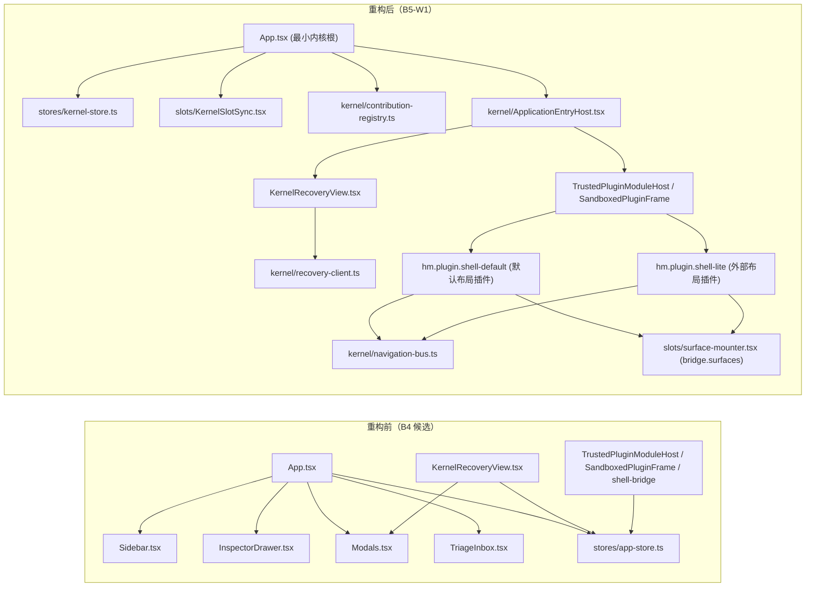

# 第五批 B5-W1 交付报告：应用布局、导航与前端状态解耦

日期：2026-11-28。任务包：B5-W1。分支：`codex/b5-w1-shell`。

## 1. 基线、分支与 W2 合入状态

| 项目 | 值 |
| --- | --- |
| 固定共同创建 SHA | `9d40b5e71a8e1b6ad717cdc618982b4b312ef6a5` |
| 包含第四批候选 SHA | `9df22350c10905abc2805380f216fa0735059824`（已核对为祖先） |
| 开发工作树 | `D:/HarnessMate/b5-w1-shell` |
| 临时目录与缓存 | `D:/HarnessMate/b5-tmp/w1`、`D:/HarnessMate/b5-tmp/pnpm-store` |
| W2 合入状态 | **可供 B5-W2 正式合入**（包含完整契约、默认布局插件、外部 `shell-lite`、独立 `KernelRecoveryView`、状态/导航/贡献解耦与全套验证；非单契约检查点） |
| 合并 main / 强推 | 未合并 `main`，未强推 |

## 2. 公共契约与调用示例

新增公开契约文件：[packages/plugin-api/src/application-contracts.ts](../../../packages/plugin-api/src/application-contracts.ts)，并由 `@harnessmate/plugin-api`、`@harnessmate/protocol` 统一导出，同步更新 `docs/plugin-api/*`（通过 `pnpm contracts:check`）。

| 接缝 | 契约 / 入口 | 语义说明 |
| --- | --- | --- |
| 应用布局能力 | `application.view.v1` + 插槽 `application.shell` | 由组合显式绑定（`allowSingleCandidate: false`）；提供 `getInfo`、`readLayoutState`、`writeLayoutState` 及前端 `ui/module.mjs` / `ui/index.html` 入口 |
| 导航总线 | `NavigationRequestV1` → `NavigationResultV1`（`bridge.navigation` / `ui.navigate`） | 支持 `target.{kind, instanceId, pageId, slotId, contract, uri}`、`context`、`placement`、`requestId`；返回 `accepted` / `unavailable` / `failed`；布局自行解释位置，内核不写死业务语义 |
| UI 贡献注册表 | `UiContributionInput` / `UiContributionRecord`（`bridge.contributions`） | 支持 `page` / `region` / `command` / `shortcut` / `menu` / `tray` / `settings`；每条注册绑定 `{ instanceId, runId }` 与 `Disposer`，停用/切换自动撤销；快捷键内置 IME 与输入焦点保护 |
| 表面挂载原语 | `bridge.surfaces`（`mountBoundSurface` / `mountSlotItem` / `listSlots` / `onSlotsChanged`） | 任何 `application.view.v1` 布局（默认或外部）通过同一公开原语挂载 `chat.view.v1`、`workspace.pages` 等子插件视图 |
| 内核装配桥 | `bridge.kernel`（`getSnapshot` / `subscribe` / `switchApplicationEntry` / `setCompositionBinding` / `rollbackPlugin` / `restoreComposition` / `requestRestart`） | 布局切换返回明确 `ApplicationSwitchResult`（`applied` / `restart_required` / `rolled_back` / `failed`） |
| 桌面菜单/重启桥 | `harnessMateBridge.menu.{syncContributions, onInvoke}` & `harnessMateBridge.restartApp` | Electron 仅保留通用窗口/安全模式/退出菜单，业务托盘动作由插件贡献并按代次同步与撤销 |

### 2.1 外部布局注册导航、贡献与挂载子插件示例

```js
// plugins/examples/hm.plugin.shell-lite/ui/module.mjs
export function mount({ container, bridge, runtime }) {
  const disposeNav = bridge.navigation.registerHandler(async (req) => {
    if (req.target?.kind === 'file') {
      return openFileInSidebar(req.context?.path ?? req.target.uri, req.context?.line, req.context?.column);
    }
    if (req.target?.kind === 'page') {
      // 挂载 workspace.pages 领域页
      return { requestId: req.requestId, status: 'accepted', placement: req.placement ?? 'primary' };
    }
    return { requestId: req.requestId, status: 'unavailable', code: 'E_NOT_SUPPORTED' };
  });

  const disposeShortcut = bridge.contributions.register({
    id: 'shell-lite.toggle-files',
    kind: 'shortcut',
    title: 'Shell Lite: 切换文件侧栏',
    shortcut: 'Mod+Shift+L',
    execute: () => toggleFileSidebar(),
  });

  const chatHandle = bridge.surfaces.mountBoundSurface(chatEl, {
    contract: 'chat.view.v1',
    surface: 'chat',
    session: activeSession,
  });

  return () => {
    chatHandle.dispose();
    disposeShortcut();
    disposeNav();
  };
}
```

### 2.2 子插件发起跨布局导航示例

```ts
const result = await bridge.navigate({
  target: { kind: 'file', uri: 'file:///D:/repo/docs/%E4%B8%AD%E6%96%87%20%E6%8C%87%E5%8D%97.md#L18C3' },
  context: { sessionId: session.id, openInspector: true, preserveSession: true },
  placement: 'side',
});
// result.status: 'accepted' | 'unavailable' | 'failed'
```

## 3. 前后依赖关系对比



## 4. 状态、资源所有权与清除的宿主入口

### 4.1 状态与资源所有权清单

| 类别 | 所有者 | 具体文件 / 状态项 | 释放 / 停用边界 |
| --- | --- | --- | --- |
| 内核装配、连接、主题、恢复 | 内核 | `stores/kernel-store.ts`（`connected`, `loading`, `plugins`, `emptyComposition`, `compositionBindings`, `compositionEntries`, `workspaceBindingsByWorkspace`, `sessionBindingsBySession`, `pluginPermissionRevision`, `applicationFailure`, `restartStatus`, `theme`）+ 共享 `DaemonWsClient` | 窗口生命周期内常驻；不包含任何会话/草稿/弹窗/领域业务字段 |
| 独立最小恢复客户端 | 内核 | `kernel/recovery-client.ts`、`components/KernelRecoveryView.tsx` | 零业务导入，仅调用 `/api/v1/health` 与 `/api/v1/plugins/*` 内核恢复接口 |
| 公共导航与贡献总线 | 内核原语，插件持有条目 | `kernel/navigation-bus.ts`、`kernel/contribution-registry.ts`、`kernel/layout-bridge.ts` | 按 `{ instanceId, runId }` 归属；布局/插件卸载时自动全量撤销处理器、快捷键、命令、菜单与布局镜像 |
| 默认应用布局呈现状态 | `hm.plugin.shell-default` | `plugins/bundled/hm.plugin.shell-default` + `packages/web/src/plugins/shell-default/*`（`Sidebar`、`InspectorDrawer`、`ModalHost`、`CommandPalette`、布局折叠/抽屉/弹窗/选区、业务快捷键、托盘动作；布局偏好持久化至 `application.view.v1` 插件存储） | 切换或停用时 unmount、清理共享 WS frame 观察者、撤销所有快捷键/菜单/导航处理器；不停止后台轮次，不自动发送草稿 |
| 外部最小布局呈现状态 | `hm.plugin.shell-lite` | `plugins/examples/hm.plugin.shell-lite/*`（会话选择、领域页切换、文件侧栏预览、`Mod+Shift+L` 快捷键、托盘动作） | 独立局部 React 状态与 `application.view.v1` 插件存储；零导入 `app-store` 或 `shell-default` |
| 聊天草稿与时间线状态 | `chat.view.v1` 插件 | `hm.plugin.chat-default` / `hm.plugin.chat-lite` 插件自身存储与 store | 切换 `application.view.v1` 布局时草稿保留在 `chat.view.v1` 存储中，不丢失、不自动发送 |
| 会话运行与后台轮次 | `session.data.v1` / `session.runtime.v1` | 守护进程会话/运行时插件与 SQLite | 布局切换或停用不影响守护进程中的运行轮次与已有会话数据 |

### 4.2 已清除的宿主直接入口

1. `packages/web/src/App.tsx`：移除 `Sidebar`、`InspectorDrawer`、`ModalHost`、`TriageInboxLifecycle`、`PluginSlotSync`、`PluginWorkspaceStage`、`handleTriageShortcut`、`useAppStore` 及硬编码业务快捷键；构建门禁 `kernel-root-ownership-check`（`packages/web/vite.config.ts`）强制禁止主内核产物静态打包业务/布局模块（主内核入口 `packages/web/dist/assets/index-*.js` 缩减至 201.53 kB）。
2. `packages/web/src/components/KernelRecoveryView.tsx`：彻底移除 `useAppStore` 导入与 `openModal('plugins')`（“打开插件恢复中心”）；恢复界面独立展示空组合、入口未绑定、布局自停用、坏修订加载/运行异常诊断，直接提供预装恢复、上一配置恢复、布局候选切换、异常实例停用、修订回退与重启入口。
3. `packages/web/src/slots/TrustedPluginModuleHost.tsx`、`SandboxedPluginFrame.tsx`、`BoundSessionSurface.tsx`、`hooks.tsx`、`shell-bridge.ts`、`sandbox-bridge-handler.ts`：全部移除 `useAppStore` 导入，改用 `useKernelStore`、`navigationBus`、`contributionRegistry`、`layoutBridge` 与公开 daemon/service API。
4. `packages/electron/src/main.ts` & `preload.ts`：业务托盘动作改由 `desktop:setMenuContributions` / `desktop:menuInvoke` 动态同步并在卸载时清空，内核仅保留窗口显隐、安全模式切换与退出。

## 5. W2 / W3 接缝与遗留适配清单

`packages/web/src/slots/shell-bridge.ts` 已将原固定业务 actions 中的 `selectSession`、`setSidebarCollapsed`、`setInspectorOpen`、`setInspectorTab`、`openPluginPanel`、`openSessionSearch`、`openSessionSearchPage`、`openHistoryImportPage` 全部迁移至公开 `NavigationBus` / `UiContributionRegistry`。以下为明确登记的 W2/W3 过渡适配（源码常量 `LEGACY_SHELL_BRIDGE_ADAPTERS`）：

| 遗留适配 / 位置 | 调用方 | 所有者 | 删除条件 |
| --- | --- | --- | --- |
| `shell-bridge`: `openModal` | `hm.plugin.chat-default`、`hm.plugin.agy-workbench-default` | **W2** | W2 将设置、插件中心及管理弹窗迁为公开 UI 贡献 / 页面后删除 |
| `Modals.tsx` / `StudioModals.tsx` / `PluginAuthoringForm.tsx` / `PluginDevPanel.tsx`（暂随 `shell-default` 挂载） | `hm.plugin.shell-default` | **W2** | W2 拆出独立管理与 AI 插件开发工具插件，改由 `ui.navigate` / UI 贡献接入 |
| `shell-bridge`: `refreshAll` | `hm.plugin.chat-default`、`hm.plugin.requests-view-default` | **W3** | W3 完成领域刷新事件与订阅收尾后删除集中 `refreshAll` |
| `shell-bridge`: `focusCheckpointDiff` | `hm.plugin.chat-default` | **W3** | W3 将 Git 检查点差异跳转迁至 `git.checkpoint.v1` + `ui.navigate` |
| `shell-bridge`: `openSubagentMergeReview` | `hm.plugin.chat-default` | **W3** | W3 将编排合回审阅弹窗迁至 `session.orchestration.v1` + `ui.navigate` |
| `shell-bridge`: `setNativeWorkbenchRoute` / `hydrateNativeRuntime` / `submitNativeCommand` / `dispatchNativeControl` / `loadNativeTimeline` / `loadNativeWorkflowResource` / `setNativeAgentMode` | `hm.plugin.agy-workbench-default` | **W3** | AGY 工作台直接消费 `agy.runtime.v1` 并经公开导航交互后删除 |
| `stores/app-store.ts`（过渡兼容层，**不再被内核打包**） | `hm.plugin.shell-default` 内部未迁 W2/W3 子面板及历史 B1–B4 单测 | **W2 → W3** | W2 迁走管理/配置状态、W3 迁走远程及剩余领域订阅与兼容组件后删除 |
| `slots/PluginSlotSync.tsx`（内置组件槽位适配） | `hm.plugin.shell-default` | **W2 / W3** | 各领域插件提供独立前端槽位模块后，仅保留 `KernelSlotSync` |

## 6. 验收核对（B5-A1 / B5-A2 / B5-A8）

| 验收项 | 验证内容 | 状态与证据 |
| --- | --- | --- |
| **B5-A1** | `hm.plugin.shell-default` 与外部 `hm.plugin.shell-lite` 走同一 `ApplicationEntryHost` + `TrustedPluginModuleHost`/`SandboxedPluginFrame` 加载与显式绑定路径；`shell-lite` 打开真实会话、挂载 `chat.view.v1`、文件侧栏与 `workspace.pages` 领域页；切换布局不停止后台运行轮次，不清空也不自动发送 `chat.view.v1` 草稿；支持坏修订回退与 `restart_required` 状态 | **已通过**（`packages/web/tests/b5-w1-shell-decoupling.test.tsx` + `packages/daemon/tests/b5-w1-application-plugins.test.ts`） |
| **B5-A2** | `NavigationBus` 支持目标实例/页面/契约、领域 context 与位置解释；`parseFileLink` 与文件侧栏保留 Windows 盘符、`file://` URI、相对路径、空格/中文与行列号，不整页跳走，保留外链打开，`workspace.files.v1` 停用返回明确 `unavailable`（`E_PLUGIN_DISABLED`）；`UiContributionRegistry` 支持注册/查询/执行/订阅、IME 组合态与输入焦点保护、Electron 托盘同步及停用/切换后旧注册彻底撤销 | **已通过**（`b5-w1-shell-decoupling.test.tsx`、`b1-05-workspace-ui.test.tsx`、`b2-w1-workspace-ui.test.tsx`、`projector.test.ts`） |
| **B5-A8** | `App.tsx` 与 `KernelRecoveryView.tsx` 零导入 `app-store`、`ModalHost`、`Sidebar` 与聊天模块（构建期 `kernel-root-ownership-check` + 源码静态守卫双重校验）；空组合、入口未绑定、布局自停用、坏修订加载/渲染异常均进入独立 `KernelRecoveryView`，无需管理页即可完成恢复、候选切换、停用、回退与重启请求 | **已通过**（`b5-w1-shell-decoupling.test.tsx`、`peer-plugins.test.tsx`、`b5-w1-application-plugins.test.ts`、Vite 构建门禁） |

> 边界说明：本包按第五批计划仅验证 W1 范围（B5-A1 / B5-A2 / B5-A8）及受影响的契约/类型/构建/定向回归测试；完整设置/插件中心/AI 开发工具迁移留 W2，远程/内核收尾/性能基准与便携 EXE 成品回归留 W3；不重跑第四批整套验收。

## 7. 真实检查命令与结果

以下检查均在最终提交源码上执行：

| 检查项 | 命令 | 结果 |
| --- | --- | --- |
| 契约一致性检查 | `pnpm contracts:check` | **通过（exit 0）** |
| 全仓类型检查 | `pnpm typecheck`（6 个工作区包） | **通过（exit 0）** |
| 全仓构建 + 内核所有权门禁 | `pnpm build`（含 `kernel-root-ownership-check`、`hm.plugin.shell-default` UI `module.mjs` 1.60 MB & `index.html`） | **通过（exit 0）** |
| 前端全套测试 | `pnpm --filter @harnessmate/web test` | **通过（35/35 文件，159/159 用例）** |
| 守护进程 B5-W1 与插件回归测试 | `pnpm --filter @harnessmate/daemon exec vitest run tests/b5-w1-application-plugins.test.ts tests/plugin-peer-assembly.test.ts tests/plugin-p4-ui-slots.test.ts tests/plugin-v4.test.ts tests/plugin-capabilities.test.ts` | **通过（5/5 文件，17/17 用例）** |
| 空白/格式检查 | `git diff --check` | **通过（无输出，exit 0）** |
