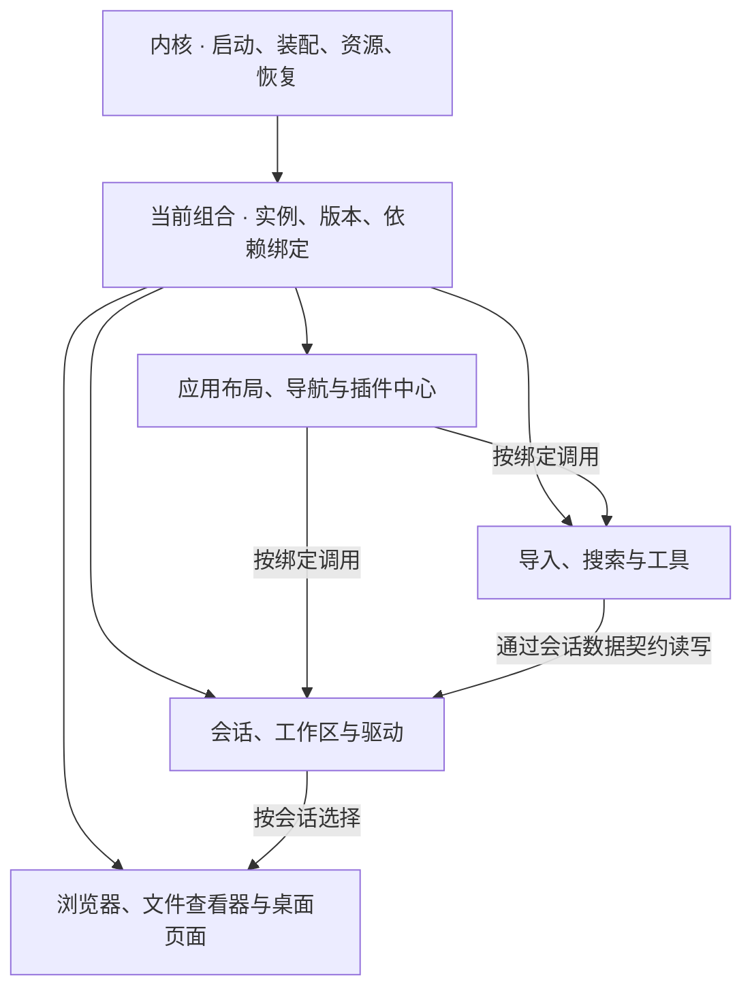

# HarnessMate 全量解耦实施设计

本设计以当前工作区的平级插件装配为起点。目标是让 **除内核外的全部现有功能都由平级插件交付**。预装组合负责提供出厂体验。同一能力允许多个实现同时运行，每个工作区、会话或调用方可选择自己的实例。迁移按业务分批完成，沿用现有插件装卸、热重载、修订回退和安全启动。 [前一阶段及验收记录](plugin-extension-recovery-plan.md)

第二批两项阻断已在集成候选 a022d24 的源码中修复并完成 457 项标准测试；其余成品/真实环境覆盖继续按第二批报告追踪。下一步按[第三批解耦实施方案](plugin-decoupling-batch-3-plan.md)推进会话数据与运行、通用驱动与协作、聊天界面三个完整开发包。第三批当前为规划状态，尚未开工；共同源码基准采用集成候选，不使用脏 main 工作区。

## 1. 当前基线与仍需解决的耦合

| 已有基础 | 尚需迁移的行为 | 处理方式 |
| --- | --- | --- |
| 服务目录支持多实例，已有工作区和会话绑定 | 部分通用服务调用仍会选取第一个注册的提供方。浏览器、预览和审批策略的默认实例仍有源码常量。 | 新调用以明确绑定和契约兼容性解析。预装组合写入默认选择，旧 SDK 调用保留兼容解析。 |
| 预装桌面浏览器、无头浏览器、文本查看器、Markdown 查看器和默认审批策略 | 预装包仍有专用可信名单，旧浏览器与文件预览入口通过兼容逻辑访问实例。 | 信任来自安装或开发关联记录。预装包通过发行组合初始化同类记录。兼容入口跟随原 API 消费方迁移。 |
| 本地插件路由、工作页、桌面视图和恢复界面已经接通 | 主工作区、原生 Harness 工作台和许多功能组件仍由 Web 应用直接导入。 | 普通启动从组合选定入口和布局。插件提供页面、导航及相关业务界面。内核直接提供恢复界面。 |
| 会话记录、原生历史映射、工具数据与 FTS 共用 SQLite | daemon 启动时创建多项业务对象，存储层集中初始化业务表。 | 先确定数据所有者和写入入口，再分批迁移初始化和 API。沿用同一数据库的办法也能完成模块拆分。 |

源码基线可查到按首个实例回落、代码内置默认项、预装信任分支、直接创建业务服务以及业务页面导入。 [服务目录](../packages/daemon/src/plugin-host/runtime/lifecycle.ts) · [绑定解析](../packages/daemon/src/plugin-host/composition/bindings.ts) · [安装与信任](../packages/daemon/src/plugins/plugin-manager.ts) · [daemon 入口](../packages/daemon/src/server/app.ts) · [Web 入口](../packages/web/src/App.tsx)

## 2. 内核边界与目标依赖图

| 内核保留 | 插件实现 |
| --- | --- |
| Electron 和 daemon 引导，最小窗口与恢复界面 | 应用布局、工作区、侧栏、设置、插件中心、插件开发和发布源管理 |
| 包发现、安装修订、组合装配、信任记录、实例身份、依赖解析、启动停止及回退 | 会话、聊天、审批策略与界面、Harness 驱动、历史、搜索和全部业务流程 |
| 进程、视图、路由、IPC、事件、任务取消和存储事务等通用资源原语 | 文件预览、浏览器、终端、Git、账本、额度、附件、MCP、远程配对等功能 |
| 保存插件运行配置与恢复信息，执行已选策略决定的宿主侧操作 | 各自的业务数据、查询接口、迁移脚本、事件语义、页内交互和外部系统适配 |

- 内核入口只引用装配、宿主原语与恢复代码。默认组合以数据列出插件包和实例，发行版通过组合把功能装回。测试使用空组合从独立目录启动，观察实际模块加载、路由和后台进程。
- 业务插件依赖公共契约、SDK 和纯工具库。同一业务的领域代码、路由、任务和视图由同一个所有者维护。涉及其他业务时使用已声明的契约，跨插件调用用 DTO 传递所需数据。
- 迁移优先移动调用入口和生命周期，物理目录搬迁可同批或紧随其后。已有 `packages/daemon/src/core` 的目录名不能决定最终归属。每批验收时按启动引用、业务写入入口和包边界判断完成度。

## 3. 统一装配、开发权限与恢复

### 身份、注册和选择

| 层级 | 保存和使用方式 |
| --- | --- |
| 插件包 | `pluginId` 标识可安装产品。按修订保存版本、摘要、入口和迁移信息。 |
| 运行实例 | 稳定 `instanceId` 指向插件包，保存该实例的配置和依赖绑定。一个包可创建多个实例，单独启停、换版本和重新配置。 |
| 运行代次 | 每次成功启动使用独立 `runId`。视图、路由、定时器、子进程和在途响应归属于运行代次。 |
| 业务选择 | 工作区或会话保存选定实例，组合提供新建时的建议。会话中的长任务在启动时记录自己的实例和代次。 |

沿用 `ctx.provide`、`ctx.services.list/call`、`ctx.routes.register`、已有的槽位和桌面视图桥。能力名由契约定义，插件可发布自己的能力和版本。通用框架识别契约名称、兼容范围与资源归属，具体方法和数据由发布方与调用方约定。兼容版本内可以补充方法或字段，不兼容变更使用新的契约版本。 [现有 SDK 上下文](../packages/plugin-api/src/context.ts)

1. 指定实例的一次性调用优先使用该实例。会话操作沿用已保存的选择，工作区级操作读取工作区选择。实例声明的依赖由该实例的绑定决定，组合给尚未选择的入口提供推荐项。具体作用域和来源在界面可见。
2. 多个兼容实现同时存在时，用户可选择绑定，也可在属于插件的页面中直接使用指定实例。旧调用保留当前解析结果供迁移。新调用在缺少选择且存在多个候选时返回候选列表，避免启动顺序决定结果。
3. 绑定指向暂停、崩溃或不兼容实例时，相关入口显示原因。组合可以为只读操作配置备选。写操作、命令和审批按原实例确认完成状态，结果未知时沿用同一请求标识查询或恢复，避免重复执行。
4. 插件实例单独拥有路由、界面 ID、存储目录、句柄和托管进程。临时端口由资源原语分配，主动共享同一工作树、文件或账号的插件沿用该资源的并发规则。安装同类插件时，各自的功能入口可并存。

依赖绑定以「调用方实例、依赖名、作用域」保存。同一调用方可以声明两个使用同一契约的依赖，例如分别保留桌面浏览器和离屏浏览器。显式选择可绑定到任意兼容实例。依赖表同时列出所选实例、选择来源和可用状态，界面与后端共用解析结果。必需依赖按拓扑就绪，循环依赖的实例显示完整依赖链。可选依赖后到时，消费方可订阅状态并补上相关入口。用户配置的实例当下不可用时保留其选择，恢复后可继续使用。

### 自定义页面与协作入口

| 场景 | 由插件完成的工作 | 复用的宿主能力 |
| --- | --- | --- |
| 新增工具或完整工作页 | 自己提供前端构建产物，注册导航、页面、命令和后端服务。页面用组合提供的主题与会话上下文。 | 已有工作页、实例路由、视图和资产加载 |
| 替换聊天区域、侧栏或设置 | 布局插件定义自己的区域和接受的贡献契约。组合选择一整套布局，也可用另一实例接管布局提供的单个区域。 | 组合入口、实例视图挂载、页面销毁与恢复 |
| 新增跨插件功能 | 提供带命名空间和版本的契约，消费方声明依赖。契约可附带配置结构、命令或页面共同使用。 | 通用服务发现、通信和依赖解析 |
| 控制原生窗口内容 | 可信插件自行启动浏览器、媒体或其他本地进程，用所需协议处理业务，页面通过配套服务呈现，也可向布局挂载宿主提供的桌面视图。 | 通用视图生命周期、托管进程与页面到服务的通信 |

固定槽位继续兼容已有插件。新布局插件可定义自己的贡献区域，并用服务目录发现提供者。业务导航保存 `{ instanceId, pageId, context }`，其中 `context` 包含业务所需的工作区、会话或资源引用。文件链接解析后交给布局或文件查看器选择侧区，工作区、路径、行号随导航一起传递。使用 `runId` 关联当前挂载对象，更新后可用稳定的页面身份重开。旧链接由原入口的兼容适配转成同一导航请求。 [现有工作页入口](../packages/web/src/slots/PluginWorkspace.tsx)

会话插件提供连续事件及重连位置。聊天页面保留一份会话投影，增量合并后按画面刷新节奏提交，历史和后台索引走独立的游标与批次。聊天渲染器可以替换，流式数据可以从同一位置重放。应用界面与后台插件各自订阅所需的事件，热切换时以最后一次已提交的位置继续。

### 可信开发体验

本地源码首次关联时确认信任。以后在同一身份和目录内编写或修改插件，沿用已有信任。可信后端可直接使用 Node.js、网络、文件和本地程序，通过通用接口注册页面、原生视图、服务、任务和路由。预装与用户安装插件在相同信任级别使用相同能力。现有沙箱运行方式继续供用户选择，旧清单的授权沿兼容路径生效。

模型工具属于调用方所在的会话。会话选定审批策略插件，内核应用其决定并校验请求身份和运行代次。各插件自行解释业务级模式，产品默认模式由预装策略插件提供。插件中心只显示用户需要处理的信任选择、实例状态和绑定，常规开发无需为每个页面、任务或服务另开授权弹窗。

应用自定义模式提供 SDK 和当前组合信息。AI 生成插件后，可以在一个草稿实例中启动、查看日志和打开页面。用户可选用、回退或停用草稿。插件开发入口、模板库和 AI 生成流程最终归入开发工具插件。

开发者碰到的新需求按所需能力落位。新增业务可从插件自己的服务、页面、进程和布局开始。需要嵌进现有页面时，贡献契约由该页面所属插件提供，作者可以同时更换布局。涉及 Electron 主进程独占的窗口操作等宿主能力时，才扩充内核的通用资源接口。新接口由实例使用，随实例停用，并沿用组合回退。浏览器用同一实现路径验证这条边界，不为每种浏览器或浏览器功能管理一套宿主接口。

### 启停、热更新和失败恢复

| 操作 | 执行顺序 | 对其他实例的影响 |
| --- | --- | --- |
| 启用 | 解析依赖，启动候选，验证声明能力已注册，再发布实例。准备失败时保留已有运行配置。 | 依赖未就绪的调用方进入等待，其余实例继续运行。 |
| 热更新或回退 | 用候选 `runId` 启动，在候选就绪后提交修订和绑定。进行中的会话任务按其已开始的实例处理，到安全边界后再切换。 | 同包的其他实例保留各自修订和配置，除非用户选择一起更新。 |
| 停用、崩溃或撤权 | 停止接受新请求，关闭视图和路由，取消或结算在途调用，清理定时器、订阅与进程。用 `runId` 丢弃迟到响应。 | 独立实例保持运行。依赖方可按组合选择可用实例或等待用户决定。 |
| 恢复组合 | 恢复上一次就绪的实例、修订和绑定集合，逐项检查兼容性。坏配置可通过内核恢复入口载入空组合或此前组合。 | 保留各插件已写入的业务数据，数据恢复走所属插件的迁移或备份能力。 |

运行期热切换依赖于插件是否能排空任务和迁移资源。无法同时持有的资源应在最短可用边界切换，必要时安排下次启动应用。打印状态时区分候选已启动、实际就绪、配置已提交三个时点。已有的安装修订和恢复快照作为接入入口。 [安装与回退](../packages/daemon/src/plugins/plugin-manager.ts) · [组合配置](../packages/daemon/src/plugin-host/composition/profile.ts)

候选启动使用独立代次，预备资源对正式调用方不可见。就绪后按一次组合修订切换服务、路由和写入所有者。需要独占的资源由旧代次交还后移交。独立托管进程可被内核终止并清理登记的资源。可信插件自行启动且未登记的进程和外部写入由该插件通过停止与恢复逻辑管理。可信代码在宿主进程内运行时，宿主挂起由下次安全启动恢复。需要独立重启能力的实例可运行在独立进程，使用同一套服务、路由和视图注册方式。

## 4. 现有功能归属清单

下表是目标功能包。它定义代码和数据归属，可以把共享同一生命周期与事务的功能合为一个包。同一能力的其他实现照常并存。已登记的三组平级能力先复用，新增契约名称在实现时按功能确认。

| 功能包 | 迁移的现有功能 | 接口和数据边界 | 批次 |
| --- | --- | --- | --- |
| 浏览器插件 | 桌面浏览器、无头浏览器、会话浏览器入口 | 沿用 `browser.v1` 和桌面视图，浏览器会话、进程与账户目录归实例 | 已有基础，第一批收尾 |
| 文件查看器与工作区文件 | 文本和 Markdown 查看器、文件列表、按行打开、规则文件预览 | 复用 `filePreview.v1`，文件读取与工作区句柄归各自功能，文件链接保留工作区、路径与行号 | 已有查看器，第二批迁移文件入口 |
| 历史来源与导入 | Codex、Claude、AGY 本机历史，CLI 与桌面来源发现，归档包导入 | 来源插件读取和解析，导入插件预览与协调。会话数据所有者执行原子归档 | 第一批 |
| 会话搜索 | 历史查询、全文索引、补建、跳转 | 消费已提交会话与条目，拥有 FTS 投影和进度，历史正文留在会话数据中 | 第一批 |
| Git、工作树与检查点 | 状态、Diff、提交、推拉、合并、工作树、检查点与恢复 | Git 插件拥有仓库操作，检查点通过 Git 和会话契约协作。按实际仓库序列化同类写操作 | 第二批 |
| 终端 | 工作区终端、会话命令、终端历史和上下文引用 | 终端插件使用宿主 PTY，拥有实例、历史、命令输出与界面 | 第二批 |
| 附件、规则与消息工具 | 文件引用、附件存放、项目规则、Message Studio、文本处理 | 文件数据和草稿分别有所有者，界面通过事件与会话插件衔接 | 第二批 |
| 账本、收件箱与通知 | 任务账本、任务状态、会话提醒、snooze、桌面通知 | 各自消费会话事件。业务表、定时任务和通知入口跟随实例生命周期 | 第二批 |
| 用量与切换 | 额度、账号用量、模型目录展示、降级建议 | 驱动提供用量查询，客户选择聚合与切换策略。账号配置引用原有身份 | 第二批 |
| MCP 管理与模型插件工具 | 服务器配置安装、启停、工具注册和能力转发 | MCP 管理插件拥有配置流程，模型工具调用绑定会话和当前实例 | 第二批 |
| 工作区与会话 | 工作区目录、会话列表、时间线、轮次、消息、归档、恢复 | 每个会话由所绑定的实例负责写入、序列与幂等处理。不同会话可由不同实现管理 | 第三批 |
| 聊天与会话视图 | 消息渲染、Composer、模式选择、命令、侧栏、文件入口、流式投影 | 由界面插件消费会话、驱动和查看契约。渲染器可为不同工作区独立配置 | 第三批 |
| Codex、Claude 与 ACP 驱动 | 实例、模型设置、CLI 生命周期、审批映射、命令、历史恢复 | 通用驱动契约已有 SDK 基础。每个驱动自带 CLI 适配和配置工作流 | 第三批 |
| 对话命令与模式 | 压缩上下文、查询额度、Plan、Goal、切换模型、管理原生插件和 Skills | 各驱动提供当前实例可用的能力和命令定义，聊天插件据此显示并调用 | 第三、四批 |
| 交接、压缩与编排 | 上下文编译与交接、跨 Harness、会话分叉合并、Side Chat、多智能体调度 | 策略和流程插件通过会话命令读写，原生动作通过已绑定驱动执行 | 第三批 |
| AGY 驱动与原生工作台 | 账号认证与 profile、AGY ACP、原生 Runtime、任务与 Goal、审批、制品、工作流与原生工作台 | 作为 AGY 功能组与通用会话契约集成。保留 native ID、运行绑定、回放协议及原生数据库迁移 | 第四批 |
| 审批策略与审批中心 | 默认决策、风险注解、人工审批、问题及凭据请求、过期处理 | 策略沿用 `approval.policy.v1`。审批记录、状态和界面归审批插件，内核按决策执行 | 第四批 |
| 应用布局和管理 | 默认工作区、导航和命令面板、设置、插件中心、开发脚手架与 AI Builder、目录与签名策略 | 通过组合设入口，插件管理界面调用内核包能力。恢复入口可重建这些界面 | 第五批 |
| 远程连线 | 手机联动、配对、设备列表、远程同步、远程页面 | 远程身份和会话订阅由远程插件提供，内核只保留传输与身份校验原语 | 第五批 |

依赖盘点可从 daemon 路由、既有第一方服务工厂和 Web 入口开始。第一批的历史和搜索使用会话数据契约上的临时适配，在第三批替换其实现。 [当前 API](../packages/daemon/src/server/app.ts) · [服务工厂](../packages/daemon/src/plugin-host/builtin/services.ts) · [聊天与界面入口](../packages/web/src/App.tsx)

## 5. 数据兼容与切换边界

| 数据 | 保留身份和迁移方式 | 降级与恢复 |
| --- | --- | --- |
| 插件组合 | 沿用组合、包修订、实例和作用域绑定。旧 P1/P2 配置通过兼容解析转为当前选择。 | 组合能回到上一个已验证状态。以已保存的绑定决定如何恢复。 |
| 会话与事件 | 保留工作区 ID、会话 ID、原生 ID、轮次、事件序号和现有导出格式。会话插件拥有写入事务。 | 先接同一数据存储，再逐步迁移代码和初始化。通过旧客户端 DTO 验证历史和进行中会话。 |
| 导入映射 | 沿用 `native_history_imports` 的去重身份。新的多账号来源采用稳定存储来源标识，明确的旧来源先查兼容映射。 | 并发导入在同一事务内返回已存在会话或创建一份新会话。取消或错误后重试能得到同一结果。 |
| 搜索及其他投影 | 原始事实仍从会话或其他数据所有者读取，搜索插件维护 FTS、水位和补建任务。按会话 ID 与已提交事件序号回放。 | 索引可重建。搜索关闭期间积累的事件在恢复后追赶，无需修改源会话。 |
| 审批与原生操作 | 审批答案、命令回执、native 绑定修订和 effect outbox 继续保留原有身份与幂等语义。 | 同一作用域的写入由所属实例处理。重启从已保存状态恢复，过期审批可结束并从待处理界面移除。 |
| 文件、外部进程与外部服务 | 维持工作区路径、插件私有目录、账户引用和设备身份。共享工作树、数据库或账号按具体资源协调。 | 插件版本回退恢复实现与配置。已提交的 Git、文件和远程操作通过相应业务恢复，进行中状态记录给用户。 |

迁移采用增量字段、兼容读取和事务化的版本记录。候选插件可以先读回旧数据、建立可重建投影，再切换写入所有者。每次切换保持一个业务写入入口，旧 API 通过兼容适配转发到同一个实例。备份使用数据库一致性快照。回退若涉及旧版无法理解的新字段，先保全数据，再通过兼容层或所属插件的恢复机制继续。旧表的删除与最终清理放在兼容调用方迁完之后。 [当前存储](../packages/daemon/src/db/sqlite.ts) · [旧接口适配](../packages/daemon/src/plugin-host/compat/legacy-compat.ts)

## 6. 直接开工的第一批 · 历史导入与会话搜索

第一批把完整功能链跑通，并补齐当前平级装配的几个具体缺口。它包含路由、页面、可替换业务服务、事件订阅、持久化和停用恢复。浏览器和查看器继续作为已落地的并存回归样本。

### 6.1 收口现有装配

- [ ] 在现有服务目录中区分旧 SDK 解析和新实例解析。新 API 遇到多个候选时按照显式绑定解析。加一组反转加载顺序的回归，用同一组合验证结果一致。
- [ ] 将出厂默认实例放入预装组合，并为可信本地插件提供一致的视图和服务调用路径。保留 P1/P2 的 URL 和清单可读性，记录兼容分支的实际调用方。
- [ ] 为导入页和搜索页使用现有工作页与实例路由。默认组合注册原有入口，停用实例时按需要把入口置为不可用或摘除。主界面通过插件注册展示入口。

### 6.2 拆出历史来源和导入

| 建议契约 | 主要输入和输出 | 所有者 |
| --- | --- | --- |
| `history.source.v1` | `discover` 返回来源实例、原会话身份、标题、时间、工作区线索和翻页位置。`read` 返回可分批处理的历史条目。 | Codex、Claude、AGY 或第三方来源插件 |
| `history.import.v1` | `preview` 报告来源、已有归档、目标工作区与可导入内容。`import` 提交指定来源并返回会话 ID 与结果。 | 导入流程插件 |
| 会话数据事务 | 读取既有映射、保存会话和事件、提交后通知索引。第一批适配到现有会话写入，后续由会话插件提供。 | 会话数据所有者 |

1. 复用 `history-scanner.ts` 的格式读取、缓存和 AGY SQLite 查询能力，把各来源的注册移到插件。先兼容当前已支持的 CLI 和桌面来源，再用另一组账户目录或测试夹具证明同类扫描器能够独立工作。
2. 发现层按来源并行执行。某个来源不可用时，该来源的入口显示状态。用户预览后提交导入目标，读入阶段可取消。保存阶段用现有事务统一生成会话、原生映射与连续事件序号。
3. 保持 `/api/v1/harnesses/discovered-sessions`、`/api/v1/harnesses/import-session` 和归档包入口的状态与 DTO，通过适配层调用对应插件。原导入 API 的本机调用约束在兼容入口保留。插件页面复用同一实例契约，旧客户端可以继续导入。导入停用后，已经归档的会话仍可通过会话功能打开。
4. 停用后取消扫描、预览和未提交任务。提交中的请求以事务结果为准。重试或并发导入同一份原生记录时，复用已保存会话 ID。导入成功后按已提交的会话事件触发搜索更新。

现有 `SessionExplorerService` 还管理分叉、Side Chat 和导出等行为。第一批迁出其中的发现、导入与索引，其余由后续会话与协作批次接走。 [扫描器](../packages/daemon/src/harnesses/history-scanner.ts) · [会话浏览服务](../packages/daemon/src/core/session-explorer-service.ts) · [会话调用入口](../packages/daemon/src/core/session-manager.ts)

### 6.3 拆出搜索与索引

1. 将 `/api/v1/search/sessions`、`/api/v1/search/reindex` 和搜索界面接到搜索插件。保留现有工作区、时间、驱动筛选和分页，打开结果仍用原有会话及轮次身份。
2. 将会话管理器内的直接索引调用改为已提交事件或条目通知。搜索插件在同一事务提交索引修改和追赶位置。全量补建从一致性快照开始，再读取快照位置之后的新增、更新和删除。快照和续读位置由会话数据契约提供，增量来源可复用已有的有序提交记录。以会话和条目 ID 幂等更新，删除后的旧条目不会因重放重新出现。
3. 保留当前全文索引作为默认实现，在同一服务契约下接入一个轻量替代实现，用于验证两种搜索可同时启动并按工作区选择。完整搜索库和外部索引可由插件作者自行实现。
4. 停用搜索实例能停止后台索引、撤下页面和路由。聊天、导入与会话打开继续运行。重新启用后可追补索引，从取消点续建。

### 6.4 第一批合并验收

- [ ] 两个来源组件同时启用，能够独立发现、预览和导入数据。模拟扫描错误，其他来源仍可使用。
- [ ] 并发导入、取消、崩溃重启与重试均保持原会话 ID 去重和事件完整。对 Codex、Claude、AGY 来源分别验证已支持的历史格式。桌面来源和 CLI 来源分别记录证据。
- [ ] 默认和替代搜索可同时启用，两个工作区分别使用自己的选择。关闭搜索后继续聊天和导入，再启用时能查到期间新增内容。
- [ ] 实测旧版工作区、会话与归档包可以继续打开。旧 URL 与新插件入口得到一致的结果。两套浏览器和预览插件的并存、回退及停用回归继续通过。
- [ ] Windows 包中用已有数据副本验证默认组合、切换单个实例、插件回退和恢复组合。记录构建、自动化、打包运行和实际外部账户的证据范围。

## 7. 后续批次与退出条件

| 批次 | 重点工作 | 该批完成的可观察结果 |
| --- | --- | --- |
| 第一批 · 历史与搜索 | 统一选择规则，迁移来源、导入、搜索的纵向工作链 | 导入和搜索的后台任务、API 与页面均可独立启停。新实现只修改插件和组合就能接入。 |
| 第二批 · 工具与数据 | 迁出 Git、终端、附件、账本、MCP、用量、收件箱及文件工作区等业务。沿用现有状态和写入原子性 | 每一组业务由对应插件注册和停止。停用 Git 或终端不影响聊天。旧工作树、终端记录和插件挂载数据仍可读取。 |
| 第三批 · 会话与通用驱动 | 装入真正的会话数据与运行插件，拆出聊天、Codex、Claude、ACP、交接和调度。已有临时会话数据适配切换到插件实现 | 三种通用路径按会话选择实例。消息流、中断、长期任务、交接、回放与恢复走插件链路。已有会话按原 ID 恢复。 |
| 第四批 · AGY 与审批 | 将 AGY native wiring、账号、命令、工作台及资源迁进 AGY 功能组，将审批业务与 UI 分离为插件 | 同一应用可复现旧 AGY 会话和多账号绑定、权限模式、问题、超时与恢复。过期审批退出待处理列表，关联事件可追溯。 |
| 第五批 · 应用界面与管理 | 默认布局、设置、插件中心、开发工具、远程功能由组合启动。收尾旧兼容适配和宿主初始化 | 打包应用用空组合启动时只加载内核和恢复界面。启用预装组合装回当前功能。用户可维护自己的组合。 |

各批次选择可独立回退的提交单元。第一批切换来源、导入与搜索三个入口。第二批按工具包逐组启用。第三批先切换会话读写，再分别切换驱动、聊天与协作入口。第四批先接管 AGY 原生链路，再切换审批策略和交互。第五批先切换布局和导航，再切换管理页和远程入口。需要延续的旧 URL 适配作为组合中的兼容插件交付，下线时间依据实际调用方确定。

### 会话、驱动和审批的交接点

1. 将会话的持久化和运行控制拆开。保存、归档、事件序列和回放归数据插件，轮次、中断、切换和驱动调用归运行插件。打开旧会话时补齐实例绑定，继续使用原有会话 ID、native ID 和历史记录。会话切换驱动时由运行插件设定安全边界，跨驱动内容通过交接契约传递。
2. 聊天插件从驱动获得命令、支持的权限模式及当前生效值。选择模式后，使用驱动回执刷新界面，区分已生效、等待新会话生效和驱动未提供。压缩、Plan、Goal、模型、额度及原生插件和 Skills 渲染成对应驱动支持的操作。实现可以选用自己的底层参数和协议。
3. 模型工具请求保留会话 ID、请求 ID、驱动代次、收到时间和截止时间。策略插件返回允许、拒绝或交给用户，执行端走驱动对应的回复机制。审批记录到期时进入终态，待处理列表随之更新。重启加载持久化状态时重新检查截止时间，迟到的答案按当前终态处理。AGY 验收分别记录 UI 选择、驱动生效模式、收到的请求、实际决策和 CLI 执行结果。
4. 应用布局插件统一接收会话跳转、文件预览和命令导航。第三批先切换聊天视图，现有布局通过入口挂载。第五批切换整个布局时，以同一导航请求回归 Windows 文件 URI、相对路径和行号。流式验收同时记录 daemon 到达时间及页面首段与后续刷新时间。

每批使用相同交付步骤。先拍一个可恢复的源码和数据基线，写清插件所有者、已用接口和旧配置映射。完成纵向迁移后核对实际入口、任务和写入者。随该批移除已被替代的宿主直接初始化，未迁完的兼容理由记到表里。默认组合和已迁移的自定义组合都验证后再关闭该批。

## 8. 最终验收

| 验收项 | 需要证明的行为 |
| --- | --- |
| 空组合 | 打包应用启动、导入有效组合和回退坏版本。业务路由、业务后台任务与插件窗口由加载的实例产生。 |
| 平级与可组合 | 预装与自装包均可用公开 SDK 提供同一契约。两个实例可以并行运行，加载顺序改变后所选实例一致。 |
| 自由开发 | 可信目录能通过插件代码实现新服务、工具、整页界面与桌面视图。实现新增业务只改插件与组合。 |
| 数据与老插件兼容 | 旧项目、会话、工具配置和已装插件能升级，保留业务身份和必要的 API 语义。可重建的投影能够补齐。 |
| 生命周期与故障 | 启动失败、挂起、重载、单实例停用、断电后恢复或回退均按运行代次处理，历史数据可读，其他实例继续运行。 |
| 会话与权限 | CLI 模拟、原生协议回放和实际启用的 CLI 环境分别验证。覆盖会话恢复、工具审批、过期清理、模式选择、跨 Harness 交接和流式响应。 |
| 性能 | 使用相同事件回放、历史库和操作脚本记录首帧时间、流式刷新频率、搜索耗时和主线程阻塞。展示迁移前后差值，确认开关、订阅和索引任务按需运行。 |
| 功能清单归零 | 核对 daemon 和 Electron 入口只引用内核与通用原语。Web 壳只装载组合页面及恢复界面。各功能包均能说明自己的接口、存储所有权和恢复方式。 |

本文是后续实施设计。当前已验证的浏览器与文件预览并存结果沿用上一阶段记录。首个实现交付是第 6 节所述的历史导入与会话搜索批次。
