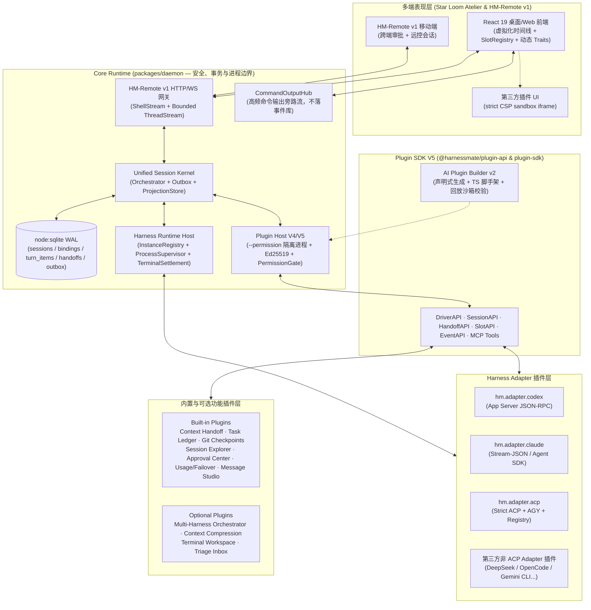

# T3 Code 深度源码调研与 HarnessMate Desktop 插件化架构设计 — 总览索引

> **调研基准时间**：2026-11-24  
> **T3 Code 调研快照**：`https://github.com/pingdotgg/t3code` · 分支 `main` · Commit `7913360b2e61bb04086229c4ec283e512c8d7a9e` · 许可证 **MIT** (`Copyright (c) 2026 T3 Tools Inc.`) · 独立克隆目录 `d:\HarnessMate\t3code-research-de702563\t3code`  
> **HarnessMate Desktop 基线**：`d:\HarnessMate\harnessmate_desktop` · Commit `970eafb` · 版本 `0.6.0` · Plugin API `4.0.0`（P0–P5 全部完成，36/36 自动化测试通过）  
> **独立技术验证目录**：`d:\HarnessMate\t3code-research-de702563\validation\`（3 组独立验证脚本，9/9 用例实证通过，零侵入现有业务代码）

---

## 一、核心结论摘要（Executive Summary）

本次源码级深度调研对比了 **T3 Code V2（Effect-TS 事件溯源多端控制面）** 与 **HarnessMate Desktop v0.6.0（Node 24 + `node:sqlite` + React 19 + Plugin SDK V4 微内核）** 的真实源码实现，得出六项决定未来架构走向的核心结论：

1. **T3 Code 的真正工程壁垒不在“聊天壳”，而在“边界清晰的 V2 控制面”** `[T3 Code 已验证实现]`：
   - **Instance-First 多实例隔离**：通过 `ProviderInstanceRegistry` 按 `ProviderInstanceId`（而非驱动类型 `driverKind`）管理会话、凭据与模型目录，支持同一 CLI 多账号并行且剥离环境残留凭据。
   - **能力驱动（Capability-Driven）而非分支硬编码**：`OrchestrationV2ProviderCapabilities` 定义了 12 大类、50+ 细粒度布尔/枚举能力；时间线渲染层（26 类归一化 `OrchestrationV2TurnItem`）几乎 100% 脱离具体 Provider 名称。
   - **事务一致的事件溯源 + 持久化投影 + Outbox 副作用模型**：`Orchestrator`（纯决策）→ `EventSink`（单事务落盘事件、投影、回执、Outbox）→ `EffectWorker`（异步执行与崩溃区分 `REPLAY_SAFE` / `PROCESS_BOUND`），配合 50ms 文本增量合批（`ProviderTextDeltaCoalescer`）与旁路命令输出总线（`CommandOutputHub`），避免高频 delta 拖垮 SQLite 和前端。
   - **生产级跨 Provider 便携交接（Portable Handoff）**：T3 Code V2 **已经真正实现**同线程跨 Provider 切换（`full_thread_summary`）与往返切回增量同步（`delta_since_target_last_seen`），并独创了**不确定投递熔断（`delivery.status === "pending"` → 强制新开原生会话）**、**容量溢出自动新开会话**，以及**推预算 + MCP 按需回查（`t3_thread_read` + `omittedItemIds`）**机制。
2. **T3 Code 的主要局限恰是 HarnessMate 的战略差异化所在** `[T3 Code 已验证实现]` + `[HarnessMate 已验证实现]`：
   - **T3 Code 没有真正的运行时第三方插件生态**：除遵循严格 ACP 规范的 `ACP Registry` 代理外，新增非 ACP Provider（如 `provider-pi`）仍需修改 7–8 个核心源码文件并重新编译打包。而 HarnessMate v0.6.0 已建成完整的 **Plugin SDK V4（进程隔离 `--permission`、双向 JSON-RPC、Ed25519 签名远程索引、CSP 沙箱 UI 插槽、AI Plugin Studio）**。
   - **T3 Code 明确不做结构化任务账本与交接脱敏**：其便携交接依赖原始消息截选，要求用户自行复述铁律，且未对 shell 输出中的敏感凭据做跨 Provider 脱敏。而 HarnessMate 已拥有 **结构化任务账本（`TaskLedgerService` + `.harnessmate/task-ledger.md`）**、**实时工作区真相锚点（Git Anchor）** 和 **SHA-256 段落哈希去重快照（`handoff-snapshot.ts`）**。
3. **HarnessMate Desktop v0.6.0 存在四处亟需补齐的底层结构性短板** `[HarnessMate 现状审查]`：
   - **静态硬编码 Harness 类型**：`HarnessKindSchema = z.enum(['codex', 'agy', 'claude', 'acp'])`、`AdapterSessionHandle.runCodexGoal`、`ContextSyncPayload.codexInjectItems`、`HARNESS_META` 以及 `isReservedServiceName` 禁止第三方注册 `harness.*`，阻碍 DeepSeek / OpenCode / Gemini CLI 等以插件化方式接入。
   - **原始流式 Delta 直接写 SQLite**：`session_events` 持久化每一条 `message.assistant.delta` / `thinking.delta` / `tool.call.delta`，缺少持久化 `TurnItem` 投影表与旁路 `CommandOutputHub`（本次验证实测混合投影方案可降低 **13.1x** SQLite 行数、**22.6x** 线缆快照体积、冷开提速 **16x–31x**）。
   - **探活副作用与缺少原子检查点**：`AcpAdapter.probe()` 会执行 `session/new` 触发外部副作用；Git 模块仅有只读状态与简单 worktree 创建，缺少隐藏 Git Ref 检查点及“先检视对话回滚能力、再动工作区文件”的安全守卫。
   - **跨 Harness 交接缺少安全与极限场景闭环**：尚未对跨引擎外发内容做敏感凭据脱敏、缺少不确定投递（崩溃在 `inject_items` 中途）保护、缺少目标窗口溢出自动降级新会话、缺少 MCP 按需回查被省略历史项，且尚无**多 Harness 并行协作（场景 D）**的独立编排模型。
4. **融合演进原则：吸收而不照搬，演进而非推翻** `[HarnessMate 原创架构设计]`：
   - 保留 HarnessMate 现有的 Node 24 + `node:sqlite` WAL + Zod + React 19 + Zustand + Plugin SDK V4 底座，**不引入 Effect-TS 框架迁移成本**。
   - 通过 **Plugin API v4.1 → v5.0 向后兼容演进**，将三层能力架构（标准能力 / 可选能力 / 原生专有扩展）与 16 个高内聚插件（5 个 Harness Adapter 插件 + 7 个内置功能插件 + 4 个按需可选插件）清晰落位，严格隔离串行上下文交接（单会话多绑定）与并行多 Harness 协作（独立 Worktree + 子任务图）。

---

## 二、核心结论置信度标注规范

本系列所有文档严格遵循以下四类标签区分事实与设计，绝不混淆推测与已验证源码：

| 标注标签 | 含义 |
| --- | --- |
| **`[T3 Code 已验证实现]`** | 已在 `t3code` commit `7913360b` 源码或录制回放夹具中逐行核验的实际能力 |
| **`[T3 Code 源码受限/未完善]`** | 源码中存在边界限制、局部硬编码或明确声明不支持的能力 |
| **`[架构推断可扩展]`** | 基于 T3 Code 或 HarnessMate 现有机制合理推导出的演进方向 |
| **`[HarnessMate 原创设计]`** | 结合 HarnessMate 现有工程与插件化愿景提出的原创架构、协议或插件规范 |

---

## 三、完整文档导航与推荐阅读顺序

### 阶段一：现状与源码调研（先建立统一事实基准）
1. **[01_T3Code_Architecture_Research.md](./01_T3Code_Architecture_Research.md)** — T3 Code V2 完整源码架构剖析：目录拓扑、Effect 服务分层、11 个内置 Provider、三条端到端真实调用链（Codex / Claude Code / ACP）、SQLite V2 架构、MIT 许可证合规边界。
2. **[02_HarnessMate_Gap_Analysis.md](./02_HarnessMate_Gap_Analysis.md)** — HarnessMate Desktop v0.6.0 与 T3 Code 逐模块能力差异矩阵：明确“已领先 / 已实现 / 部分实现 / 缺失 / 不需要照搬 / 需重构”。

### 阶段二：五大核心子架构设计（核心平台蓝图）
3. **[03_Unified_Harness_Architecture.md](./03_Unified_Harness_Architecture.md)** — 统一 Harness 接入与多实例运行时架构：三层能力模型、Instance-First 路由、多协议传输治理、进程隔离与崩溃终态结算、无需改主程序新增 Harness 规范。
4. **[04_Session_and_History_Architecture.md](./04_Session_and_History_Architecture.md)** — 统一会话与历史持久化架构：8 层数据概念解耦、混合持久化模型（Projection + 有限事件日志 + Outbox + CommandOutputHub）、原生会话映射、导入、分支与回放恢复。
5. **[05_Context_Handoff_Protocol.md](./05_Context_Handoff_Protocol.md)** — **Context Handoff Protocol v2** 完整规范：场景 A/B/C/D 深度拆解、状态机与时序图、推预算+拉回查混合协议、敏感信息脱敏、不确定投递熔断、能力可迁移边界矩阵与 TypeScript/Zod 定义。
6. **[06_Frontend_Adaptation_Architecture.md](./06_Frontend_Adaptation_Architecture.md)** — 前端多 Harness 统一适配与插件 UI 扩展架构：标准消息块（`TurnBlock`）、未知块降级、动态 `OptionDescriptor` 配置面板、V4/V5 类型化插槽与 CSP 沙箱扩展、长会话虚拟化与性能预算。

### 阶段三：插件生态、SDK 与产品体验（工程化拆解）
7. **[07_Plugin_SDK_Expansion.md](./07_Plugin_SDK_Expansion.md)** — Plugin SDK V4 → V5 增量补齐方案：13 组 SDK 能力域差异评估、V4/V5 统一权限体系、向后兼容策略、AI Plugin Builder 两级进化方案（声明式 + 隔离代码脚手架 + 回放验证）。
8. **[08_Plugin_Catalog.md](./08_Plugin_Catalog.md)** — 五层架构归属总表与 **16 个插件全景目录**：核心/内置/可选/适配器边界、无环依赖 DAG、优先级（P0–P3）及详细规范入口。
9. **[09_UX_and_Interaction_Design.md](./09_UX_and_Interaction_Design.md)** — 产品体验与交互设计规范：低摩擦跨 Harness 交接 UX、透明可控交接抽屉、检查点与 Diff 审查流、全局待办审批与 Triage、插件化 UI 设计语言一致性治理。

### 阶段四：落地路线、技术验证与决策留档（可执行闭环）
10. **[10_Implementation_Roadmap.md](./10_Implementation_Roadmap.md)** — 分阶段工程路线图（Phase 0–4）：前置依赖图、并行开发泳道、里程碑验收指标及延后项清单。
11. **[11_Technical_Validation.md](./11_Technical_Validation.md)** — 实证技术验证报告：HarnessMate 36/36 基线测试、T3 Code 真实 NDJSON 通信帧分析、3 组独立验证脚本（9/9 通过）实测性能数据、未验证假设与风险登记册。
12. **[12_Architecture_Decisions.md](./12_Architecture_Decisions.md)** — 关键架构决策记录（ADR-01 ~ ADR-12）：备选方案对比、选择理由、适用范围、重新评估触发条件与 MIT 许可证复用清单。

### 阶段五：独立插件任务说明书（`plugins/` 目录，供 AI Coding Agent 直接实施）
详见 **[08_Plugin_Catalog.md](./08_Plugin_Catalog.md)** 中的完整链接表，涵盖全部 **16 份** 独立插件技术设计文档（`plugins/01_*.md` 至 `plugins/16_*.md`）。

---

## 四、关键架构决策速览（ADR 索引）

| ADR 编号 | 决策主题 | 最终选型 | 详细出处 |
| --- | --- | --- | --- |
| **ADR-01** | 底层并发与运行时框架 | 保持 Node 24 + 原生 TS + Zod，不迁移 Effect-TS；吸收其 Outbox/单事务模式 | [12_Architecture_Decisions.md](./12_Architecture_Decisions.md) |
| **ADR-02** | 协议保真与统一抽象 | 三层能力模型（标准核心 + 可选能力矩阵 + `ext:<vendor>.*` 原始透传） | [03_Unified_Harness_Architecture.md](./03_Unified_Harness_Architecture.md) |
| **ADR-03** | 存储模型：事件日志 vs 投影 | 混合架构：持久化 `TurnItem` 投影 + 有界生命周期事件日志 + 旁路 `CommandOutputHub` | [04_Session_and_History_Architecture.md](./04_Session_and_History_Architecture.md) |
| **ADR-04** | 多 Harness 身份路由 | 从单实例 `harnessKind` 升级为 `instanceId` + `driverId` + `continuationKey` | [03_Unified_Harness_Architecture.md](./03_Unified_Harness_Architecture.md) |
| **ADR-05** | 第三方 Harness Adapter 扩展 | 允许签名/高风险授权的隔离进程插件注册非 ACP Driver；标准 ACP 走声明式/Registry | [07_Plugin_SDK_Expansion.md](./07_Plugin_SDK_Expansion.md) |
| **ADR-06** | 跨 Harness 交接核心策略 | 混合四层协议：工作区锚点 + 任务账本 + 预算截选消息 + MCP 按需回查（+ 可选 AI 摘要插件） | [05_Context_Handoff_Protocol.md](./05_Context_Handoff_Protocol.md) |
| **ADR-07** | 往返切回（A→B→A）策略 | 优先复用热绑定 + `delta_since_target_last_seen`；容量溢出或投递不确定时自动切新会话 | [05_Context_Handoff_Protocol.md](./05_Context_Handoff_Protocol.md) |
| **ADR-08** | 串行交接 vs 多引擎并行协作 | 严格状态模型分离：串行共享 `Session` 多绑定；并行基于 `Worktree + Child Session DAG` | [05_Context_Handoff_Protocol.md](./05_Context_Handoff_Protocol.md) |
| **ADR-09** | 集中式状态管理 vs 插件自治 | Core 单一事实源（SQLite + EventSink）；插件只读投影、通过钩子/服务提案，严禁直写核心库 | [12_Architecture_Decisions.md](./12_Architecture_Decisions.md) |
| **ADR-10** | 前端适配与插件 UI 隔离 | 核心归一化块 + `chat.block` 键值插槽 + 未知块降级；第三方 UI 强制 CSP 沙箱 iframe | [06_Frontend_Adaptation_Architecture.md](./06_Frontend_Adaptation_Architecture.md) |
| **ADR-11** | 进程内插件 vs 进程外隔离 | 分层信任运行态：第一方核心插件 `kernel` 态；第三方代码与 Adapter 强制 `--permission` 隔离进程 | [12_Architecture_Decisions.md](./12_Architecture_Decisions.md) |
| **ADR-12** | T3 Code MIT 代码与架构合规 | 参考架构独立实现为主；如复用算法或常量须保留 MIT 声明并写入第三方许可清单 | [12_Architecture_Decisions.md](./12_Architecture_Decisions.md) |

> **独立架构审查状态**：全套 29 份设计文档（`00`–`12` + `plugins/01`–`16`）已完成跨文档一致性与 8 项架构红线审查，审查结论与修正记录见 [12_Architecture_Decisions.md](./12_Architecture_Decisions.md) 第二节。

---

## 五、整体目标架构全景图

