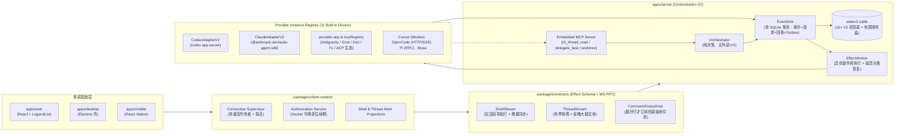

# 01 · T3 Code 深度源码架构调研报告

> **仓库身份核验**：`https://github.com/pingdotgg/t3code`  
> **克隆本地路径**：`d:\HarnessMate\t3code-research-de702563\t3code`  
> **核验分支与版本**：`main` · Commit `7913360b2e61bb04086229c4ec283e512c8d7a9e`（2026-11-23）  
> **开源许可证**：MIT License (`Copyright (c) 2026 T3 Tools Inc.`)，完整原文已核验自 `t3code/LICENSE`。

---

## 一、项目定位与总体拓扑 `[T3 Code 已验证实现]`

T3 Code 由 Ping Labs（T3 Tools Inc.）开发，其核心定位是 **AI Coding Agents 的开源控制面（Control Plane）**——不自建模型推理或私有 Agent 执行循环，而是托管用户本机已安装并登录的各类编码 Agent CLI / SDK（BYOS: Bring Your Own Subscription），通过统一的 Node WebSocket RPC 服务向 Desktop（Electron）、Web（`app.t3.codes` / 本地托管）与 Mobile（React Native iOS/Android）三端提供一致的会话管理、多 Agent 协作、检查点回滚、Diff 审阅与远程控制能力。

### 1.1 Monorepo 工作区结构

基于 `t3code/apps/` 与 `t3code/packages/` 实际目录扫描，T3 Code 采用 `pnpm` + **Effect-TS**（`tsconfig.effect.json`）架构，清晰划分为应用层与领域包层：

| 目录 | 职责与核心技术栈 | 关键入口源码 |
| --- | --- | --- |
| `apps/server` | 核心后端服务：Effect RPC over WS/HTTP、V2 事件溯源编排器（`orchestration-v2`）、SQLite 持久化、Provider 宿主、MCP Server、Git/Worktree/Checkpointing、Workflows | `apps/server/src/ws.ts`, `orchestration-v2/Orchestrator.ts` |
| `apps/web` | React + Vite + Tailwind 前端（启用 React Compiler + `@legendapp/list/react` 虚拟化 + `@effect/atom-react` 原子状态） | `apps/web/src/components/chat/MessagesTimeline.tsx`, `ChatView.tsx` |
| `apps/desktop` | Electron 桌面壳（托管内嵌 server runner；主进程禁止同步加载原生模块，隔离至独立子进程） | `docs/internals/01_architecture.md#L67-L71` |
| `apps/mobile` | React Native 客户端（共享 `packages/client-runtime` 连接与投影逻辑） | `docs/internals/11_mobile-layout.md` |
| `packages/contracts` | Effect `Schema` 跨端线缆契约与前向兼容解码器（客户端/服务端独立版本演进边界） | `packages/contracts/src/orchestrationV2.ts`, `provider.ts`, `rpc.ts` |
| `packages/client-runtime` | Web/Desktop/Mobile 共享的连接监管器、鉴权服务、环境路由与前端投影状态库 | `packages/client-runtime/src/connection/supervisor.ts`, `providerClients.ts` |
| `packages/provider-core` | Provider 抽象核心接口（`ProviderDriver`, `ProviderAdapterV2`, `handoffBudget`, `selectionTransition`, `subagentProjection`） | `packages/provider-core/src/server/ProviderAdapter.ts`, `driver.ts`, `handoffBudget.ts` |
| `packages/provider-*` | 10 个独立 Provider 包：`provider-acp`, `provider-acp-registry`, `provider-cursor`, `provider-fx`, `provider-grok`, `provider-kiro`, `provider-muse`, `provider-opencode`, `provider-pi`, `provider-testing` | `packages/provider-acp/src/server/AcpSessionRuntime.ts` 等 |
| `packages/effect-acp`, `effect-codex-app-server` | 底层强类型协议客户端库（ACP JSON-RPC 2.0、Codex App Server JSON-RPC 2.0） | `packages/effect-codex-app-server/` |
| `packages/source-control-*`, `secret-provider-*` | 可插拔源码托管（GitHub/GitLab/Bitbucket/Forgejo/Azure DevOps）与凭据保险库（1Password） | `packages/secret-provider-core/` |

### 1.2 核心架构分层图

---

## 二、后端编排引擎：Orchestrator → EventSink → EffectWorker `[T3 Code 已验证实现]`

T3 Code 在架构上最值得深入学习的是其 **Orchestration V2 事件溯源与 Outbox 事务模式**（`apps/server/src/orchestration-v2/`）：

### 2.1 纯命令决策与单事务提交
- **`Orchestrator.ts`**（17,631 行）：按 `threadId` 经由 `KeyedLock` 串行化外部命令（`OrchestrationV2Command`）。核心铁律见 `docs/internals/01_architecture.md#L32-L43`：**命令决策阶段严禁执行外部 I/O**（不直接启动 CLI、不直接调用 Git、不直接调网络）。
- **`EventSink.ts`**（1,338 行）：提供 `commitCommand`、`writeWithEffects`、`writeIfRunCurrent`、`writeIfProviderThreadOwner` 等带乐观并发检查（CAS）的写入原语。在**同一个 SQLite 事务**（`sql.withTransaction` + `publishLane` 串行信号量 `Semaphore.make(1)`，`EventSink.ts#L329-L350`）中原子写入：
  1. `orchestration_v2_events`（领域事件）
  2. `orchestration_v2_projection_*`（物化投影表）
  3. `orchestration_v2_command_receipts`（幂等命令回执，防重试重复执行）
  4. `orchestration_v2_effect_outbox`（持久化异步副作用任务）
  - 只有在 SQLite 事务提交成功后，才向内存 `PubSub` 广播事件，并通过 `Effect.uninterruptibleMask` 确保已提交事件不会因中断而漏发导致父子任务悬挂。

### 2.2 Outbox 副作用执行器与崩溃恢复分类
- **`EffectOutbox.ts`**（808 行）与 **`EffectWorker.ts`**（1,127 行）将所有外部 I/O 拆分为 17 种强类型 `OrchestrationEffectRequestV2`（`EffectOutbox.ts#L35-L142`），并在进程意外退出/服务端重启时，将其严格划分为两类（`EffectOutbox.ts#L144-L165`）：
  - **`REPLAY_SAFE_EFFECT_TYPES_AFTER_PROCESS_LOSS`**（崩溃后可安全重放）：`provider-runtime.continue`、`provider-session.detach`、`provider-thread.rollback`、`checkpoint.capture`、`scheduled-tasks.cleanup`、`terminal.cleanup`、`preview.cleanup`、`attachment.cleanup`、`thread-title.generate`、`delegated-tasks.stop`。
  - **`PROCESS_BOUND_EFFECT_TYPES`**（绑定已亡内存进程，重启时必须退役/取消，绝不盲目重放）：`provider-session.apply-model-selection`、`provider-session.apply-thread-title`、`provider-turn.start`、`provider-turn.interrupt`、`provider-turn.steer`、`provider-turn.restart`、`runtime-request.respond`。
- **服务升级与自动续跑保护**（`docs/internals/07_server-updates.md#L17-L44`）：
  - 升级前在稳定 `serviceLauncher.ts` 中对 `statev2.sqlite`（含 WAL/SHM）做一次性快照，新版本试运行失败自动回滚。
  - 重启续跑（`provider-runtime.continue`）限制单轮连续崩溃恢复次数防止死循环，且**绝不自动续跑**已归档、已结算、已延后、用户主动停止或正在等待审批/提问/凭据输入的线程。

---

## 三、多 Harness（Provider）适配体系与真实调用链 `[T3 Code 已验证实现]`

### 3.1 11 个内置 Provider Driver 与传输协议全景

经核验 `apps/server/src/provider/builtInDrivers.ts#L33-L45` 与各 `packages/provider-*` 源码，T3 Code 当前内置 11 个驱动：

| Driver (`driverKind`) | 源码位置 | 底层通信协议与运行形态 | 原生历史注入 | 原生 Fork | 原生回滚 |
| --- | --- | --- | --- | --- | --- |
| `codex` | `apps/server/src/orchestration-v2/Adapters/CodexAdapterV2.ts` + `packages/effect-codex-app-server` | `codex app-server` 双向 JSON-RPC 2.0 over stdio | 支持 (`thread/inject_items`) | 支持 (`thread/fork`) | 支持 (`CodexThreadRevert.ts`) |
| `claudeAgent` | `apps/server/src/orchestration-v2/Adapters/ClaudeAdapterV2.ts` | `@anthropic-ai/claude-agent-sdk` (`query()`, `canUseTool`, `forkSession`) + 进程组守卫脚本 | 否（走内联上下文） | 支持 (`forkSession`) | 支持（SDK 回退/新会话） |
| `antigravity` | `apps/server/src/orchestration-v2/Adapters/AntigravityAdapterV2.ts` + `provider/acp/Antigravity*` | 基于 `packages/provider-acp` 的第一方 ACP 扩展风味（带 `authenticateEagerly`、子工作映射） | 否（内联） | 视 ACP 协商 | 视能力 |
| `cursor` | `packages/provider-cursor` | 独立子进程 Worker (`__cursor-sdk-worker`) + IPC 封装 Cursor Agent SDK | 否（内联） | 视能力 | 视能力 |
| `opencode` | `packages/provider-opencode` (`v2/OpenCode2Client.ts`, `OpenCode2Server.ts`) | 本地托管 HTTP + SSE 服务（Basic Auth + `effect/encoding/Sse` 事件流） | 否（内联） | 视能力 | 视能力 |
| `pi` | `packages/provider-pi` | 自定义 RPC (`rpc.ts`) + 运行时注入 MCP Extension (`mcpExtensionSource.ts`) | 否（内联） | 视能力 | 视能力 |
| `grok` | `packages/provider-grok` | 基于 `provider-acp` + `xaiAcpExtension.ts` | 否（内联） | 视 ACP 协商 | 视能力 |
| `fx` | `packages/provider-fx` | 基于 `provider-acp` | 否（内联） | 视 ACP 协商 | 视能力 |
| `kiro` | `packages/provider-kiro` | 基于 `provider-acp` | 否（内联） | 视 ACP 协商 | 视能力 |
| `muse` | `packages/provider-muse` | 自定义协议 (`protocol.ts`, `sdk.ts`) | 否（内联） | 视能力 | 视能力 |
| `acpRegistry` | `packages/provider-acp-registry` | 严格 ACP 协议（支持动态发现/安装 ACP Registry 与本地 ACP 命令：Claude/Copilot/Devin/Droid/Kimi/Omp/OpenCode ACP 等） | 否（内联） | 视 ACP 协商 | 视能力 |

### 3.2 核心抽象设计亮点
1. **实例与驱动解耦**（`packages/provider-core/src/server/driver.ts#L41-L128` + `ProviderInstanceRegistry.ts`）：
   - `ProviderDriver<Config>` 是无状态工厂，`create(input)` 根据 `instanceId`、`config` 与解析后的 `ResolvedProviderInstanceEnvironment` 创建隔离的 `ProviderInstance`（拥有独立的 `continuationIdentity: { driverKind, continuationKey }`）。
   - 修改 `displayName` / `accentColor` 等展示属性不会重启运行中的会话（`runtimeEqual`，`ProviderInstanceRegistry.ts#L80-L81`）；禁用实例不会读取其保险库密钥（`isEntryEnabled`，`#L243`）。
2. **12 维度能力声明矩阵**（`packages/contracts/src/orchestrationV2.ts#L431-L448`）：
   - `sessions`, `threads`, `turns`, `streaming`, `tools`, `approvals`, `planning`, `subagents`, `context`, `checkpointing`, `identity`, `runtimePolicy`。
   - 铁律（`docs/internals/03_providers.md#L30-L39`）：**诚实声明能力、绝不模拟缺失的权限模式、绝不在确认对话可回滚前触碰磁盘文件、后台探活必须保持被动（绝不在 probe 中打开会话触发 hooks/MCP）**。
3. **选择变更计划协商**（`packages/provider-core/src/server/selectionTransition.ts` + `ProviderSwitchService.ts`）：
   - 切换模型/选项/Provider 时，适配器先返回 `ProviderSelectionTransitionPlan`（`apply_on_next_turn` | `restart_session` | `create_with_handoff` | `reject`），再由 `decideProviderSessionTransition` 统一决策是否复用进程、重启续接或执行跨 Provider 上下文交接。

### 3.3 三条端到端真实调用链追踪 `[T3 Code 已验证实现]`

#### 调用链 1：Codex（`codex app-server` JSON-RPC 2.0）
> 核验来源：`apps/server/src/ws.ts` → `Orchestrator.ts` → `EventSink.ts` → `EffectWorker.ts` → `ProviderTurnStartService.ts` → `CodexAdapterV2.ts` + 录制夹具 `turn_interrupt_mid_tool/codex_transcript.ndjson`

1. **用户输入 → RPC**：Web/Mobile 经 `createEnvironmentRpcCommand` 通过 WS 发送 `WsRpcGroup` 命令（如 `message.dispatch`），`ws.ts` 校验 `AuthOrchestrationOperateScope` 与 `CLIENT_CAPABILITIES`。
2. **纯命令编排**：`Orchestrator.ts` 校验线程状态与运行时模式上限（`RuntimePolicyV2`），分配 `runId / attemptId / rootNodeId`，如发生跨 Provider 切换则经 `ContextHandoffService.prepareProviderHandoff` 生成交接记录。
3. **单事务提交**：`EventSink.commitCommand` 原子写入 `run.updated(starting)`、消息/TurnItem 投影、命令回执以及 Outbox 任务 `provider-turn.start`。
4. **异步执行与交接**：`EffectWorker` 认领 `provider-turn.start` → `ProviderTurnStartService.start` 打开/复用 `ProviderSessionManager` 会话 → 调用 `CodexAdapterV2.ensureThread` / `resumeThread`（发 `initialize` + `initialized` + `config/read` + `thread/start` 或 `thread/resume`）→ 若有待交付上下文，调用 `deliverContextHandoffs` → 先持久化 `delivery.status = "pending"` → 调用 `CodexAdapterV2.injectHistory`（`CodexAdapterV2.ts#L8408-L8412` 发送 `thread/inject_items` Responses API message items）→ 成功后更新 `delivery.status = "injected"`。
5. **Turn 启动与流式事件解析**：`CodexAdapterV2.startTurn`（`#L8435`）发送 `turn/start`（`#L7892`），`RunExecutionService` 订阅 `ProviderAdapterV2Event` 流：
   - `item/reasoning/summaryTextDelta` & `item/agentMessage/delta` → 经 `ProviderTextDeltaCoalescer`（50ms 间隔，`#L314`）合并为快照事件 `message.updated` / `turn_item.updated` 批量提交 `EventSink.withProviderBatch`。
   - `item/started(commandExecution)` 的原始 stdout 块 → 经 `command_output.delta` 直接路由至 `CommandOutputHub`，**绕过事件库**。
   - `thread/tokenUsage/updated` → 更新 `providerThread.contextUsage`（含 `modelContextWindow`、`cachedInputTokens`）。
   - `commandExecution/requestApproval` 等服务端请求 → 转为 `runtime_request.updated` + `turn_item(approval_request)`；用户决策经 `runtime-request.respond` 回调 `CodexAdapterV2.respondToRuntimeRequest`（`#L9065`）。
   - 终端中断 `turn/interrupt` 还会追加 `thread/backgroundTerminals/terminate` 清理遗留后台进程（夹具第 38 行）。
6. **终态结算与前端渲染**：`turn/completed` → `turn.terminal` → `RunExecutionService` 结算全部未关闭子 Agent/工具调用 → 排入 `checkpoint.capture` Outbox 捕获隐藏 Git Ref → `ThreadStream` 经 `WireProjection` 剔除大报文体后推送至 `client-runtime`，`MessagesTimeline` 通过 `LegendList` 增量渲染。

#### 调用链 2：Claude Code（`@anthropic-ai/claude-agent-sdk`）
> 核验来源：`ClaudeAdapterV2.ts` + 录制夹具 `turn_interrupt_mid_tool/claude_transcript.ndjson`

1. **会话启动与进程组隔离**：`ClaudeAdapterV2.openSession` 通过 `ClaudeAgentSdkQueryRunner` 启动 `query()`，使用 `CLAUDE_GROUP_WATCH_SCRIPT`（`#L414-L420`，fd 3/4 管道同步 + 进程组 `kill -TERM 0`）防止孤儿进程和挂载目录 `chdir` 卡死主服务；通过 `--mcp-config` 注入认证后的 T3 内置 MCP 服务器（90s 注册超时）。
2. **上下文交付**：因 Claude SDK 无类似 `thread/inject_items` 的原生历史注入接口，`deliverContextHandoffs` 将预算内选定历史渲染为带归属标签的 `inline` 上下文前置块（`withInlineContext`），保留用户原始输入完整不截断；通过 `CLAUDE_AUTO_COMPACT_RESERVE_TOKENS = 33_000`（`#L284`）精确推算压缩阈值，并基于 `cache_creation.ephemeral_1h_input_tokens / ephemeral_5m_input_tokens` 追踪 Prompt Cache TTL（`#L272-L353`）。
3. **工具审批与提问拦截**：无论何种权限模式，T3 Code 均挂载 `canUseTool` 回调（`#L12773`, `#L13039`），将工具权限申请、`AskUserQuestion` 和 MCP Elicitation 转为统一的 `OrchestrationV2RuntimeRequest`，等待 `respondToRuntimeRequest`（`#L15208`）唤醒 `Deferred` 返回 `PermissionResult`。
4. **流式消息、思维签名与子 Agent**：解析 `SDKMessage`（`system/init`、`assistant` 内含带 `signature` 的 `thinking` 块与 `tool_use` 块、`SDKResultMessage`、`rate_limit_event`），按 `ClaudeTaskOutputTail.ts` 追踪后台子任务，并按 `claudeWorkflowProgress.ts` 归并工作流子 Agent 进度。

#### 调用链 3：ACP / Antigravity / OpenCode
> 核验来源：`packages/provider-acp/src/server/AcpSessionRuntime.ts`, `adapter.ts`, `packages/provider-acp-registry/src/server/*`, `packages/provider-opencode/src/server/v2/OpenCode2Client.ts`

- **通用 ACP 与 Antigravity**：`AcpSessionRuntime.ts` 封装 `effect-acp` 客户端，统一处理 `initialize` → 可选 `authenticateEagerly`（Antigravity 用于确定凭据源）→ `session/new` 或 `session/load` / `session/resume`（含 `sessionLoadReplayIdleGap = 2s` 回放静默就绪判定、`additionalDirectories` / `extraRoots` 多目录授权、`mcpOverAcpBridge.ts` 桥接 T3 MCP 工具、`clientTerminals.ts` 客户端托管终端）；严格遵循“非第一方 ACP 代理零厂商特判”原则，靠能力矩阵自然降级。
- **OpenCode（HTTP + SSE 非 stdio 典范）**：`OpenCodeServerOwner.ts` / `OpenCode2Server.ts` 托管本地 HTTP 进程，`OpenCode2Client.ts` 通过 HTTP Basic Auth 发起 REST 控制请求并消费 `effect/encoding/Sse` 事件流，检测静默断流（`OpenCode2SilentStreamError`）与终端状态事件，说明 `ProviderAdapterV2` 抽象天然兼容 stdio、SDK、子进程 Worker 及 HTTP/SSE 等所有传输方式。

---

## 四、持久化、历史、Checkpointing 与跨 Provider 交接核验 `[T3 Code 已验证实现]`

### 4.1 SQLite V2 架构（`statev2.sqlite`）
核验自 `apps/server/src/persistence/Migrations/055_OrchestrationV2.ts`（及 056–111 号增量迁移）：
- **核心投影表（16+ 张）**：`orchestration_v2_projection_threads`、`runs`、`run_attempts`、`nodes`、`provider_sessions`、`provider_threads`、`provider_turns`、`runtime_requests`、`messages`、`plans`、`turn_items`、`checkpoint_scopes`、`checkpoints`、`context_handoffs`、`context_transfers`、`subagents`，另含 `orchestration_v2_events`、`orchestration_v2_command_receipts`、`orchestration_v2_effect_outbox`、`workflow_*`（10 张表）等。
- **有限事件窗 + 权威投影**：`OrchestrationEventStore.ts#L38-L39, #L101-L102` 明确记录 `event-log-pruned-through`；旧事件会被定期裁剪，投影表即为持久化事实源，客户端游标落后于裁剪点时自动切回有界快照同步。

### 4.2 跨 Provider 交接核验结论
经核验 `Orchestrator.ts#L2890-L3020, #L9175-L9385`、`ContextHandoffService.ts`、`ContextHandoffDelivery.ts`、`ProviderTurnStartService.ts#L1150-L1953`、`handoffBudget.ts`：
- **已实际实现**：
  1. **同线程冷切换（A→B）**：`strategy = "full_thread_summary"`，打包全部可见用户/助手/命令/文件变更/计划项（显式排除 `reasoning`、`attachment`、原生工具状态）。
  2. **同线程往返切回（A→B→A）**：保留 `ProviderThread` 行，计算 `targetLastCompletedRun`，使用 `strategy = "delta_since_target_last_seen"` 仅补发缺失区间。
  3. **容量感知预算 + 溢出自动新开会话**：`handoffBudget()` 按 `min(modelWindow, reportedMax, autoCompactThreshold) - nativeUsed - currentTurn(UTF-8 1B/tok + 图片 8192/附件 4096) - workReserve(max(16k, 25%))` 计算可用空间；放不下时自动创建新原生线程做 `full_thread_summary`（若有运行中后台任务则抛出 `ContextHandoffBackgroundWorkError` 拒绝切换，防孤儿任务）。
  4. **不确定投递熔断**：`injectHistory` 前先写 `delivery.status = "pending"`；若崩溃导致状态滞留，下次强制开启全新原生线程。
  5. **推预算 + MCP 拉回查**：被预算省略的条目仅传递 `omittedItemIds`（最多 20 个，占预算 ≤ 1/8），引导接收方按需调用 `t3_thread_read({threadId, view:"activity", itemId, maxCharsPerItem:4000, textOffset})` 分页回查。
  6. **原生 CLI 历史导入与线程分支合并**：`AgentSessionScanner.ts` 流式扫描 Codex（含 `.jsonl.zst` 与 `state_5.sqlite`）、Claude、Pi 历史；`t3_thread_transfer` 支持 `fork` 与 `merge_back`（`fork_delta_summary`）。
- **明确边界与局限 `[T3 Code 源码受限/未完善]`**：
  - 无结构化任务账本（`Objective / Steps / Pinned Constraints / Blockers / Verifications`），无实时工作区 Git 变更锚点；
  - 无跨 Provider 外发敏感信息自动脱敏机制；
  - 无法在运行时通过插件加载非 ACP 的自定义 Provider（新增如 `provider-pi` 仍需改 7–8 处核心源码并重新发版）。

---

## 五、T3 Code 的工程优缺点总评

| 维度 | 值得深度吸收的工程亮点 | 不适合照搬或存在局限的部分 |
| --- | --- | --- |
| **Provider 治理** | Instance-First 隔离、12 维诚实能力矩阵、选择变更协商、被动探活、严格 ACP 合规、录制回放夹具测试 | 静态编译期注册，无第三方非 ACP 插件运行时扩展能力 |
| **持久化与流式性能** | 单事务 Event+Projection+Outbox、50ms Delta 合批、`CommandOutputHub` 旁路、线缆 Omit 大报文体、`LegendList` 虚拟化 | 重度依赖 Effect-TS 生态（学习曲线陡峭、与 HarnessMate 现有 Node+Zod 底座异构） |
| **上下文交接** | `delta_since_target_last_seen`、不确定投递熔断、容量溢出自动新开会话、MCP `t3_thread_read` 按需回查 | 缺任务状态账本、缺跨引擎凭据脱敏、缺工作区文件陈旧度提醒 |
| **协作与 Git 工作流** | 隐藏 Git Ref Checkpoints、对话+文件原子回滚守卫、`delegate_task`+worktree 隔离、`t3_worktree_handoff`、Workflow 引擎 | 无开放第三方插件市场/AI 插件自主开发闭环 |
| **开源许可合规** | MIT 许可证极其友好，设计思路与数据结构模式可自由借鉴 | 应以架构吸收+独立实现为主；若借鉴任何具体函数实现须保留 MIT 版权声明 |
