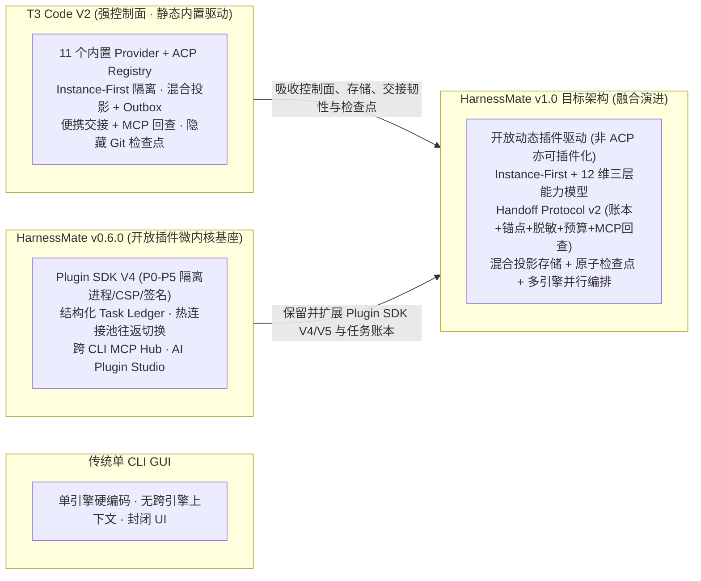

# 02 · HarnessMate Desktop 现状与 T3 Code 能力差异分析

> **审计基准**：`d:\HarnessMate\harnessmate_desktop`（Commit `970eafb`，v0.6.0，Plugin API `4.0.0`，36/36 测试通过）对比 `pingdotgg/t3code`（Commit `7913360b`，V2）。所有结论均基于当前工作区实际源码核验，非历史设计文档。

---

## 一、HarnessMate Desktop v0.6.0 真实工程基线盘点

通过逐包阅读 `packages/{protocol,plugin-api,plugin-sdk,daemon,web,electron}` 源码，当前 HarnessMate Desktop 已是一套高度工程化的桌面应用，绝非空白原型：

| 工程包 | 实际已实现能力（源码依据） | 当前成熟度 |
| --- | --- | --- |
| **`packages/protocol`** | `CanonicalEvent`（23 种事件）、`Session` / `SessionHarnessBinding` / `SessionTaskState` / `ContextPreview` / `ApprovalRequest` / `McpServerEntry` / `HarnessAccountUsage` / `HM-Remote v1` REST+WS 协议 (`src/canonical.ts`, `remote-v1.ts`, `plugin-sdk.ts`) | 核心契约完整，但 `HarnessKindSchema` 仍为硬编码 4 枚举 |
| **`packages/plugin-api`** | **Plugin API 4.0.0** 独立公共契约包：V1–V4 清单 Schema、14 项公共事件与钩子契约（`handoff.compose`, `handoff.shouldOffer`, `approval.annotate`）、9 个类型化 UI 插槽（5 种基数 × 3 种作用域）、`IsolatedPluginContext`、RPC v1 协议、离屏浏览器预览桥 (`docs/plugin-api/*`) | **领先于 T3 Code**，体系严谨 |
| **`packages/plugin-sdk`** | 4 种 V4 插件模板脚手架（`isolated` / `ui-slot` / `service` / `declarative`）、Ed25519 密钥生成与包签名 CLI (`src/scaffold.ts`, `browser-preview-template.ts`) | **领先于 T3 Code**，待补齐 Adapter 模板与测试夹具 |
| **`packages/daemon`** | Node 24 + `node:sqlite` WAL (`db/sqlite.ts` 11 张表)；3 大内置适配器（`codex-adapter.ts`, `claude-adapter.ts`, `acp-adapter.ts`）+ 自定义 ACP；`SessionManager`（热连接池上限 6、跨端原子审批、120s 过期清理）；`TaskLedgerService`（自动沉淀账本并原子写 `.harnessmate/task-ledger.md`）；`ContextCompiler`（4 段式编译 + SHA-256 段落哈希去重 + 5 种注入驱动）；`PluginHost`（`--permission` 隔离进程 + 指数退避重启 + 远程签名索引 + 热重载 `PluginDevWatcher`）；`PluginAuthoring`（AI 生成声明式插件草稿）；`UsageService` / `McpService` / `HistoryScanner` / `GitService` | 基础雄厚；但在持久化投影、多实例隔离、第三方非 ACP 适配器、检查点与并行编排上有明显短板 |
| **`packages/web`** | React 19 + Tailwind v4（Star Loom Atelier 双主题）+ Zustand；增量事件投影器（`lib/projector.ts`，1500 轮增量投影 90ms）；`SlotRegistry` + `SlotErrorBoundary` + `SandboxedPluginFrame`（严格 CSP iframe + 主题同步 + `runId` 通信）；`ChatStage`、`HarnessSwitcher`、`ModelPicker`、`InspectorDrawer`、`PluginAuthoringForm` / `PluginDraftReview` | 基础可用；存在 `HARNESS_META` / `DRIVER_LABELS` 硬编码、缺虚拟化列表、缺统一 Diff 审查与工作树工作流 |
| **`packages/electron`** | 自动托管 Daemon、托盘保活、系统审批通知、原生目录选择、离屏 Chromium 浏览器预览 (`src/main.ts`, `plugin-browser.ts`) | 稳定可用 |

---

## 二、逐能力域深度差异对比矩阵

> 分类定义：**`[HM 领先]`** HarnessMate 已优于 T3 Code；**`[已实现]`** 双方均有完整实现；**`[部分实现]`** HarnessMate 有基础但距生产级仍有差距；**`[缺失]`** HarnessMate 尚未实现；**`[无需照搬]`** 不符合 HarnessMate 定位或收益不及成本。

| 能力领域 | 具体功能点 | T3 Code V2 现状（源码依据） | HarnessMate v0.6.0 现状（源码依据） | 状态判定 | 演进策略 |
| --- | --- | --- | --- | --- | --- |
| **1. 多 Harness 接入** | 多账号 / 多实例路由 | `ProviderInstanceRegistry.ts` 按 `instanceId` 隔离配置、凭据与会话 | `HarnessRegistry` 以单例 `id` (`codex`/`claude`/`agy`) 键控，无多实例配置 | **`[缺失]`** | 升级为 `instanceId` + `driverId` + `continuationKey` |
| | 能力声明与协商 | `OrchestrationV2ProviderCapabilities`（12 类 50+ 项）+ `selectionTransition.ts` | `HarnessCapabilities` 仅 8 个粗粒度布尔字段；接口泄露 `runCodexGoal`、`codexInjectItems` | **`[部分实现]`** | 重构为三层能力模型 + 消除适配器接口硬编码 |
| | 传输层覆盖 | stdio JSON-RPC / Anthropic SDK / ACP / HTTP+SSE (OpenCode) / 子进程 Worker (Cursor) | 仅 stdio JSON-RPC (Codex/ACP) + stream-json (Claude) | **`[部分实现]`** | 核心支持通用隔离进程适配器，支持任意传输协议 |
| | 第三方插件动态接入非 ACP Harness | 仅支持 ACP Registry 动态接入；非 ACP 驱动需改 7–8 处核心源码重编译 | 仅支持声明式自定义 ACP；`isReservedServiceName` 明确禁止第三方提供 `harness.*` | **`[部分实现]`** | **核心差异化突破**：Plugin API v5 开放受控 `harness:driver:register` |
| | 被动健康检查与探测 | 强制被动探测，禁止在 probe 阶段打开会话触发 hooks/MCP (`03_providers.md#L43`) | `AcpAdapter.probe()` 调用 `session/new` (`acp-adapter.ts#L218`)；`CodexAdapter.probe()` 启停 app-server | **`[部分实现]`** | 拆分为被动快速探活 vs 显式刷新元数据 |
| | 权限模式诚实性 | 严禁伪造缺失的原生权限模式；透传原生审批选项 (`03_providers.md#L33`) | `acp-adapter.ts` 在客户端模拟 Auto / Accept Edits / Plan 自动应答 | **`[部分实现]`** | 改为能力诚实声明 + 明确区分“原生强约束”与“客户端策略护栏” |
| | 跨 CLI MCP Hub 统一管理 | 侧重将 T3 内置 MCP 注入各 Agent；支持 MCP OAuth 引导与 MCP Apps | `mcp-service.ts` 已支持跨 CLI MCP 发现与聚合，且有官方 `plugin-mcp-stdio` / HTTP 租约 | **`[HM 领先]`** | 保留优势，并补充 MCP OAuth 引导与 MCP 工具回查会话历史 |
| **2. 会话与持久化** | 持久化数据模型 | 16+ 持久化投影表 + 有限事件窗 + Outbox 表 + 命令幂等回执 (`055_OrchestrationV2.ts`) | 11 张表；`session_events` 无限追加原始 `*.delta` 帧，无 `turn_items` 投影表与 Outbox | **`[部分实现]`** | 增设 `session_turn_items` 投影表、有界事件日志与 Outbox 表 |
| | 流式增量合批与旁路 | 50ms 文本合批 (`ProviderTextDeltaCoalescer`) + `CommandOutputHub` 原始输出不落库 | 每次 `delta` 直接 `INSERT INTO session_events` 并全量 WS 广播（前端做了合批） | **`[部分实现]`** | 后端引入 50ms Coalescer + 旁路 `CommandOutputHub` |
| | 崩溃恢复与终态结算 | 区分 `REPLAY_SAFE` / `PROCESS_BOUND` Outbox，终态自动结算全部悬挂工具/子 Agent | 仅重启时将 `running`/`awaiting_approval` 置 `idle` 并过期审批 (`session-manager.ts#L109`) | **`[部分实现]`** | 引入终态级联结算 + Outbox 恢复状态机 |
| | 原生历史导入 | `AgentSessionScanner.ts` 流式解析 Codex(`.zst`+`state_5.sqlite`)/Claude/Pi，防 OOM/FIFO 挂起 | `history-scanner.ts` 支持 Codex/Claude/AGY 导入，但缺大文件流式裁剪与 Pi/OpenCode 支持 | **`[部分实现]`** | 增强流式字段过滤解析器并下沉为可插拔导入器 |
| | 会话分支、搜索、归档与导出 | 原生/便携 Fork + `merge_back` + 全局/线程内搜索 + 归档/延后/置顶；**缺整线程导出** | 有 `handoffSession` 复制分支与 Markdown 导出（含交接快照）；**缺全局全文检索与 `merge_back`** | **`[部分实现]`** | 补齐 FTS5 全文搜索、原生+便携 Fork 及 `merge_back` |
| **3. 跨 Harness 交接** | 结构化任务状态账本 | 无（仅截选原始对话，要求用户手动重申重要约束） | `TaskLedgerService` 完整实现客观进度、铁律、改动文件、验证结果并落盘 `.harnessmate/task-ledger.md` | **`[HM 领先]`** | 强化并作为 Handoff v2 的核心锚点块，增补失败尝试记录 |
| | 往返增量交接 (`A→B→A`) | `delta_since_target_last_seen` + `ProviderThread` 独立追踪 | `session_harness_bindings.synced_up_to_seq` + 6 槽热连接池 + SHA-256 段落哈希去重 | **`[已实现]`** | 融合双方优点：增补文件陈旧度检测与运行态门控 |
| | 不确定投递防护 | 注入前写 `delivery.status = "pending"`，崩溃后强制新开原生会话 | `outbound-gate.ts` 仅在发送中写 `handoff.snapshot`、发送后写 `delivered`，崩溃后无强制切新会话保护 | **`[缺失]`** | 吸收 T3 Code 两阶段投递状态机（`pending` 熔断） |
| | 容量预算与溢出自动降级 | 结合模型窗口 + 已用 token + 附件预留 + 工作预留，溢出自动开新原生会话 | 固定 `budgetTokens`（默认 12,000），不感知目标热会话已用窗口，无溢出自动重建 | **`[部分实现]`** | 引入容量感知预算器 + 自动新会话恢复降级 |
| | 被省略历史按需回查 | 交接包嵌入 `omittedItemIds` + `t3_thread_read` MCP 分页回查 | 截断后信息永久丢失，接收引擎无法拉取完整工具输出或早期轮次 | **`[缺失]`** | 在内置 MCP 租约暴露 `hm_session_read` 按需拉取工具 |
| | 跨引擎敏感信息脱敏 | 未实现（原始命令输出直接交接） | 未实现（`outputExcerpt` / `diffExcerpt` 直接拼接交接） | **`[缺失]`** | **HarnessMate 原创增强**：交接前强制脱敏过滤 + 审计计数 |
| | 多 Harness 并行协作（场景 D） | `delegate_task(isolation:"worktree")` + 父唤醒队列 + `WorkflowEngine` | 仅支持单会话建 worktree；单活跃 turn 串行模型，无多引擎并行协作 | **`[缺失]`** | 设计为独立可选插件 `hm.plugin.multi-harness-orchestrator` |
| **4. 前端适配与体验** | 消息块抽象与未知块降级 | 26 种 `OrchestrationV2TurnItem` + `ForwardCompatibleUnionArray` 过滤未知类型 | `ProjectedTurn` 仅支持文本/思考/工具/审批/交接快照 5 类，无扩展块插槽渲染 | **`[部分实现]`** | 升级为 `TurnBlock` 联合类型 + `chat.block` 键值插槽 + 未知块 JSON 降级卡片 |
| | 动态 Provider 配置 UI | `ProviderOptionDescriptor` 驱动 `TraitsPicker`（effort/thinking/fastMode/window/agent） | `ModelPicker` 仅支持固定 `model` + 固定 8 枚举 `ReasoningEffort` | **`[部分实现]`** | 升级为 `OptionDescriptor[]` 动态渲染 |
| | 性能与长会话虚拟化 | `@legendapp/list/react` 虚拟化 + `TimelineMinimap` + 滚动锚定记忆 + 线缆省略 | 最近 80 项分页 + 向前加载 + 增量投影器（无真实 DOM 虚拟化与小地图） | **`[部分实现]`** | 引入虚拟化滚动 + 线缆 `outputOmitted` 懒加载 |
| | Git 检查点与 Diff 审查 | 隐藏 Git Ref 检查点 + 对话/文件联动回滚 + 统一 Diff + 一键 Commit/Push/PR | 仅右侧抽屉显示 `git status` 与原始 diff 文本，无检查点回滚与 PR 闭环 | **`[缺失]`** | 建设内置 `hm.plugin.git-checkpoints` 插件 |
| | 终端、HTML 渲染与 Triage | 内置 PTY 抽屉 + HTML 实时渲染卡片 + Triage/Snooze/Pin/Settlement + 命令面板 | 有基础 `terminal-service.ts` 与离屏 Chromium 浏览器预览；缺 Triage 与全局命令面板 | **`[部分实现]`** | 拆分为独立插件，复用已有沙箱 iframe 与离屏渲染能力 |
| **5. 插件与 AI 共建** | 插件运行时、签名与 UI 沙箱 | 无第三方插件系统 | **Plugin SDK V4 P0–P5 全部落地**（`--permission`、Ed25519、CSP iframe、热重载、日志面板） | **`[HM 领先]`** | 守护既有投资，向 V5 兼容演进 |
| | AI Plugin Builder | 无 | `PluginAuthoring` 仅支持生成纯数据声明式 JSON，无法生成隔离代码/UI/Adapter 插件 | **`[HM 领先 / 待升级]`** | 升级为两级 AI Builder（声明式 + 隔离 TS/UI 脚手架 + 沙箱测试验证） |
| **6. 非目标差异** | Effect-TS 全栈重写 / 原生 iOS&Android App / T3 Connect 云中继 | 深度绑定 Effect-TS、独立 React Native App、自有云中继基础设施 | Node 24 + Zod + React 19 + Electron + `HM-Remote v1` (局域网/Tailscale) | **`[无需照搬]`** | 坚持轻量原生栈与 `HM-Remote v1`，避免过度工程化 |

---

## 三、HarnessMate Desktop 现有代码关键技术债务定位（精确到源码）

在演进架构前，必须精准识别以下 **7 处源码级耦合点**，避免新插件架构被旧假设卡死：

1. **硬编码 Harness 枚举**：`packages/protocol/src/canonical.ts#L4` 的 `HarnessKindSchema = z.enum(['codex', 'agy', 'claude', 'acp'])` 渗透至 `SessionSchema`、`SessionHarnessBindingSchema`、`ContextPreviewSchema`、`McpServerEntrySchema`、`HarnessAccountUsageSchema` 以及前端 `packages/web/src/lib/harness-meta.ts#L10` 的 `HARNESS_META`。
2. **适配器接口泄露厂商方法**：`packages/daemon/src/harnesses/types.ts#L20-L24` 直接定义 `codexInjectItems`，`#L138` 直接定义 `runCodexGoal?(args: string)`；`packages/daemon/src/core/context-compiler.ts#L366-L376` 的 `selectPlannedDriver()` 与 `outbound-gate.ts#L33` 直接判断 `kind === 'codex'` / `kind === 'claude'` / `kind === 'agy'`。
3. **第三方插件无法注册非 ACP 驱动**：`packages/daemon/src/plugin-host/permissions/permissions.ts#L204-L207` 与 `docs/plugin-api/services.md#L5` 禁止第三方提供 `harness.*` 服务；`HarnessRegistry.isReserved()` 硬编码保留 `codex | claude | agy`。
4. **原生命令逻辑硬编码在 `SessionManager`**：`packages/daemon/src/core/session-manager.ts#L854-L950` 的 `executeHarnessCommand()` 存在大量 `if (session.harnessKind === 'codex')` / `'claude'` / `'agy'` 分支，应下沉至适配器能力接口 `runNativeCommand()`。
5. **原始流式 Delta 持久化膨胀**：`packages/daemon/src/core/session-manager.ts#L1589-L1661` 将 `message.assistant.delta`、`thinking.delta`、`tool.call.delta` 逐条调用 `store.appendEvent()` 落盘 `session_events`，长任务下将产生数万至数十万冗余行。
6. **探测操作带外部副作用**：`packages/daemon/src/harnesses/acp-adapter.ts#L217-L221` 在 `probe()` 期间执行真实 `session/new`；`codex-adapter.ts#L152` 每次强制刷新均冷启动完整 `codex app-server`。
7. **AI Plugin Builder 生成范围受限**：`packages/daemon/src/plugins/plugin-authoring.ts#L10-L21` 的 `schemaGuide` 明确禁止生成 JavaScript、自定义 UI 插槽、自定义服务或 Harness 适配器，与 V4 已落地的隔离进程/CSP iframe/脚手架能力脱节。

---

## 四、战略定位对比：不是复制 T3 Code，而是打造开放工作平台

**结论**：HarnessMate Desktop 不需要也不应该抛弃现有的 Plugin SDK V4、任务账本和 `HM-Remote v1` 去重做一个 Effect-TS 版 T3 Code；正确路线是**保留并强化 HarnessMate 的插件微内核与任务账本优势**，精准吸收 T3 Code 在 **Instance-First 多实例隔离、12 维能力驱动架构、混合投影+Outbox 持久化、两阶段安全交接+MCP 回查、隐藏 Git 检查点** 五大领域的成熟工程实践，最终成为真正开放、可由 AI 自主扩展的多 Harness 开发平台。
