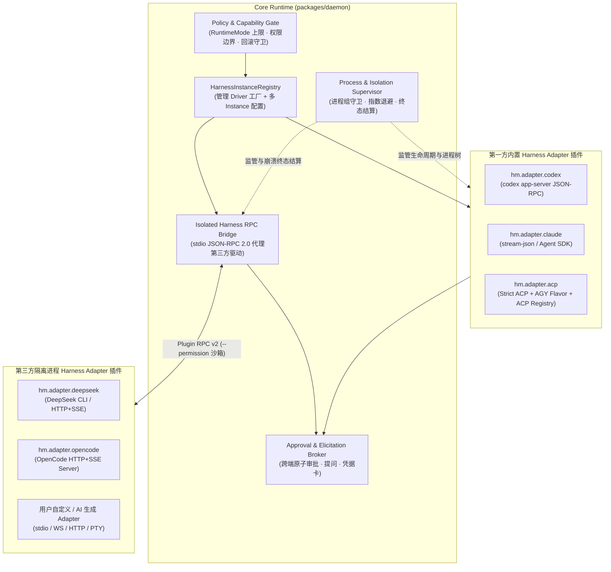
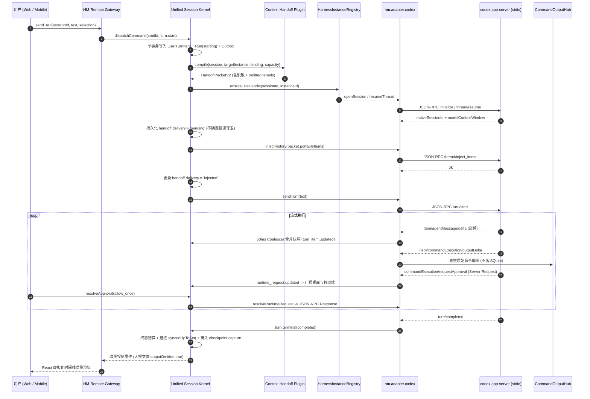

# 03 · 统一 Harness 接入与多实例运行时架构

> **设计目标**：在兼容 HarnessMate Desktop v0.6.0（`packages/daemon/src/harnesses/*`、`@harnessmate/plugin-api` 4.0.0）的基础上，彻底解除静态 4 枚举与核心硬编码限制，实现**无需修改主程序即可通过插件接入任意 AI Coding Harness**（Codex、Claude Code、Antigravity、Gemini CLI、DeepSeek Harness、OpenCode 及私有 Agent），同时不阉割任何高级 Harness 的专有能力。

---

## 一、核心设计原则（吸收 T3 Code 经验 + HarnessMate 插件化升级）

1. **三层能力架构（避免最低公共能力阉割）** `[HarnessMate 原创设计]`：
   - **L1 · 标准核心能力（Standard Core）**：所有 Harness 必须实现的最小可用闭环——被动探活、会话创建/销毁、文本轮次执行、流式输出（或单次完整输出）、取消中断、终态事件结算、统一错误分类。
   - **L2 · 可选能力矩阵（Optional Negotiated Capabilities）**：借鉴 T3 Code `OrchestrationV2ProviderCapabilities`（`packages/contracts/src/orchestrationV2.ts#L431-L448`），以结构化能力表诚实声明：原生历史注入、原生会话恢复/Fork/回滚、运行中 Steering、队列消息、原生权限模式集、审批/提问/凭据弹窗、思考流、子 Agent、Prompt Cache/上下文窗口遥测、模型目录、动态 Trait 选项（`OptionDescriptor`）、MCP 工具注入传输方式。
   - **L3 · 原生专有扩展通道（Native Vendor Extensions）**：允许 Harness 通过命名空间前缀 `ext:<driverId>.*` 声明并透传无法标准化的专有能力，包括：专有配置项、专有斜杠指令（如 Codex `/goal`、Claude `/reload-plugins`）、专有消息块（如 DeepSeek 思维预算图、Codex MCP App、Antigravity Artifact）、专有事件载荷（原样存入 `rawExtension` 供自定义 UI 插槽消费）。
2. **Instance-First 多实例隔离** `[T3 Code 已验证实现]` → `[HarnessMate 演进]`：
   - 借鉴 `t3code/apps/server/src/provider/ProviderInstanceRegistry.ts`，分离 **Driver（驱动类型，如 `codex` / `claude` / `deepseek`）** 与 **Instance（配置实例，如 `codex-work`、`codex-personal`、`claude-gateway`）**。
   - 每个实例独立持有 `instanceId`、`driverId`、`continuationKey`（决定两个实例之间是否可复用同一底层原生会话存储，例如同一账号不同显示名可复用，不同 `CODEX_HOME` 不可复用）、独立环境变量白名单与密钥引用、独立配额计数和会话池。修改显示名或强调色不中断运行中会话。
3. **诚实能力与权限不造假原则** `[T3 Code 已验证实现]`：
   - 借鉴 `t3code/docs/internals/03_providers.md#L30-L39`：未实现的权限模式不伪装成原生支持；若对不支持 `plan` 的底层 CLI 启用客户端护栏，必须在 UI 与协议中显式标注 `enforcement: 'client_guard'` 而非冒充 `'provider_native'`。
   - 探活（`probe`）严格区分 **`passive`（被动快速检测：二进制/版本/本地配置，严禁开启会话、严禁触发 hooks/MCP）** 与 **`refreshCatalog`（用户显式刷新：拉取实时模型列表与账号配额）**，修复当前 `AcpAdapter.probe()` 调用 `session/new` 的隐患（`packages/daemon/src/harnesses/acp-adapter.ts#L218`）。

---

## 二、分层架构与组件边界



---

## 三、TypeScript / Zod 核心接口规范（`packages/protocol` & `packages/plugin-api`）

> 兼容策略：原有 `HarnessKindSchema = z.enum(['codex', 'agy', 'claude', 'acp'])` 演进为 `HarnessDriverIdSchema = z.string().regex(/^[a-z0-9][a-z0-9._-]{1,63}$/)`，保留旧字段 `harnessKind` 作为 `driverId` 兼容别名（`codex` / `claude` / `agy` / `acp` 零破坏）。

```ts
// ── 1. 三层能力声明矩阵 ──────────────────────────────────────────────
export interface HarnessCapabilitiesV2 {
  /** L1: 标准核心（所有驱动必须显式声明真实支持度） */
  standard: {
    streaming: boolean;
    interactiveApproval: boolean;
    cancel: boolean;
    imageInput: boolean;
    fileAttachments: boolean;
  };
  /** L2: 可选高阶能力（供 Orchestrator / Handoff / UI 自动协商与降级） */
  optional: {
    sessions: {
      supportsMultiInstance: boolean;
      supportsModelSwitchInSession: boolean;
      supportsRuntimeModeSwitchInSession: boolean;
      supportsNativeResume: boolean;
      supportsNativeFork: boolean;
      supportsNativeRollback: boolean;
      supportsNativeCompaction: boolean;
    };
    turns: {
      supportsActiveSteering: boolean;
      supportsQueuedMessages: boolean;
      terminalStatusQuality: 'strong' | 'heuristic';
    };
    streaming: {
      streamsAssistantText: boolean;
      streamsReasoning: boolean;
      streamsToolOutput: boolean;
      streamsPlanText: boolean;
    };
    approvals: {
      nativePermissionModes: Array<'plan' | 'manual' | 'accept_edits' | 'auto'>;
      enforcement: 'provider_native' | 'client_guard';
      supportsStructuredQuestions: boolean;
      supportsMcpElicitation: boolean;
    };
    context: {
      /** 决定 Handoff 投递驱动选择，替代 ContextCompiler 硬编码 kind 判断 */
      historyInjectionMode: 'native_items' | 'acp_embedded_resource' | 'system_append_plus_inline' | 'inline_only';
      supportsContextTelemetry: boolean;
      supportsPromptCacheMetrics: boolean;
    };
    tools: {
      pluginMcpTransport: 'http' | 'acp' | 'stdio' | 'none';
      supportsSubagents: boolean;
      supportsTodoPlan: boolean;
      supportsProposedPlanCard: boolean;
    };
  };
  /** L3: 原生专有扩展注册清单（协议、命令、UI 块均须带命名空间） */
  nativeExtensions: {
    blockTypes: string[];          // e.g. ['ext:deepseek.reasoning_budget', 'ext:codex.mcp_app']
    nativeCommands: Array<{
      name: string;                // e.g. 'goal', 'compact', 'reload-plugins'
      description: string;
      argumentHint?: string;
      allowWhileBusy?: boolean;    // 如 Codex `/goal status|pause` 允许运行中执行
    }>;
    optionDescriptorsSchemaId?: string;
  };
}

// ── 2. 动态模型与选项描述符（借鉴 T3 Code TraitsPicker） ────────────────
export type ProviderOptionDescriptor =
  | {
      id: string;                  // e.g. 'reasoningEffort' | 'thinking' | 'contextWindow' | 'fastMode'
      label: string;
      category: 'reasoning' | 'speed' | 'context' | 'agent' | 'vendor';
      type: 'select';
      options: Array<{ id: string; label: string; description?: string; isDefault?: boolean }>;
      currentValue: string;
    }
  | {
      id: string;
      label: string;
      category: 'reasoning' | 'speed' | 'context' | 'agent' | 'vendor';
      type: 'boolean';
      currentValue: boolean;
    };

// ── 3. 实例配置与延续身份 ─────────────────────────────────────────────
export interface HarnessInstanceConfig {
  instanceId: string;              // e.g. 'codex-work', 'deepseek-default'
  driverId: string;                // e.g. 'codex', 'claude', 'acp', 'deepseek'
  displayName: string;
  accentColor?: string;
  enabled: boolean;
  continuationKey: string;         // 相同 driverId + continuationKey 才允许跨实例无缝续接原生线程
  binaryOverride?: string;
  config: Record<string, unknown>; // 经 Driver 声明的 JSON Schema 校验
  envSecrets?: Record<string, { kind: 'literal'; value: string } | { kind: 'secretRef'; ref: string }>;
}

// ── 4. 统一选择切换协商（借鉴 T3 Code selectionTransition） ──────────────
export type SelectionTransitionPlan =
  | { type: 'apply_on_next_turn' }
  | { type: 'apply_in_session' }
  | { type: 'restart_and_resume' }
  | { type: 'create_with_handoff' }
  | { type: 'reject'; reason: string };

// ── 5. 统一 Harness Driver 与 Session Handle 契约 ─────────────────────
export interface HarnessDriverV2 {
  readonly driverId: string;
  readonly displayName: string;
  readonly protocolLabel: string;
  readonly configJsonSchema: Record<string, unknown>;
  readonly capabilities: HarnessCapabilitiesV2;
  /** 被动快速探活：严禁打开会话、触发 hooks 或启动 MCP */
  probePassive(instance: HarnessInstanceConfig): Promise<HarnessHealthSnapshot>;
  /** 显式刷新模型与动态选项目录（允许发起短连接查询） */
  refreshCatalog?(instance: HarnessInstanceConfig, cwd?: string): Promise<HarnessCatalogSnapshot>;
  /** 协商同一实例内模型/Trait/权限模式变更的过渡策略 */
  planSelectionTransition(input: {
    current: ModelOptionSelection;
    target: ModelOptionSelection;
    sessionCapabilities: HarnessCapabilitiesV2;
  }): SelectionTransitionPlan;
  openSession(instance: HarnessInstanceConfig, config: AdapterSessionConfigV2): Promise<HarnessSessionHandleV2>;
}

export interface HarnessSessionHandleV2 {
  readonly nativeSessionId: string | null;
  readonly negotiatedCapabilities: HarnessCapabilitiesV2;
  /** 通用原生历史注入接口（不再硬编码 codexInjectItems） */
  injectHistory?(packet: PortableHistoryPayload): Promise<boolean>;
  sendTurn(input: TurnInputV2): Promise<{ deliveryDriver: ContextInjectionDriver }>;
  steerTurn?(input: { turnId: string; text: string }): Promise<void>;
  interrupt(turnId: string): Promise<void>;
  resolveRuntimeRequest(requestId: string, response: RuntimeRequestResolution): Promise<void>;
  /** 通用原生命令接口（替代硬编码 runCodexGoal 与 SessionManager 中的 switch） */
  runNativeCommand?(command: string, args: string): Promise<NativeCommandOutput>;
  /** 可选原生操作：仅当 capabilities 声明为 true 时调用 */
  forkNativeSession?(atNativeTurnId?: string): Promise<{ nativeSessionId: string }>;
  rollbackNativeSession?(targetNativeTurnId: string): Promise<void>;
  hasPendingBackgroundWork?(): Promise<boolean>;
  updateSelection?(selection: ModelOptionSelection): Promise<void>;
  dispose(): Promise<void>;
  onEvent(listener: (event: NormalizedAdapterEventV2) => void): () => void;
}
```

---

## 四、多传输协议接入模式规范

HarnessMate Core 不预设底层通信协议，所有传输复杂度完全收口在 Adapter 插件边界内部：

| 传输方式 | 代表 Harness | 进程与通信治理要点 |
| --- | --- | --- |
| **双向 JSON-RPC 2.0 over stdio** | Codex App Server、Antigravity ACP、Gemini/Kiro/Copilot ACP | 使用 `ResilientJsonLineParser` 忽略非 JSON 前导噪声；握手设 30s 超时；维护 `pendingRequests` 超时与断链自动拒绝 |
| **双向 Stream-JSON / Agent SDK** | Claude Code CLI / SDK | 复用进程组守卫（Windows Job Object / POSIX `kill -TERM 0`）防孤儿进程；剥离非本实例环境变量中的 `ANTHROPIC_API_KEY` |
| **本地托管 HTTP + SSE / WebSocket** | OpenCode (`OpenCode2Server` + SSE)、DeepSeek Server | Adapter 内部持有端口租约与 Bearer/Basic 令牌；实现静默断流心跳检测（参照 `OpenCode2SilentStreamError`） |
| **子进程 SDK Worker** | Cursor SDK、第三方 Node/Python SDK | 运行于独立隔离子进程，防止原生模块或 SDK 未捕获异常拖垮 Daemon 主进程 |
| **PTY 交互式 CLI 适配** | 遗留仅支持 TTY 的第三方 CLI | 仅作为降级传输封装于 Adapter 内部，须显式声明 `terminalStatusQuality: 'heuristic'`、禁用原生回滚/Fork |

---

## 五、端到端完整调用链设计（以两类典型 Harness 为例）

### 5.1 链路 A：内置 Codex Adapter + 原生历史注入



### 5.2 链路 B：第三方隔离进程 Adapter（DeepSeek Harness，零改主程序）

1. 用户通过插件中心或 AI Plugin Builder 安装并授权 `hm.adapter.deepseek`（申请全局高风险权限 `harness:driver:register` + `net:api.deepseek.com` 或 `process:spawn:deepseek-cli`）。
2. `PluginHost` 在隔离子进程启动插件，通过 Plugin RPC v2 握手获取 `HarnessCapabilitiesV2`（例如声明 `historyInjectionMode: 'inline_only'`、`nativeExtensions.blockTypes: ['ext:deepseek.reasoning_budget']` 与动态 `optionDescriptors`）。
3. 主程序 `HarnessInstanceRegistry` 自动将该驱动注册为可选引擎；前端 `HarnessSwitcher`、`ModelPicker` 与 `TraitsPicker` 自动读取其元数据与 `optionDescriptors` 渲染，**主程序前后端零代码修改**。
4. 运行轮次时，主程序通过 `IsolatedHarnessHost` 经 stdio JSON-RPC 下发 `harness.turn.start`；插件返回的 `ext:deepseek.reasoning_budget` 块经由 `chat.block` 键值插槽路由至该插件的 CSP 沙箱 UI 卡片渲染（未提供 UI 时自动降级为可折叠原生 JSON 检视卡片）。
5. 若插件子进程意外崩溃（如 OOM / exit 137），`ProcessSupervisor` 立即在宿主侧执行**终态结算（Terminal Settlement）**：将所有未闭环的 `tool_call` / `subagent` 置为 `interrupted`，过期挂起审批，将轮次置为 `failed` 并触发指数退避重建与 Failover 建议（已在验证脚本 #3 `validate-plugin-harness-isolation.mjs` 中实证通过）。

---

## 六、进程生命周期、异常恢复与安全边界

| 异常场景 | 处理机制 | 设计出处 |
| --- | --- | --- |
| **进程异常退出 / OOM** | 立即结算未关闭工具调用、审批与子 Agent；区分 `REPLAY_SAFE` 与 `PROCESS_BOUND` 任务；子进程指数退避（10 分钟内 5 次崩溃转 `FAILED`） | 吸收 T3 Code `RunExecutionService` + 延续 HM P3 隔离机制 |
| **早停（Early Stop）竞争** | 借鉴 T3 Code `03_providers.md#L76`：在收到 `turn.started` 前缓存取消意图，待原生 `turnId` 注册后立即下发 `interrupt`，10 秒未确认则向 UI 暴露 **Force Stop** | 吸收 T3 Code `CodexAdapterV2` / `ClaudeAdapterV2` |
| **外部 CLI 占用原生会话锁** | 识别 `E_NATIVE_THREAD_IN_USE` 错误，**禁止**静默回退新建会话造成历史分叉，明确提示用户关闭外部进程或手动分支 | 吸收 T3 Code `ProviderAdapterThreadInUseError` |
| **凭据与工作区隔离** | 严禁把上传附件复制到项目目录内以绕过沙箱；每个实例使用白名单环境变量，清除非本实例声明的宿主环境 API Key | 吸收 T3 Code `03_providers.md#L11-L13, #L49-L50` |
| **无改核心新增 Harness 检查清单** | 仅需 1 个插件包：`manifest.json`（声明 `contributes.harnessDriver` + `configSchema` + `slots`）+ 隔离驱动入口 + 可选自定义块 UI HTML + 录制回放测试夹具。核心改动量 = **0 行** | `[HarnessMate 原创设计]` |
