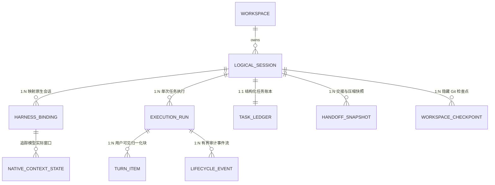
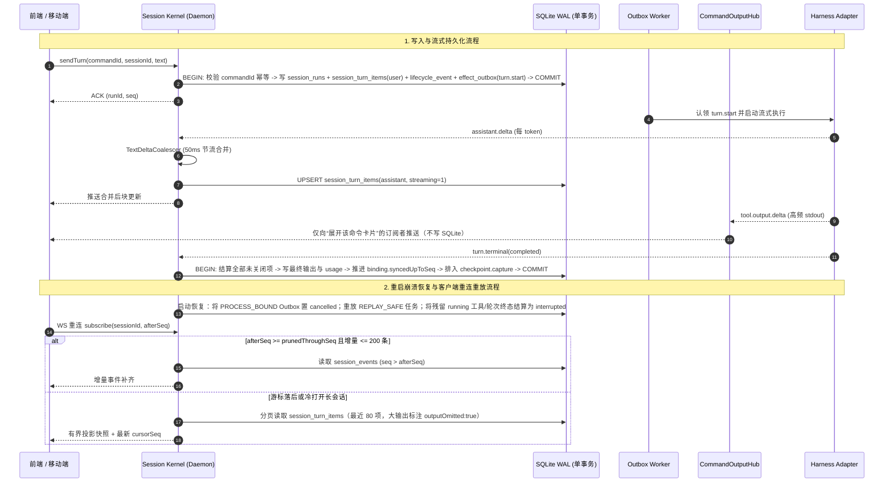

# 04 · 统一会话管理与历史持久化架构

> **核心原则**：彻底区分“用户看到的完整协作历史”与“底层某个 Harness 模型此刻实际持有的上下文窗口”，以 **Core 单一事实源（Single Source of Truth）** 终结多插件重复维护会话状态的风险。

---

## 一、T3 Code 会话系统源码调研复盘 `[T3 Code 已验证实现]`

基于 `t3code/apps/server/src/persistence/Migrations/055_OrchestrationV2.ts`、`OrchestrationEventStore.ts`、`EventSink.ts`、`ProjectionStore.ts` 与 `AgentSessionScanner.ts` 核验：

1. **双层会话与多对一映射**：T3 Code 自己持久保存完整的应用级会话（`OrchestrationV2AppThread`），同时在 `orchestration_v2_projection_provider_threads` 中为同一应用线程维护**多个** `ProviderThread`（含 `providerInstanceId`、`nativeThreadRef`、`firstRunOrdinal`、`lastRunOrdinal`、`contextUsage`）。原生会话 ID 仅是次级引用（*"App IDs are primary; provider IDs are refs"*）。
2. **混合存储形态（并非纯快照，也非无限事件重放）**：
   - 写路径经由 `EventSink` 单事务同时写入 `orchestration_v2_events`（**有限保留窗**，通过 `event-log-pruned-through` 定期裁剪）与 16+ 张物化投影表（`threads / runs / run_attempts / nodes / provider_threads / provider_turns / turn_items / messages / runtime_requests / checkpoints / context_handoffs / context_transfers / subagents`）。
   - 流式文本经 `ProviderTextDeltaCoalescer`（50ms）合批为快照写入，原始命令输出走内存 `CommandOutputHub` 不落事件表。
3. **重连、幂等与崩溃恢复**：
   - `orchestration_v2_command_receipts` 按 `commandId` 去重；
   - `EventSink` 使用 `writeIfRunCurrent` / `writeIfProviderThreadOwner` 乐观并发锁防止旧 attempt 覆写新状态；
   - `EffectOutbox` 在重启时自动退役 `PROCESS_BOUND` 任务，仅重放 `REPLAY_SAFE` 任务，并禁止自动续跑待用户审批/提问的线程。
4. **原生导入与分支**：`AgentSessionScanner.ts` 支持流式扫描 Codex（含 `.jsonl.zst` 压缩 rollout 与 `state_5.sqlite`）、Claude、Pi 的本地会话；`ThreadForkService.ts` + `t3_thread_transfer` 支持原生/便携 Fork 与 `merge_back`；不支持整线程 Markdown 导出（`thread-migration.md#L41`）。

---

## 二、HarnessMate 八层核心数据概念严格解耦 `[HarnessMate 原创设计]`

为避免把聊天 UI 历史、原生进程状态与模型上下文窗口混为一谈，HarnessMate 统一会话系统明确划分 **8 个正交实体**：



| 概念层级 | 实体名 | 精确语义与生命周期 | 是否等于模型当前上下文？ |
| --- | --- | --- | --- |
| **1. 应用级逻辑会话** | `LogicalSession` (`sessions`) | 用户视角的统一任务线程，关联 `workspaceId`、`cwd`、`worktreeBranch`、当前活跃 `harnessInstanceId`、父子/分支血缘 `lineage` | **否**（横跨多次引擎切换、多次压缩与崩溃重启） |
| **2. Harness 原生会话绑定** | `HarnessBinding` (`session_harness_bindings`) | `(sessionId, harnessInstanceId)` 到底层 `nativeSessionId` 的映射，记录 `syncedUpToSeq` 水位、`lastWorkspaceDigest`、`nativeContextUsage`、`status` | **近似指针**（指向某引擎原生会话的持久化句柄） |
| **3. 单次任务/执行实例** | `ExecutionRun` (`session_runs`) | 一次用户请求或自动续跑产生的执行实例，含 `runId`、`ordinal`、`attemptId`、`harnessInstanceId`、`requestedModel`、`actualModel`、`status`、`startedAt/completedAt` | **否**（只代表单轮执行生命周期） |
| **4. 用户可见消息与工作块** | `TurnItem` (`session_turn_items`) | 持久化投影表：用户消息、助手回复、思考摘要、工具调用、Diff、审批、计划、检查点、交接卡、子 Agent、扩展块 | **否**（包含已压缩、已省略、或由其他引擎产生的完整历史） |
| **5. 原始运行事件流** | `LifecycleEvent` (`session_events`) | **有界**结构化生命周期事件日志（用于实时推送、重连增量追赶、插件事件分发与审计；**不再持久化高频 token/stdout delta**） | **否** |
| **6. 模型实际上下文态** | `NativeContextState` | 某个 `nativeSessionId` 此刻在服务端/CLI 中实际持有的估算占用（`usedTokens`, `maxTokens`, `autoCompactThreshold`, `cacheTtlExpiresAt`, `compactedUpToSeq`） | **是**（但部分隐藏态如 KV Cache/加密思维链不可直接观测） |
| **7. 上下文快照与压缩记录** | `HandoffAndCompactionRecord` (`session_handoffs`) | 每次跨引擎交接与原生/主动压缩的不可变快照（`strategy`, `deliveryStatus`, `includedItemIds`, `omittedItemIds`, `sectionHashes`, `redactedCount`, `before/afterTokens`） | **定义上下文边界（`contextBoundarySeq`）** |
| **8. 持久化工作区状态** | `WorkspaceCheckpoint` (`session_checkpoints`) | 隐藏 Git Ref（`refs/harnessmate/checkpoints/<sessionId>/<runOrdinal>`）与改动文件清单，独立于用户分支提交历史 | **否**（代表磁盘代码真相，可与对话联动回滚） |

---

## 三、SQLite 混合持久化 Schema 演进（兼容 `packages/daemon/src/db/sqlite.ts`）

保留现有 11 张表（`workspaces`, `sessions`, `session_events`, `session_harness_bindings`, `session_task_state`, `approvals`, `native_history_imports`, `plugin_*`, `paired_devices`）零破坏，**增量迁移新增 5 张核心表 + 1 张 FTS5 索引表**：

```sql
-- 1. 单次执行实例与尝试记录（解耦 Run 与 Session，支撑重试、排队与精确水位）
CREATE TABLE IF NOT EXISTS session_runs (
  run_id TEXT PRIMARY KEY,
  session_id TEXT NOT NULL REFERENCES sessions(id) ON DELETE CASCADE,
  ordinal INTEGER NOT NULL,
  attempt_ordinal INTEGER NOT NULL DEFAULT 1,
  harness_instance_id TEXT NOT NULL,
  driver_id TEXT NOT NULL,
  native_session_id TEXT,
  requested_model TEXT,
  actual_model TEXT,
  status TEXT NOT NULL, -- queued|starting|running|awaiting_approval|completed|failed|cancelled|interrupted|rolled_back
  error_code TEXT,
  error_message TEXT,
  created_at INTEGER NOT NULL,
  started_at INTEGER,
  completed_at INTEGER,
  UNIQUE(session_id, ordinal)
);
CREATE INDEX IF NOT EXISTS idx_runs_session_status ON session_runs(session_id, status);

-- 2. 持久化归一化时间线块投影表（解决冷开重放与 Delta 膨胀的核心！）
CREATE TABLE IF NOT EXISTS session_turn_items (
  item_id TEXT PRIMARY KEY,
  session_id TEXT NOT NULL REFERENCES sessions(id) ON DELETE CASCADE,
  run_id TEXT REFERENCES session_runs(run_id) ON DELETE CASCADE,
  seq INTEGER NOT NULL,
  ordinal INTEGER NOT NULL,
  harness_instance_id TEXT NOT NULL,
  type TEXT NOT NULL,   -- user_message|assistant_message|reasoning|command_execution|file_change|tool_call|approval_request|todo_list|proposed_plan|checkpoint|handoff|compaction|subagent|ext:*
  status TEXT NOT NULL, -- pending|running|completed|failed|cancelled|interrupted
  summary_text TEXT,    -- 供列表/搜索与线缆轻量预览
  payload_json TEXT NOT NULL,
  raw_vendor_json TEXT, -- 保留原始厂商协议载荷（供调试与未来渲染器升级）
  updated_at INTEGER NOT NULL
);
CREATE INDEX IF NOT EXISTS idx_turn_items_session_seq ON session_turn_items(session_id, seq);
CREATE INDEX IF NOT EXISTS idx_turn_items_run ON session_turn_items(run_id, ordinal);

-- 3. 命令幂等回执 + 持久化副作用 Outbox（防重复提交与崩溃恢复）
CREATE TABLE IF NOT EXISTS command_receipts (
  command_id TEXT PRIMARY KEY,
  session_id TEXT NOT NULL,
  command_type TEXT NOT NULL,
  status TEXT NOT NULL, -- accepted|rejected
  result_seq INTEGER NOT NULL,
  error_text TEXT,
  created_at INTEGER NOT NULL
);

CREATE TABLE IF NOT EXISTS effect_outbox (
  effect_id TEXT PRIMARY KEY,
  command_id TEXT NOT NULL,
  session_id TEXT NOT NULL REFERENCES sessions(id) ON DELETE CASCADE,
  effect_type TEXT NOT NULL,
  recovery_class TEXT NOT NULL, -- 'replay_safe' | 'process_bound'
  payload_json TEXT NOT NULL,
  status TEXT NOT NULL,         -- pending|running|succeeded|failed|cancelled
  attempt_count INTEGER NOT NULL DEFAULT 0,
  available_at INTEGER NOT NULL,
  last_error TEXT,
  updated_at INTEGER NOT NULL
);
CREATE INDEX IF NOT EXISTS idx_outbox_claim ON effect_outbox(status, available_at);

-- 4. 不可变上下文交接与压缩审计表（支持两阶段 pending 熔断与区间追溯）
CREATE TABLE IF NOT EXISTS session_handoffs (
  handoff_id TEXT PRIMARY KEY,
  session_id TEXT NOT NULL REFERENCES sessions(id) ON DELETE CASCADE,
  target_run_id TEXT NOT NULL,
  to_harness_instance_id TEXT NOT NULL,
  native_session_id TEXT,
  strategy TEXT NOT NULL,       -- full_thread_summary|delta_since_target_last_seen|fork_delta_summary|compaction
  delivery_status TEXT NOT NULL,-- pending|injected|inline|failed|superseded
  covered_from_seq INTEGER NOT NULL,
  covered_to_seq INTEGER NOT NULL,
  included_item_ids_json TEXT NOT NULL,
  omitted_item_ids_json TEXT NOT NULL,
  section_hashes_json TEXT NOT NULL,
  redacted_count INTEGER NOT NULL DEFAULT 0,
  snapshot_markdown TEXT,
  created_at INTEGER NOT NULL,
  updated_at INTEGER NOT NULL
);
CREATE INDEX IF NOT EXISTS idx_handoffs_session_target ON session_handoffs(session_id, to_harness_instance_id, created_at DESC);

-- 5. 隐藏 Git Ref 检查点索引
CREATE TABLE IF NOT EXISTS session_checkpoints (
  checkpoint_id TEXT PRIMARY KEY,
  session_id TEXT NOT NULL REFERENCES sessions(id) ON DELETE CASCADE,
  run_id TEXT REFERENCES session_runs(run_id) ON DELETE CASCADE,
  git_ref TEXT NOT NULL,        -- refs/harnessmate/checkpoints/<sessionId>/<runOrdinal>
  base_commit TEXT,
  changed_files_json TEXT NOT NULL,
  status TEXT NOT NULL,         -- captured|restored|pruned
  created_at INTEGER NOT NULL
);

-- 6. 全文检索虚拟表（支撑毫秒级全局会话与消息搜索）
CREATE VIRTUAL TABLE IF NOT EXISTS session_search_fts USING fts5(
  session_id UNINDEXED,
  item_id UNINDEXED,
  title,
  body,
  tokenize='unicode61'
);
```

> **实测收益**（详见 [11_Technical_Validation.md](./11_Technical_Validation.md) Validation #2）：在 50 轮 / 5,250 条高频流式事件压测中，采用“50ms 合批投影 + `CommandOutputHub` 旁路 + 线缆 `outputOmitted` 懒加载”后，SQLite 写入行数减少 **13.1 倍**（5,250 → 400 行），磁盘体积缩小 **11.6 倍**，冷开重建时间从 `14.15–21.82 ms` 降至 **`0.69–0.88 ms`**（提速 **16x–31x**），WebSocket 快照流量缩减 **22.6 倍**。

---

## 四、全生命周期核心流程（创建、写入、恢复、重放）



---

## 五、会话进阶能力设计：防重/乱序、压缩隔离、导入、外部 CLI 互通与分支

1. **防止重复、丢失、乱序与状态不一致**：
   - **写入幂等**：客户端每次写操作携带 UUID `commandId`，查 `command_receipts` 重复直接返回原 `result_seq`；
   - **单会话串行写车道**：为每个 `sessionId` 维护内存 `KeyedMutex` + SQLite 单调递增 `seq`，确保同一会话事件全局全序；
   - **乐观所有权校验**：流式回调写入前校验 `run.activeAttemptId === callback.attemptId`，防止超时/取消后的滞后流污染新轮次；
   - **客户端幂等去重与乱序容忍**：前端按 `seq` 去重并排序，遇 `seq` 断层主动向服务端请求有界快照校准。
2. **上下文压缩前后的历史分离**：
   - 执行原生 `/compact` 或插件主动压缩时，在 `session_turn_items` 插入一条 `type: 'compaction'` 边界卡片（记录 `beforeTokenCount / afterTokenCount / summary`），并在 `session_harness_bindings` 更新 `compactedUpToSeq`。
   - **用户时间线永远保留压缩前的全部历史消息与工具记录**（仅视觉上以“上下文压缩分割线”折叠提示），而下次构建模型上下文或跨引擎交接时，默认仅从 `contextBoundarySeq` 之后起算，彻底解耦 UI 历史与模型窗口。
3. **原生历史导入与外部 CLI 互通**：
   - 将现有 `history-scanner.ts` 抽离为插件可注册的 `NativeSessionImporter` 扩展点，吸收 T3 Code `AgentSessionScanner.ts` 的**流式 JSON 字段筛选器**（防 GiB 级带截图 JSONL 导致 OOM）和 **`.jsonl.zst` 解压支持**。
   - **外部 CLI 与桌面端续接同一会话**：复用 `session_harness_bindings.native_session_id`；若检测到原生会话被外部 CLI 进程独占锁占用（`E_NATIVE_THREAD_IN_USE`），拒绝静默开新会话；用户重新切回桌面端时，支持通过适配器 `readThreadSnapshot()` 同步外部 CLI 期间新增的对话增量。
4. **会话分支（Fork）、合并回流（Merge-Back）、归档、搜索与导出**：
   - **Fork**：优先走适配器 `forkNativeSession()`（如 Codex `thread/fork` / Claude `forkSession`），不支持或失败时自动降级为**便携 Fork**（复制 `TaskLedger` + 创建 `full_thread_summary` 交接记录，父子会话通过 `parent_session_id` / `forked_at_run_id` 关联）。
   - **Merge-Back**：借鉴 T3 Code `t3_thread_transfer(merge_back)`，允许将探索分支的结论与修改摘要以 `fork_delta_summary` 注入回父会话。
   - **搜索与导出**：基于 `session_search_fts`（SQLite FTS5）实现毫秒级跨会话全文检索；保留并升级现有的 Markdown / JSON 整会话导出（包含任务账本与交接审计记录）。
