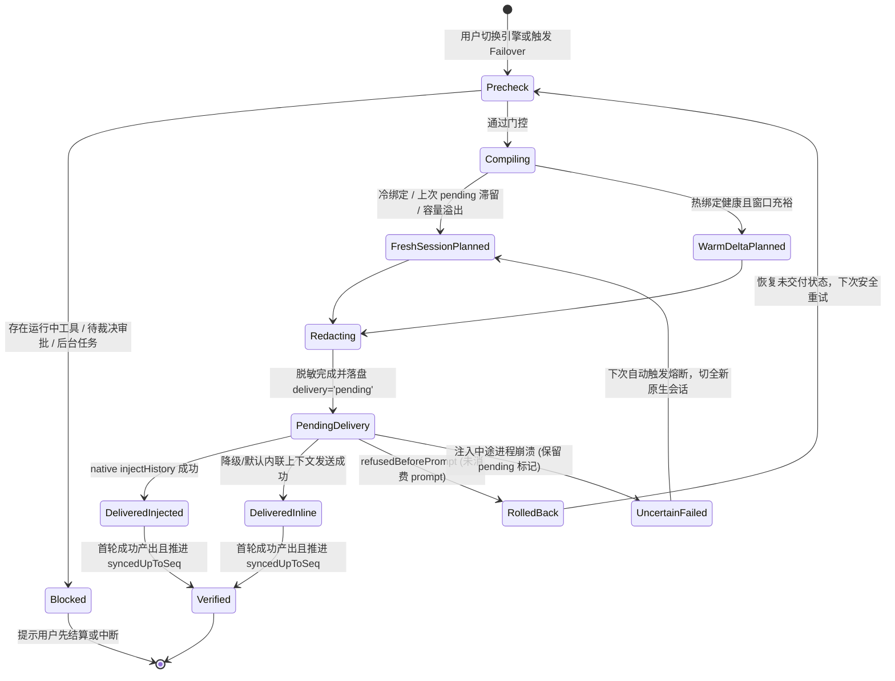

# 05 · 跨 Harness 上下文交接协议（Context Handoff Protocol v2）

> **本章定位**：本调研最核心的架构规范。明确回答 T3 Code 在跨 Harness 交接上的真实实现边界，并在此基础上为 HarnessMate Desktop 提出可工程化落地、能支撑真实长任务开发的 **Context Handoff Protocol v2**。

---

## 一、T3 Code 跨 Provider 交接真实能力边界核验 `[T3 Code 已验证实现]`

经逐行源码审查（`Orchestrator.ts#L2890-L3020, #L9175-L9385`、`ContextHandoffService.ts`、`ContextHandoffDelivery.ts`、`ProviderTurnStartService.ts#L1150-L1953`、`handoffBudget.ts`），核验结论如下：

| 维度 | T3 Code V2 是否真正实现？ | 源码级核验事实 | 能力边界与不足 `[T3 Code 源码受限/未完善]` |
| --- | --- | --- | --- |
| **场景 A：A→B 同线程切换** | **已实现** | 同一 `AppThread` 下为 B 新建 `ProviderThread`，生成 `full_thread_summary`；Codex 用 `thread/inject_items`，其余用带归属头内联上下文 | 无结构化任务账本、无实时 Git 变更锚点；长会话下重要约束可能被预算淘汰，文档明确要求用户手动复述 |
| **场景 B：A→B→A 往返切回** | **已实现** | 查找到 A 的旧 `ProviderThread` 与 `targetLastCompletedRun`，生成 `delta_since_target_last_seen` 仅补发 B 执行的增量轮次 | 若 B 修改了 A 之前读过的文件，T3 未显式向 A 注入“工作区文件已变更，旧认知失效”的陈旧度警告 |
| **场景 C：超长会话预算与溢出** | **已实现** | 悲观容量预算（1B/tok + 图片 8192 + 预留 25%）+ `omittedItemIds` + `t3_thread_read` MCP 分页回查 + 溢出自动新开原生会话 | 仅做确定性消息截选，不支持按代码符号/相关性检索或可选 AI 摘要压缩 |
| **不确定投递与并发保护** | **已实现** | 注入前落盘 `delivery.status = 'pending'`，崩溃后强制新开原生线程；存在运行中后台任务时拒切（`ContextHandoffBackgroundWorkError`） | —（此机制极成熟，应完整吸收） |
| **跨引擎敏感凭据防泄露** | **未实现** | `historicalMessage()` 直接拼接原始 `command_execution.output` | 将 Codex 本地 shell 报错里的 API Key / Token 原样发送给另一家云厂商存在明显安全风险 |
| **场景 D：多引擎并行开发** | **独立编排实现** | 通过 MCP `delegate_task(isolation:'worktree')` 创建独立子线程 + Git Worktree，父线程经完成队列被唤醒，**不与串行切换共用同一线程状态** | 缺少细粒度文件级冲突预检与面向普通用户的可视化多引擎看板 |

---

## 二、状态可迁移性三元边界矩阵（严守物理与协议事实）

**绝不假设所有 Harness 都允许注入任意历史消息，更绝不假设模型隐藏态可跨厂商迁移。** 下表定义 HarnessMate 的绝对工程边界：

| 状态分类 | 具体信息项 | 可迁移性 | 跨 Harness 处理策略 |
| --- | --- | --- | --- |
| **1. 可无损迁移（Portable）** | 任务目标、阶段清单、关键架构决策、用户钉选铁律、已尝试的失败方案、用户/助手规范文本、验证命令结果、受改动文件列表、未决阻塞项、被省略项的稳定 `itemId` 指针 | **可直接迁移** | 结构化打包（Block A–D），经脱敏与预算裁剪后通过目标最佳通道交付 |
| **2. 只能重建（Reconstructible）** | 工作区当前文件真实内容与 Git Diff、代码符号索引、MCP 工具租约连接、目标模型的项目级规则（`AGENTS.md`/`CLAUDE.md`）、对话语义摘要 | **不可直传旧态，须现场重建** | 交接前现场采样 Git Truth Anchor；目标会话启动时重新挂载 MCP 租约；按需调用 `hm_session_read` 或文件读取工具重建工作记忆 |
| **3. 原则上不可迁移（Non-Portable）** | **服务端 KV Cache / Prompt Cache**、**加密或带签名的隐藏推理链**（如 Claude `thinking.signature`、OpenAI Codex `invalid_encrypted_content`）、**运行中的原生工具句柄/PTY PID/子进程 FD**、**厂商私有鉴权会话/Cookie/OAuth Token**、**原生未完结 Tool Use ID 配对状态** | **严禁迁移** | 交接编译器在源码层显式剔除 `reasoning` 与 `native_tool_state`；前置门控强制要求挂起工具与审批先结算；严禁传递任何认证凭据 |

---

## 三、四大真实场景架构方案

### 场景 A：执行器冷切换（如 Codex 额度耗尽 → 切 Claude Code / Antigravity / DeepSeek）
- **核心动作**：触发 `strategy = 'full_thread_summary'`。交接包包含 5 个结构化层：
  1. **Block A · Workspace Truth Anchor（实时重建）**：当前 `cwd`、`worktreeBranch`、最新 `git status`（过滤 `.harnessmate/`）、工作区内容指纹 `workspaceDigest`、`.harnessmate/task-ledger.md` 路径。
  2. **Block B · Structured Task Ledger（高优必保）**：任务目标、已完成/进行中/阻塞步骤、架构决策、**用户钉选铁律（Pinned Constraints）**、**已尝试但失败的方案（Failed Attempts，避免新引擎重踩坑）**、最近测试验证结果。
  3. **Block C · Older Digest & Omitted Pointers**：超出原文窗口的早期轮次骨架摘要 + 精确 `omittedItemIds` 列表 + `hm_session_read` MCP 拉取指令。
  4. **Block D · Budgeted Verbatim Window**：按“最新用户消息 → 最新助手消息 → 最初用户意图 → 从新到旧逐轮回填”优先级保留完整原文（含失败/中断轮次的局部产出）。
  5. **Block E · Plugin Extension Sections**：通过 Plugin V4/V5 `handoff.compose` 瀑布钩子追加的可选上下文（如符号索引插件、CI 报错插件），受独立字符上限保护。

### 场景 B：切换后再次返回（Codex → Claude → 切回 Codex）
- **核心问题**：Codex 原生会话是否继续用？如何防止 Codex 依据过时文件认知继续写代码？
- **精准策略（组合热复用 + 陈旧度锚点 + 熔断降级）**：
  1. **优先热复用**：查询 `session_harness_bindings(sessionId, 'codex')`，若存在有效 `native_session_id`、无滞留 `delivery_status = 'pending'` 记录、且目标剩余窗口能容纳增量包，则**复用原 Codex 原生会话**，使用 `strategy = 'delta_since_target_last_seen'`，仅抽取 `seq > binding.synced_up_to_seq` 且 `harness_instance_id !== 'codex'` 的 Claude 增量轮次。
  2. **工作区陈旧度强制宣告（Staleness Invalidation）**：比对 `binding.last_workspace_digest` 与当前 `currentWorkspaceDigest`。只要 Claude 期间修改了任何文件，Block A 显式注入 `[WORKSPACE_MUTATED_SINCE_LAST_TURN]` 清单，明确告知 Codex：“你此前读取的以下文件已被 Claude 修改，操作前必须重新读取最新磁盘版本”。
  3. **三大自动切新原生会话熔断条件**（借鉴并增强 T3 Code `ProviderTurnStartService.ts#L1646-L1858`）：
     - 上次 `injectHistory` 滞留 `pending`（不确定投递）；
     - 热会话已用 Token + 增量包 + 当前用户请求 + 工作预留 > 目标模型窗口（容量溢出）；
     - 底层返回 `invalid_encrypted_content` / 原生会话损坏 / 不可逆回滚失效。
     - 触发熔断时，保留旧原生会话只读归档记录（不破坏原生历史），为 Codex 创建**新原生会话**并切为 `full_thread_summary` 自动重传。

### 场景 C：超长会话上下文压缩与迁移策略对比

| 迁移策略 | 信息保真度 | Token 成本 | 缓存命中率 | 迁移延迟 | 可靠性 | 实现复杂度 | 适用角色 |
| --- | --- | --- | --- | --- | --- | --- | --- |
| 全量历史重放 | 极高（短会话） | 极高（长会话爆窗） | 低（跨厂商为 0） | 低 | 易超限失败 | 低 | 仅短会话（< 8k tok） |
| 纯最近消息窗口 | 低（丢初始目标与铁律） | 低 | 低 | 极低 | 高 | 极低 | 不可单独用于复杂工程任务 |
| 纯 AI 生成交接摘要 | 中高（语义好但易丢精确路径/报错） | 中（需额外 LLM 调用） | 中 | 高（+3–15s） | 依赖摘要模型质量 | 中 | **可选增强插件**（100+ 轮归档压缩） |
| 结构化任务状态账本 | 高（约束/进度极稳，缺细节原文） | 极低（~500–1.5k tok） | 高 | 极低（确定性） | 极高 | 中 | **必选核心锚点（Block B）** |
| 文件/符号级上下文索引 | 高（定位精准） | 低 | 高 | 低–中 | 高 | 中高 | **可选插件**（注入 Block E） |
| 相关性历史检索 / MCP 回查 | **按需 100% 保真** | **极低（零预占）** | 高 | 低（仅需时调用） | 依赖目标支持 MCP | 中 | **必选兜底（`hm_session_read`）** |
| **混合四层 + MCP 回查（选定方案）** | **综合最高** | **严格受预算可控** | **最优** | **< 20ms（零额外 LLM 调用）** | **极高** | **中高（已具备 70% 基础）** | **HarnessMate 默认主策略** |

### 场景 D：多个 Harness 并行开发（严禁复用串行交接状态机）

> **关键架构铁律**：串行交接（A→B→A）操作的是**同一条逻辑会话、同一个工作目录、互斥活跃轮次**；多 Harness 并行开发（如 Codex 写后端 API + Claude 写前端页面 + DeepSeek 写单测）必须采用**独立的父子任务树 + Git Worktree 物理隔离模型**，绝不能把多个并行流硬塞进同一 `LogicalSession` 的单一 `status` 中！

| 维度 | 串行上下文交接（`hm.plugin.context-handoff`） | 多 Harness 并行协作（`hm.plugin.multi-harness-orchestrator`） |
| --- | --- | --- |
| **会话拓扑** | 1 个 `LogicalSession` 绑定 N 个 `HarnessBinding`，同一时刻仅 1 个活跃 Run | 1 个 Coordinator 父会话 + N 个独立 `ChildSession`（各自独立事件流与状态） |
| **文件系统隔离** | 共享同一 `cwd` / Worktree | 每个并行子任务强制分配独立 **Git Worktree + 独立分支**（`hm/sub/<taskId>`），避免并发写冲突 |
| **上下文传播** | 沿时间线做全量或 `delta_since_target_last_seen` 同步 | 借鉴 T3 Code `delegate_task`：**默认零父历史**，仅下发精炼 `SubtaskSpec` + 共享只读账本快照 + 广播事件 |
| **结果回收与合并** | 无需代码合并（同目录续写） | 子任务终态自动写入 **Completion Cohort** 唤醒父会话；经冲突预检后由用户或主 Agent 执行 cherry-pick / merge-back |

---

## 四、Context Handoff Protocol v2 完整契约（TypeScript / Zod）

```ts
export type HandoffStrategy =
  | 'native_warm'
  | 'full_thread_summary'
  | 'delta_since_target_last_seen'
  | 'fork_delta_summary';

export type HandoffDeliveryStatus = 'pending' | 'injected' | 'inline' | 'failed' | 'superseded';

export interface HandoffPrecheckResult {
  allowed: boolean;
  blockers: Array<{
    code: 'E_SESSION_BUSY' | 'E_INFLIGHT_TOOL_CALL' | 'E_PENDING_APPROVAL' | 'E_BACKGROUND_WORK_ACTIVE' | 'E_TARGET_UNAVAILABLE';
    message: string;
    canForceAbort?: boolean;
  }>;
  warnings: Array<{
    code: 'W_WORKSPACE_STALE' | 'W_CAPACITY_OVERFLOW_FRESH_SESSION' | 'W_UNCERTAIN_DELIVERY_FRESH_SESSION' | 'W_SECRETS_REDACTED' | 'W_MCP_PULL_UNAVAILABLE';
    message: string;
  }>;
}

export interface ContextHandoffPacketV2 {
  protocolVersion: '2.0';
  handoffId: string;
  sessionId: string;
  targetRunId: string;
  sourceHarnesses: string[];
  targetInstanceId: string;
  targetDriverId: string;
  strategy: HandoffStrategy;
  forceFreshNativeSession: boolean;
  freshSessionReason?: 'cold_binding' | 'uncertain_delivery' | 'capacity_overflow' | 'native_rejected' | 'user_requested';
  coveredSeqRange: { from: number; to: number };
  budget: {
    modelContextWindow: number;
    nativeUsedTokens: number;
    workReserveTokens: number;
    currentPromptReservedTokens: number;
    availableHandoffTokens: number;
    estimatedPacketTokens: number;
  };
  workspaceAnchor: {
    cwd: string;
    gitBranch: string | null;
    workspaceDigest: string;
    mutatedSinceTargetLastTurn: boolean;
    mutatedFiles: string[];
    ledgerFilePath: string | null;
  };
  ledgerSnapshot: {
    version: number;
    objective: string;
    pinnedFacts: string[];
    failedAttempts: Array<{ summary: string; harnessId: string; seq: number }>;
    steps: Array<{ title: string; status: string; ownerHarnessId?: string | null }>;
    decisions: string[];
    verifications: Array<{ command: string; status: string; summary?: string }>;
    blockers: string[];
  };
  portableItems: Array<{
    itemId: string;
    seq: number;
    turnId: string;
    harnessId: string;
    role: 'user' | 'assistant';
    kind: 'user_message' | 'assistant_message' | 'command_execution' | 'file_change' | 'proposed_plan' | 'error';
    status: string;
    text: string;
  }>;
  omitted: {
    count: number;
    itemIds: string[];             // 最多列最近 20 个，总字节 <= budget / 8
    mcpPullToolAvailable: boolean;
    mcpPullInstruction?: string;   // hm_session_read({sessionId, itemId, textOffset})
  };
  extensionSections: Array<{ id: string; source: string; text: string; hash: string }>;
  sectionHashes: Record<string, string>;
  security: {
    redactedCount: number;
    redactedCategories: string[];  // e.g. ['openai_key', 'bearer_token', 'env_secret']
  };
  /** 面向不支持 native_items 通道的最终渲染文本 */
  renderedMarkdown: string;
}

export interface ContextHandoffManager {
  precheck(sessionId: string, targetInstanceId: string): Promise<HandoffPrecheckResult>;
  exportPacket(input: {
    sessionId: string;
    targetInstanceId: string;
    userPrompt: string;
    attachments?: Attachment[];
    overrides?: { syncMode?: ContextSyncMode; budgetTokens?: number; excludedItemIds?: string[]; userEditedNotes?: string };
  }): Promise<ContextHandoffPacketV2>;
  deliverPacket(handle: HarnessSessionHandleV2, packet: ContextHandoffPacketV2, turn: TurnInputV2): Promise<{
    deliveryStatus: 'injected' | 'inline';
    nativeSessionId: string | null;
  }>;
  rollbackOnRefusedBeforePrompt(handoffId: string): Promise<void>;
}
```

---

## 五、跨 Harness 交接状态机与失败回滚时序

### 5.1 交接状态机



### 5.2 交接结果验证与降级矩阵

| 目标 Harness 原生能力组合 | 自动协商交付方式 | 降级保障与结果验证 |
| --- | --- | --- |
| 支持 `native_items` + 支持 MCP（如 Codex） | `thread/inject_items` 注入结构化历史 + `hm_session_read` MCP 回查 | 投递后写入 `handoff.snapshot_delivered`；若 `inject_items` 抛错则自动切 `inline` 并记录诊断告警 |
| 支持 `acp_embedded_resource` + 支持 MCP（如 Antigravity / 标准 ACP） | 用户侧 `embeddedContext` 资源块（参考语气）+ `hm_session_read` MCP 回查 | 复用 SHA-256 段落哈希去重，未变段落仅传摘要指针 |
| 支持 `system_append_plus_inline` + 支持 MCP（如 Claude Code） | 固定一句系统连续性提示（`--system-prompt-snapshot off`）+ 用户侧内联交接块 + MCP 回查 | 绝不把用户/工具不可信文本直接塞入 System Prompt，防止提示词注入提权 |
| 仅 `inline_only` 且无 MCP（如极简第三方 CLI） | 结构化 `<harnessmate_handoff>` 用户信封（优先保证 Block A+B 完整） | `mcpPullToolAvailable = false`，自动调高 Block C 骨架摘要比例，并在交接抽屉向用户标注“省略项需手动补充” |
| 交接前发生 `refusedBeforePrompt`（如参数错误/未登录） | 调用 `rollbackOnRefusedBeforePrompt()` 撤销 `pending` 标记 | 用户原消息保留在输入草稿中，会话状态干净回退至 `idle`，不推进 `syncedUpToSeq` |
