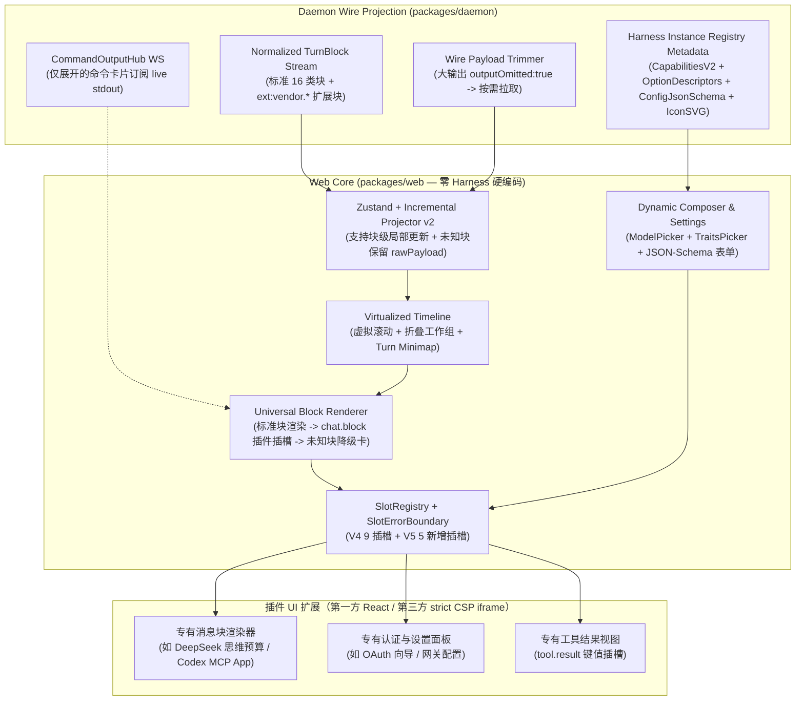

# 06 · 前端多 Harness 统一适配与插件 UI 扩展架构

> **核心目标**：让新增一个全新的 AI Coding Harness（如 DeepSeek Harness、OpenCode、Gemini CLI 或私有 Agent）时，**主程序前端（`packages/web`）原则上零代码修改**，完全依靠后端能力声明、标准化消息块、动态配置描述符与插件 UI 插槽完成一致且不阉割特性的呈现。

---

## 一、T3 Code 前端适配机制深度核验 `[T3 Code 已验证实现]`

经源码审计 `t3code/packages/contracts/src/orchestrationV2.ts`、`packages/client-runtime/src/providerClients.ts` 及 `apps/web/src/components/`，T3 Code 采用 **“后端强归一化为主 + 声明式配置描述符为辅 + 极少数认证/配额页面局部特判”** 的混合架构：

1. **核心聊天时间线 100% Provider 无关**：
   - 全文检索 `apps/web/src` 证实：`MessagesTimeline.tsx`、`TimelineV2EventRow.tsx`、`TimelineWorkEntryRow.tsx`、`TimelinePendingApprovalRow.tsx`、`DiffPanel.tsx`、`ProviderSubagentBar.tsx` 中**没有任何 `provider === "codex" / "claudeAgent"` 判别分支**。
   - 所有不同底层协议的差异均在服务端适配器被归一化为 **26 种强类型 `OrchestrationV2TurnItem`**（`orchestrationV2.ts#L1897-L2134`）：消息、推理、提议计划卡片、Todo 列表、结构化提问、文件变更、命令执行、文件/网页检索、审批请求、检查点、中断请求/结果、系统通知、错误/重试、上下文压缩、跨引擎交接、分支、子会话创建、凭据卡、环境配对卡、反馈卡、子 Agent、动态工具。
   - **前向兼容解码**：`ForwardCompatibleUnionArray`（`#L2138-L2157`）在客户端遇到未知未来 `type` 时平滑忽略/降级，防止旧版客户端因服务端升级崩溃。
2. **模型与专有推理/速度选项完全由 Schema 描述符驱动**：
   - `TraitsPicker.tsx`（`#L119-L197`）消费服务端下发的 `ProviderOptionDescriptor[]`（`select` / `boolean`），动态渲染 `effort`、`reasoningEffort`、`variant`、`contextWindow`、`agent`、`fastMode`、`thinking` 控件；甚至在某旧模型不可用时自动合成只读占位描述符保留历史选择（`buildUnavailableModelOptionDescriptors`）。
3. **T3 Code 前端仍残留的 Provider 硬编码边界 `[T3 Code 源码受限/未完善]`**：
   - 集中在 **账号引导、认证向导与用量面板**（`AddCodexAccountDialog.tsx`、`CodexSetupSection.tsx`、`ChatGptWelcomeCoordinator.tsx`、`ProviderAuthenticationSection.tsx`、`UsagePage.tsx`）以及极少数提示词前缀逻辑（如 Claude `Ultrathink:` 识别，`TraitsPicker.tsx#L54`）。
   - **原因**：T3 Code 缺乏第三方插件 UI 沙箱，因此专有引导流只能写死在 `apps/web`。而 HarnessMate Desktop 已建成 **P4 类型化插槽 + CSP 沙箱 iframe**，可以彻底把这类专有 UI 下沉到 Adapter 插件内部！

---

## 二、HarnessMate 前端多 Harness 统一适配架构设计 `[HarnessMate 原创设计]`



---

## 三、标准消息块模型（`TurnBlock`）与未知事件降级协议

升级现有 `packages/web/src/lib/projector.ts` 中扁平的 `ProjectedTurn`（当前仅 `thinking / assistantText / tools / approvals / handoffSnapshots`），演进为**有序块数组 `TurnBlock[]`**，完整保留模型输出与工具调用交错的真实时间顺序，并保留 `rawVendorPayload`：

```ts
export interface TurnBlockBase {
  readonly blockId: string;
  readonly schemaVersion: 2;
  readonly seq: number;
  readonly turnId: string;
  readonly harnessInstanceId: string;
  readonly driverId: string;
  readonly status: 'pending' | 'running' | 'completed' | 'failed' | 'cancelled' | 'interrupted';
  readonly createdAt: number;
  readonly updatedAt: number;
  /** 仅用于诊断/开发者检视/未来插件升级重绘，线缆默认裁剪，点击“查看原始帧”按需拉取 */
  readonly rawRef?: { eventSeq: number; vendorType: string };
}

export type StandardTurnBlock =
  | (TurnBlockBase & { type: 'user_message'; text: string; attachments: Attachment[]; expandedCommand?: string | null })
  | (TurnBlockBase & { type: 'assistant_text'; text: string; streaming: boolean; phase?: 'commentary' | 'final' })
  | (TurnBlockBase & { type: 'reasoning'; text: string; streaming: boolean; redactedSignature?: boolean })
  | (TurnBlockBase & { type: 'command_execution'; command: string; cwd?: string; exitCode?: number | null; outputPreview?: string; outputOmitted?: boolean })
  | (TurnBlockBase & { type: 'file_change'; files: Array<{ path: string; changeKind: 'add' | 'update' | 'delete' | 'rename'; additions?: number; deletions?: number }>; diffOmitted?: boolean })
  | (TurnBlockBase & { type: 'tool_call'; toolCallId: string; toolName: string; toolKind: ToolKind; summary: string; inputSummary?: string; outputPreview?: string; outputOmitted?: boolean; parentToolUseId?: string | null })
  | (TurnBlockBase & { type: 'approval_request'; approval: ApprovalRequest; nativeOptions?: Array<{ id: string; label: string; kind: string }> })
  | (TurnBlockBase & { type: 'user_question'; requestId: string; questions: StructuredQuestion[]; answers?: Record<string, string | string[]> })
  | (TurnBlockBase & { type: 'secret_request'; requestId: string; prompt: string; fields: Array<{ key: string; label: string }>; fulfilled: boolean })
  | (TurnBlockBase & { type: 'todo_list'; steps: Array<{ id: string; title: string; status: 'pending' | 'in_progress' | 'done' | 'blocked' }> })
  | (TurnBlockBase & { type: 'proposed_plan'; planId: string; markdown: string; streaming: boolean; accepted?: boolean })
  | (TurnBlockBase & { type: 'subagent_run'; subagentId: string; origin: 'provider_native' | 'app_owned'; targetInstanceId: string; childSessionId?: string | null; promptSummary: string; progress?: string; resultSummary?: string })
  | (TurnBlockBase & { type: 'handoff_card'; handoffId: string; strategy: HandoffStrategy; fromHarnesses: string[]; toInstanceId: string; deliveryStatus: HandoffDeliveryStatus; includedCount: number; omittedCount: number; redactedCount: number; workspaceStale: boolean })
  | (TurnBlockBase & { type: 'compaction_divider'; beforeTokens?: number; afterTokens?: number; summary?: string })
  | (TurnBlockBase & { type: 'checkpoint_marker'; checkpointId: string; gitRef: string; changedFilesCount: number; canRollback: boolean })
  | (TurnBlockBase & { type: 'html_render'; renderId: string; title: string; artifactUrl: string; heightHint?: number })
  | (TurnBlockBase & { type: 'system_notice'; level: 'info' | 'warn' | 'error'; message: string; code?: string });

/** L3 厂商专有扩展块与未知未来块 */
export interface ExtensionTurnBlock extends TurnBlockBase {
  readonly type: `ext:${string}`;   // e.g. 'ext:deepseek.reasoning_budget'
  readonly title: string;
  readonly fallbackSummary: string; // 插件未提供自定义 UI 或被禁用时的可读摘要
  readonly payload: Record<string, unknown>;
}

export type TurnBlock = StandardTurnBlock | ExtensionTurnBlock;
```

### 未知块与专有块三级渲染解析链
1. **一级匹配（标准核心块）**：由内置通用消息渲染器直接渲染，确保 16 类高频体验极致流畅（零 iframe 延迟）。
2. **二级匹配（`chat.block` 键值插件插槽）**：当遇到 `type: 'ext:<vendor>.*'`（或标准块被高优先级插件以 `tool.result` / `approval.detail` 增强）时，查询 `SlotRegistry.getItems('chat.block', { matchKey: block.type })`；第三方插件在已有 `SandboxedPluginFrame`（`sandbox="allow-scripts"` + 主题 CSS 变量自动同步 + `SlotErrorBoundary`）中渲染。
3. **三级降级（未知块/插件卸载/渲染异常兜底）**：若无对应渲染器或沙箱报错，渲染统一的 **“扩展块兼容卡片”**——展示 `title`、`fallbackSummary`、来源 `driverId` 及可展开的只读 JSON 检视器，**绝不丢数据、绝不白屏崩溃**。

---

## 四、去除前端硬编码：能力发现、动态设置与 UI 插槽扩展

### 4.1 消除 `packages/web/src/lib/harness-meta.ts` 硬编码
当前 `HARNESS_META` 将视觉配色与标签写死为 4 个枚举键（`codex | agy | claude | acp`）。改造方案：
- 后端 `GET /api/v1/harnesses` 直接下发每个实例的 **`presentation`** 字段（`shortLabel`, `accentColor`, `iconSvgPaths`, `tagline`, `protocolLabel`），参照 T3 Code `packages/provider-pi/src/client.ts` 的轻量声明式图标与标签模型。
- 前端仅保留一个默认回退主题色（`var(--accent-star)`），任何第三方 Adapter 插件安装后立即可呈现专属徽章、名称与强调色。

### 4.2 动态设置面板与 Trait 控件
1. **Composer 工具栏动态 Traits（`composer.traits`）**：不再把推理强度写死为 8 个固定枚举，而是读取当前选中模型/实例返回的 `ProviderOptionDescriptor[]`，通用渲染 `select` 下拉菜单与 `boolean` 开关（如 Thinking 开关、Fast Mode、1M Context Window、Reasoning Budget、Subagent 模式），不支持的选项自动隐藏。
2. **Harness 实例设置表单（`harness.settings`）**：
   - 默认由核心 **JSON-Schema 动态表单引擎**根据 `HarnessDriverV2.configJsonSchema` 自动渲染设置项（文本、开关、枚举、路径选择、密钥引用 `secretRef`）；
   - 如某 Harness 需要复杂交互（如 OAuth 设备码登录、本地凭证扫描、多账号导入），其插件可注册 `harness.settings` 插槽提供沙箱化定制面板。

### 4.3 V4 → V5 类型化 UI 插槽目录扩展（完全兼容现有 9 个 V4 插槽）

| 插槽 Key | 状态 | 基数 | 作用域 | 用途与多 Harness 适配价值 |
| --- | --- | --- | --- | --- |
| 现有 9 个 V4 插槽 (`session.header.title`, `sidebar.tools`, `composer.actions`, `inspector.tabs`, `statusbar.items`, `chat.node`, `tool.result`, `approval.detail`, `chat.message.wrapper`) | **保留 100% 兼容** | 不变 | 不变 | 保护所有既有 V1–V4 插件零破坏迁移 |
| **`chat.block`** | **V5 新增** | `keyed` (`block.type`) | `session` | 专有消息块（`ext:<vendor>.*`）及扩展标准块渲染器 |
| **`composer.traits`** | **V5 新增** | `list` | `session` | 注入引擎或工作流级输入栏快捷参数开关 |
| **`harness.settings`** | **V5 新增** | `keyed` (`driverId`) | `root` | Harness 插件自定义认证、安装检测与高级设置视图 |
| **`inspector.diff`** | **V5 新增** | `single` | `session` | 允许 `hm.plugin.git-checkpoints` 接管/增强右侧 Diff 与检查点视图 |
| **`session.sidebar.badge`** | **V5 新增** | `list` | `session-maybe` | 侧栏会话行轻量状态徽标（延后/置顶/并行子任务数/未读审批） |

---

## 五、全场景 UI 覆盖与恢复一致性

| 交互要素 | 统一适配机制 | 会话恢复后如何完整重建？ |
| --- | --- | --- |
| **流式增量更新** | 服务端 50ms 合并 + 前端 `requestAnimationFrame` 批量合帧；流式未完成时纯文本轻渲染，完成后切换语法高亮 Markdown | 从 `session_turn_items` 读最新合并快照，若 `status === 'running'` 自动挂载实时 WS 订阅继续追帧 |
| **命令输出与终端** | 折叠态仅传摘要与退出码（`outputOmitted: true`）；展开态订阅 `CommandOutputHub` 实时流或按需拉取完整输出 | 折叠态零流量秒开；展开时调 `GET /api/v1/sessions/:id/items/:itemId` 懒加载完整输出 |
| **文件修改与 Diff** | 单轮 `file_change` 块聚合变更统计（`+N/-M`），点击打开右侧统一 Diff 面板；结合隐藏 Git Ref 查看任意历史轮次 Diff | 由 `session_checkpoints` 索引直接驱动 `git diff <refA>..<refB>`，重启后任意历史轮次 Diff 100% 可复现 |
| **审批、提问与凭据卡** | 统一 `RuntimeRequest` 渲染：透传原生选项按钮、叠加 `approval.detail` 风险标注；敏感密钥走专用 `secret_request` 遮罩卡片 | 未决请求保存在 SQLite `approvals` / `runtime_requests`，重启后已失效的实时回调明确标为 `expired` 并提示重试 |
| **Todo、计划与子 Agent** | 渲染标准 `todo_list`、`proposed_plan`（含一键“批准并执行”）与可折叠 `subagent_run` 聚合组（借鉴 `V2SubagentGroup`） | 全部落盘 `session_turn_items`，刷新或跨设备打开状态完全一致 |
| **上下文使用量仪表** | 读取活跃 `HarnessBinding.nativeContextUsage`（`usedTokens / maxTokens / autoCompactThreshold / cacheTtl`），无遥测时显示估算值并标注“估算” | 持久化在 `session_harness_bindings`，切回任意会话即刻还原 |
| **长会话虚拟化性能** | 引入虚拟列表（参考 T3 Code `LegendList` 或 `@tanstack/react-virtual`）+ 右侧轻量 Turn Minimap + 记住每会话滚动锚点与折叠态 | 冷开只拉取最近 80 项有界快照，向上滚动按 `beforeSeq` 游标无缝翻页 |
| **协议版本演进** | 握手头携带 `HM-Protocol-Version` 与 `clientCapabilities`；服务端按客户端能力裁剪未知大字段，客户端按 `schemaVersion` 降级未知块 | 保障 Electron 桌面端、远程 Web 与移动客户端独立升级不互崩 |
