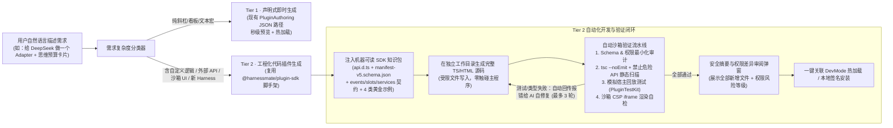

# 07 · Plugin SDK V4 → V5 补齐与 AI Plugin Builder 演进方案

> **核心原则**：最大化复用 HarnessMate Desktop 已经落地的 **Plugin SDK V4（P0–P5，API `4.0.0`）** 基础设施（`packages/plugin-api`、`packages/plugin-sdk`、`packages/daemon/src/plugin-host/*`），**严格坚持按需增量扩展**，不为假想需求制造冗余抽象，且对所有既有 V1–V4 插件保持 **100% 向后兼容**。

---

## 一、13 组 SDK 能力现状对照与补齐判定

基于 `docs/plugin-api/plugin-api.api.md`（695 行）、`events.md`、`services.md`、`slots.md` 及 `packages/daemon/src/plugin-host/permissions/permissions.ts` 逐项核验：

| # | SDK 接口域 | V4 (`4.0.0`) 已有能力 | 面向多 Harness / 上下文交接 / 协作的真实缺口 | V5 (`5.0.0` / `4.x`) 建议改动 | 必要性 |
| --- | --- | --- | --- | --- | --- |
| 1 | **Harness Adapter API** | **缺失**（仅声明式 ACP 配置；`harness.*` 禁止第三方提供） | 无法用插件接入 DeepSeek / OpenCode / Gemini CLI 等非 ACP 引擎 | 新增 `ctx.harnesses.registerDriver(driver)` + 隔离进程 Harness RPC v2，受全局高风险权限 `harness:driver:register` 门控 | **P0 必补** |
| 2 | **Session API** | `list`, `get`, `capabilities`, `prepareTurn`, `runNative` | 缺分页读取归一化块（供 MCP 回查/搜索）、缺 Fork/Archive、缺多实例绑定查询 | 新增 `sessions.listItems(filter)`、`sessions.getItem(id)`、`sessions.getBindings(id)`、`sessions.fork(opts)`、`sessions.switchInstance(opts)`（带权限门控） | **P0 必补** |
| 3 | **Context / Handoff API** | `handoff.section()`, `handoff.onCompose()`, `handoff.onShouldOffer()`, `ledger.get/append` | 缺敏感脱敏钩子、缺压缩引擎扩展点、缺交接前只读预览查询、缺账本失败尝试写入 | 新增 `handoff.onRedact()`、`handoff.preview(sessionId, targetInstanceId)`、`context.registerCompressor()`、`ledger.recordFailedAttempt()` | **P0 必补** |
| 4 | **Message / Block API** | 仅 `events:message`（用户/助手完成文本） | 插件无法读取结构化 `TurnBlock` 或向时间线发出轻量诊断/状态卡片 | 在 `sessions.listItems` 统一暴露只读 `TurnBlock`；新增 `sessions.postNotice(sessionId, notice)`（仅允许信息通知，不可伪造用户/助手发言） | **P1 必补** |
| 5 | **Event API** | 11 项事件 + 3 项钩子（`turn.*`, `message.*`, `tool.completed`, `approval.requested`, `session.created/closing`） | 缺引擎切换、交接交付、检查点、Worktree、子任务等关键控制面事件 | 新增 `session.harness_switched`、`handoff.delivered`、`checkpoint.captured`、`worktree.changed`、`subagent.updated`；**明确不暴露高频原始 delta 事件**（防跨进程 RPC 风暴） | **P1 必补** |
| 6 | **Runtime API** | `ctx.api.version`, `ctx.api.has(feature)`, `ctx.effect`, `ctx.logger`, `runId` | 缺受控进程派生（供第三方 CLI Adapter 启动目标 CLI）与优雅取消信号 | 新增 `ctx.runtime.spawnCli(spec)`（**仅向持有 `process:spawn:<binary>` 权限的 Adapter 插件开放**，强制进程组管理与环境白名单） | **P0 必补** |
| 7 | **Workspace / Git API** | `fs.read/list/stat/write`（工作区沙箱内）+ 内置 `git` 服务 | 缺受控 Git 只读查询、检查点查询与 Worktree 申请接口 | 通过公共服务 `git` 标准化导出 `status / diff / listWorktrees / createWorktree / captureCheckpoint / diffCheckpoints`（受 `workspace:git:read/write` 门控） | **P1 必补** |
| 8 | **Tool (MCP) API** | `ctx.tools.register(PublicModelTool)` 已接入官方 MCP 租约，支持任意 JSON Schema | 已有能力很强！只需补充只读/高危注解（`readOnly / destructive / alwaysLoad`）及会话上下文透传 | 增量扩展 `PublicModelTool` 元数据字段（零破坏） | **P1 增量** |
| 9 | **Permission API** | V4 既有精确权限：`session:read`、`events:approval`、`approvals:annotate`、`tools:model`、`fs:workspace:read/write`、`net:<host>`、`handoff:section`、`storage:plugin/workspace`、`service:provide:<name>`（见 `permissions.ts`） | 需按 V4 相同命名语法补充面向驱动、进程、Git、编排与隐私凭据的细粒度权限，并坚守“插件绝不能替用户审批”铁律 | V5 新增：`harness:driver:register`、`process:spawn:<bin>`、`process:pty:workspace`、`workspace:git:read`、`workspace:git:write`、`session:fork`、`session:switch`、`session:orchestrate`、`handoff:redact`、`context:compressor`、`secrets:read:<ns>`、`fs:cli_histories:read` | **P0 增量** |
| 10 | **Storage API** | `storage.plugin` + `storage.workspace` KV 存储 | 满足绝大部分插件需求；暂不需要给插件开放自定义 SQLite 表（防锁表与迁移冲突） | 仅新增 `storage.plugin.listPrefix(prefix)` 与可选单键 TTL，**不暴露裸 SQL** | **P2 轻量** |
| 11 | **UI Extension API** | 9 个类型化插槽 + `SandboxedPluginFrame`（严格 CSP iframe + 主题 CSS 变量 + `postMessage`） | 缺专有块渲染、动态 Trait 控件、Harness 设置表单、Diff 面板、侧栏徽标插槽 | 新增 5 个类型化插槽：`chat.block`, `composer.traits`, `harness.settings`, `inspector.diff`, `session.sidebar.badge` | **P1 增量** |
| 12 | **Capability Registry** | 仅 `HOST_SUPPORTED_FEATURES` 字符串数组 | 缺少跨插件查询“当前有哪些 Harness/能力/可选扩展已就绪”的统一只读发现面 | 新增 `ctx.capabilities.listHarnesses()`、`ctx.capabilities.hasFeature(name)` | **P1 增量** |
| 13 | **Inter-Plugin Service Discovery** | 已有 `inject` / `optional` / `provides` + `ctx.get(name)` + 跨进程 RPC 代理 | 已有机制非常优秀！仅需补充**有向无环图（DAG）启动期环路检测**与服务版本契约校验 | 在 `PluginHost` 加载阶段增加环依赖检测（返回 `E_CIRCULAR_DEPENDENCY`）与语义化版本校验 | **P1 增量** |

---

## 二、关键新增 SDK TypeScript 契约草案（`@harnessmate/plugin-api` v5.0 增量）

```ts
// ── 1. 新增特性开关（接入 HOST_SUPPORTED_FEATURES，确保低版本宿主安全拒载） ──
export const HOST_FEATURES_V5 = [
  'harness.driver.v2',
  'runtime.spawnCli',
  'handoff.protocol.v2',
  'sessions.items.read',
  'sessions.fork',
  'ui.slots.v5',
] as const;

// ── 2. IsolatedPluginContext V5 增量接口（完全继承 V4 全部属性） ────────
export interface IsolatedPluginContextV5 extends IsolatedPluginContext {
  readonly harnesses: {
    /** 需全局高风险权限 `harness:driver:register` */
    registerDriver(driver: PluginHarnessDriverRegistration): Disposer;
    listInstances(): Promise<ReadonlyArray<PublicHarnessInstanceInfo>>;
  };
  readonly runtime: {
    /** 需显式授权 `process:spawn:<command>`；宿主强制进程组托管、剥离敏感环境变量并在卸载时自动回收 */
    spawnCli(spec: {
      command: string;
      args: string[];
      cwdWorkspaceId: string;
      extraEnv?: Record<string, string>;
    }): Promise<ManagedCliProcessHandle>;
  };
  readonly sessions: IsolatedPluginContext['sessions'] & {
    listItems(sessionId: string, opts?: {
      afterSeq?: number;
      beforeSeq?: number;
      types?: string[];
      limit?: number;
      includeOmittedBodies?: boolean;
    }): Promise<{ items: TurnBlock[]; nextSeq: number | null }>;
    getItem(sessionId: string, itemId: string, opts?: { textOffset?: number; maxChars?: number }): Promise<{
      item: TurnBlock;
      bodyChunk?: string;
      nextTextOffset?: number | null;
    } | null>;
    getBindings(sessionId: string): Promise<ReadonlyArray<PublicHarnessBinding>>;
    fork(sessionId: string, opts?: { targetInstanceId?: string; title?: string; createWorktree?: boolean }): Promise<PublicSession>;
    /** 需 `session:switch` 权限：切换逻辑会话的当前活跃 Harness 实例 */
    switchInstance(sessionId: string, opts: { targetInstanceId: string; forceFreshNativeSession?: boolean }): Promise<void>;
    postNotice(sessionId: string, notice: { level: 'info' | 'warn' | 'error'; message: string; code?: string }): Promise<void>;
  };
  readonly handoff: IsolatedPluginContext['handoff'] & {
    /** 需 `handoff:redact` 权限：在交接包外发前对敏感片段脱敏 */
    onRedact(listener: (input: { text: string; targetDriverId: string }) => Promise<{ text: string; categories: string[] }>): Disposer;
    preview(sessionId: string, targetInstanceId: string): Promise<ContextHandoffPreviewV2>;
  };
  readonly context: {
    /** 需 `context:compressor` 权限：向核心注册可选的高压缩比滚动摘要/符号索引压缩器 */
    registerCompressor(compressor: ContextCompressorProvider): Disposer;
  };
}
```

---

## 三、向后兼容性与安全边界铁律

1. **V1–V4 插件零破坏兼容**：
   - `PluginManifest` 沿现有 `upgrade-v1.ts → upgrade-v2.ts → upgrade-v3.ts` 链平滑追加 `upgrade-v4.ts`；
   - `engines.pluginApi: "^4.0.0"` 的既有插件无需修改任何代码即可在 V5 宿主下原样运行；
   - 新增能力全部通过 `ctx.api.has('<feature>')` 探测，不支持时返回标准错误码 `E_NOT_SUPPORTED`。
2. **绝不可妥协的 5 条安全红线**：
   - **禁止第三方替换核心安全面**：`auth`、`permissions`、`remote`、`mcpHub`、`session-kernel` 永久保留为不可替换核心服务；`harness:driver:register` 只能**新增**驱动，绝不可劫持或覆盖已存在的内置 `codex` / `claude` / `agy` 驱动 ID。
   - **禁止插件越权审批或访问系统提示词**：插件永远只能通过 `approval.annotate` 叠加风险标注，绝无 `resolveApproval` 接口；第三方插件注入的交接段落永远进入用户侧通道，绝不进入 System Prompt。
   - **禁止插件直写 SQLite 或绕过进程组监管**：所有持久化必须经宿主 RPC（带 `runId` 过期校验）；第三方 Adapter 派生 CLI 必须经 `ctx.runtime.spawnCli`，确保插件禁用/崩溃时宿主连带清理全部子进程树，且环境变量自动剥离 Daemon Token 与其他 Harness 的 API Key。
   - **高危插件安装强制双重信任**：包含 `harness:driver:register` 或 `process:spawn:*` 权限的远程插件必须通过 Ed25519 受信任发布者签名校验，本地开发包必须经显式权限摘要确认。

---

## 四、AI Plugin Builder v2 赋能方案（让 AI 真正自主开发规范插件）

当前 `packages/daemon/src/plugins/plugin-authoring.ts` 仅允许 AI 生成纯 JSON 声明式清单（限制于斜杠指令/简单面板/纯文本程序），导致用户无法让 AI 自主构建 V4/V5 隔离代码插件、沙箱 UI 卡片或第三方 Harness Adapter。建议升级为 **两级 AI Plugin Builder 架构**：



### AI Plugin Builder 必须内置的四大支撑包（随 `@harnessmate/plugin-sdk` 同步 `pnpm contracts:generate` 自动生成，防止文档漂移）
1. **单文件精简契约摘要（`docs/plugin-api/ai-builder-context.md`）**：由构建脚本自动汇总 `plugin-api.api.md`、`events.md`、`services.md`、`slots.md`、错误码与权限风险表（控制在 ≤ 6,000 Tokens，避免塞爆 AI 上下文）。
2. **五套官方黄金模板（`packages/plugin-sdk/src/scaffold.ts` 扩展）**：现有 `declarative`、`isolated`、`ui-slot`、`service` 四个模板基础上，新增 **`harness-adapter`**（含被动探活、stdio/HTTP 传输骨架、三层能力声明、录制回放测试夹具）。
3. **内置离线测试夹具库（`@harnessmate/plugin-sdk/testing`）**：提供 `createMockPluginHost()`、`createMockSession()`、`replayAdapterTranscript(ndjson)`，让 AI 写完插件后能直接运行 `vitest` / `node --test` 自证通过。
4. **静态安全审计器（`plugin-static-audit`）**：在进入人工审阅前自动扫描生成的插件代码与清单，拦截越权 `child_process` 裸调用、未声明外网域名、超范围权限申请及不安全内联脚本。
