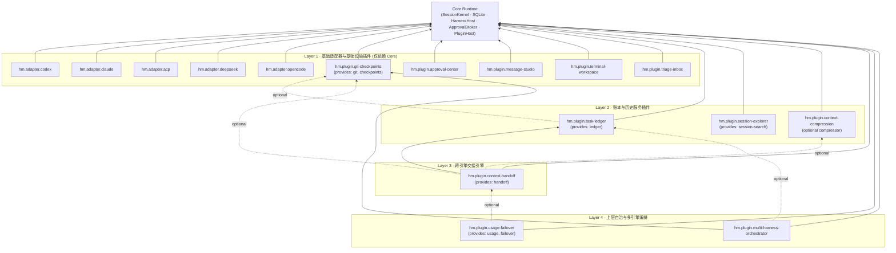

# 08 · HarnessMate Desktop 插件化架构拆分与全景插件目录

> **拆分原则**：**绝不为了“插件化”而把安全边界、事务一致性或进程监督拆散**；同时确保每一个业务扩展与 Harness 驱动拥有单一职责、清晰边界与严格无环依赖（DAG）。

---

## 一、五层架构归属边界总览

| 架构层次 | 不可下放/必须归属本层的能力 | 归属判断依据 |
| --- | --- | --- |
| **1. Core Runtime** (`packages/daemon/src/core/*`, `db/*`, `plugin-host/*`, `server/*`) | Unified Session Kernel（SQLite 单事务投影+有界事件日志+Outbox）、`CommandOutputHub`、`HarnessInstanceRegistry` 与 `ProcessSupervisor`、跨端原子 `ApprovalBroker`、`PluginHost` 安全沙箱与 `PluginPermissionService`、`HM-Remote v1` 网关与鉴权、基础 MCP 租约路由与 `hm_session_read` 只读端点 | 涉及**安全红线、SQLite 事务原子性、全局事件序列一致性、OS 进程树回收、跨设备原子锁**，任何插件崩溃或恶意行为都不可破坏此层 |
| **2. Plugin SDK** (`@harnessmate/plugin-api`, `@harnessmate/plugin-sdk`, `@harnessmate/protocol`) | V4/V5 公共类型契约、`HarnessDriverV2` 协议、三层能力模型、`TurnBlock` 契约、UI 插槽定义、测试夹具库（`PluginTestKit`）、脚手架 CLI、AI Plugin Builder 机器可读文档包 | 平台与生态的稳定契约面，版本化演进并由 `pnpm contracts:check` 自动守护 |
| **3. Harness Adapter Plugin** (5 个) | `hm.adapter.codex`、`hm.adapter.claude`、`hm.adapter.acp`（含 AGY 与 ACP Registry）、`hm.adapter.deepseek`（可选参考）、`hm.adapter.opencode`（可选参考） | 隔离各家 CLI/SDK/HTTP/ACP 协议细节与多实例认证，核心零厂商依赖 |
| **4. Built-in Plugin** (7 个) | `hm.plugin.context-handoff`、`hm.plugin.task-ledger`、`hm.plugin.git-checkpoints`、`hm.plugin.session-explorer`、`hm.plugin.approval-center`、`hm.plugin.usage-failover`、`hm.plugin.message-studio` | 随应用默认启用、提供核心用户体验，但模块边界独立，支持单独启停、热更新或由高级第三方插件经 `service:provide:<name>` 替换 |
| **5. Optional Plugin** (4 个) | `hm.plugin.multi-harness-orchestrator`、`hm.plugin.context-compression`、`hm.plugin.terminal-workspace`、`hm.plugin.triage-inbox` | 面向进阶多引擎协作、超长项目压缩或工作台效率增强，按需安装，避免首屏与核心复杂度膨胀 |

---

## 二、对初步研究方向清单的合并、精简与重构说明

对照调研背景中的 22 项初步候选模块，为避免碎片化耦合和重复维护状态，进行了如下合理合并与归属修正：

- **收归 Core Runtime（不拆为插件）**：`Harness Adapter Framework`（收归 Core `HarnessInstanceRegistry` + `IsolatedHarnessHost`）、`Unified Session Manager`（收归 Core Session Kernel）、`Workspace Manager`（收归 Core Workspace/CWD 管理）。
- **合并内聚为高价值插件**：
  - `Context Handoff Manager` + `Context Inspector` → **`hm.plugin.context-handoff`**（统筹交接编译、脱敏、预算与交接检视抽屉）；
  - `Git Worktree Manager` + `Git Diff` + `Hidden Git Checkpoints` → **`hm.plugin.git-checkpoints`**（统一 Git 工作树、检查点回滚、Diff 审查与 Commit/PR）；
  - `Session History Explorer` + `Native Session Importer` + `Session Search and Export` → **`hm.plugin.session-explorer`**（全部围绕只读历史投影、FTS5 检索、导入与导出）；
  - `Universal Message Renderer` 扩展 + `Tool Call Inspector` + `Model & Reasoning Selector` → **`hm.plugin.message-studio`**（核心基础渲染留于 `packages/web`，高级工具检视/动态 Traits/HTML 实时卡片收口于此内置插件）；
  - `Usage and Cost Analytics` + `Auto Failover` → **`hm.plugin.usage-failover`**（额度监测与限额切换天然闭环）；
  - `Task Orchestrator` + `Multi-Harness Collaboration` + `Agent Execution Monitor` → **`hm.plugin.multi-harness-orchestrator`**（统一承接场景 D 并行协作、Worktree 子任务图与多任务监控）。

---

## 三、严格无环依赖拓扑（Dependency DAG）

> **DAG 校验**：全图严格分层（Core ← L1 ← L2 ← L3 ← L4），**零循环依赖**；所有跨插件非强依赖均通过 V4 `optional` 声明，任一可选插件停用时系统优雅降级，不引发连锁失效。

---

## 四、16 个插件全景目录与独立设计文档索引

| # | 插件 ID | 插件名称 | 类型 | 优先级 | 难度 | 对应现有 v0.6.0 状态 | 详细技术说明书 |
| --- | --- | --- | --- | --- | --- | --- | --- |
| 01 | `hm.adapter.codex` | OpenAI Codex Adapter | Adapter (内置) | **P0** | 高 | 演进 `core.harness.codex` + `codex-adapter.ts` | [plugins/01_adapter_codex.md](./plugins/01_adapter_codex.md) |
| 02 | `hm.adapter.claude` | Claude Code Adapter | Adapter (内置) | **P0** | 高 | 演进 `core.harness.claude` + `claude-adapter.ts` | [plugins/02_adapter_claude.md](./plugins/02_adapter_claude.md) |
| 03 | `hm.adapter.acp` | ACP & Antigravity Adapter | Adapter (内置) | **P0** | 高 | 演进 `core.harness.agy/acp` + 新增 ACP Registry | [plugins/03_adapter_acp.md](./plugins/03_adapter_acp.md) |
| 04 | `hm.adapter.deepseek` | DeepSeek Harness Adapter | Adapter (可选) | **P2** | 中 | 缺失（首个第三方隔离非 ACP 标杆） | [plugins/04_adapter_deepseek.md](./plugins/04_adapter_deepseek.md) |
| 05 | `hm.adapter.opencode` | OpenCode HTTP/SSE Adapter | Adapter (可选) | **P2** | 中 | 缺失（首个 HTTP+SSE 传输标杆） | [plugins/05_adapter_opencode.md](./plugins/05_adapter_opencode.md) |
| 06 | `hm.plugin.context-handoff` | Context Handoff & Inspector | Built-in | **P0** | 高 | 演进 `core.context-bridge` + `ContextCompiler` | [plugins/06_plugin_context_handoff.md](./plugins/06_plugin_context_handoff.md) |
| 07 | `hm.plugin.task-ledger` | Structured Task State Ledger | Built-in | **P0** | 中 | 演进 `core.task-ledger` + `TaskLedgerService` | [plugins/07_plugin_task_ledger.md](./plugins/07_plugin_task_ledger.md) |
| 08 | `hm.plugin.git-checkpoints` | Git Checkpoints, Diff & Worktree | Built-in | **P1** | 高 | 演进 `core.git-inspector` + `git-service.ts` | [plugins/08_plugin_git_checkpoints.md](./plugins/08_plugin_git_checkpoints.md) |
| 09 | `hm.plugin.session-explorer` | Session Explorer, Search & Importer | Built-in | **P1** | 中 | 演进 `history-scanner.ts` + 新增 FTS5/Fork/MergeBack | [plugins/09_plugin_session_explorer.md](./plugins/09_plugin_session_explorer.md) |
| 10 | `hm.plugin.approval-center` | Approval, Question & Secret Center | Built-in | **P1** | 中 | 演进审批面板与 `approval.annotate` | [plugins/10_plugin_approval_center.md](./plugins/10_plugin_approval_center.md) |
| 11 | `hm.plugin.usage-failover` | Multi-Instance Usage & Failover | Built-in | **P1** | 中 | 合并演进 `core.account-usage` + `core.auto-failover` | [plugins/11_plugin_usage_failover.md](./plugins/11_plugin_usage_failover.md) |
| 12 | `hm.plugin.message-studio` | Message Studio, Traits & HTML Render | Built-in | **P1** | 中 | 演进 `ModelPicker` / 工具卡片 / 离屏预览 | [plugins/12_plugin_message_studio.md](./plugins/12_plugin_message_studio.md) |
| 13 | `hm.plugin.multi-harness-orchestrator` | Multi-Harness Parallel Orchestrator | Optional | **P2** | 极高 | 缺失（全新承接场景 D 并行开发） | [plugins/13_plugin_multi_harness_orchestrator.md](./plugins/13_plugin_multi_harness_orchestrator.md) |
| 14 | `hm.plugin.context-compression` | AI Context Compression & Symbol Index | Optional | **P2** | 中高 | 缺失（补齐超长 100+ 轮智能摘要与符号索引） | [plugins/14_plugin_context_compression.md](./plugins/14_plugin_context_compression.md) |
| 15 | `hm.plugin.terminal-workspace` | Integrated PTY Terminal & Context Chips | Optional | **P3** | 中 | 演进 `terminal-service.ts` 为完整终端抽屉 | [plugins/15_plugin_terminal_workspace.md](./plugins/15_plugin_terminal_workspace.md) |
| 16 | `hm.plugin.triage-inbox` | Triage Inbox & Command Palette | Optional | **P3** | 低中 | 缺失（借鉴 T3 Code Triage/Snooze/快捷键） | [plugins/16_plugin_triage_inbox.md](./plugins/16_plugin_triage_inbox.md) |
