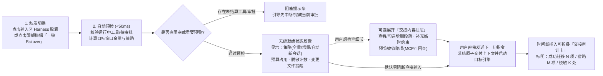

# 09 · 用户体验与交互设计调研及插件化 UI 治理规范

> **核心目标**：从真实开发者高频长任务视角，拆解 T3 Code 交互设计**为什么有效**，将其转化为契合 HarnessMate Desktop（**Star Loom Atelier** 视觉体系 + 插件化开放平台）的零摩擦交互流，并建立防碎片化的插件 UI 治理机制。

---

## 一、T3 Code 值得借鉴的核心交互逻辑与深层原因 `[T3 Code 已验证实现]`

| 交互场景 | T3 Code 具体做法（源码依据） | 为什么有效（底层人因逻辑） | HarnessMate Desktop 落地适配 |
| --- | --- | --- | --- |
| **1. 工作区与多仓项目** | 左侧按 Project 分组，支持多目录/Worktree 关联、项目图标、独立环境变量与 `.t3/setup` 初始化脚本 (`docs/user/multi-repo-projects.md`) | 开发者经常在主仓与特性 Worktree 间并行，项目级隔离减少切目录认知负担 | 升级左侧 Workspace 树，支持主目录 + 折叠 Worktree 子节点 + 一键新建隔离 Worktree 会话 |
| **2. 多会话切换与记忆** | `rememberTimelinePosition()` 记住每个线程的滚动锚点与工作组折叠状态 (`timelineScrollAnchoring.ts`)；Shell 快照仅加载活跃行 | 切回 500 轮长会话时不会跳回顶部或丢失阅读位置，消除“迷路感” | 在 `ChatStage` 增加按 `sessionId` 持久化的滚动锚点与卡片展开态缓存 |
| **3. 工具执行折叠与工作组** | `WorkLogBlock` / `WorkGroupSection` 将一轮内连续的读文件/搜索/命令折叠为紧凑可展开工作流条，配合 `TimelineMinimap` 侧边小地图 | 防止 20 次 `grep`/`read_file` 淹没真正重要的助手结论与用户决策 | 在 `hm.plugin.message-studio` 中实现“步骤组默认紧凑折叠、报错/修改文件/待审批自动高亮展开” |
| **4. 审批与受控提问交互** | `ComposerPendingApprovalActions` 将待处理审批固定在输入区上方显著位置，透传原生选项，支持快捷键决策；`SecretRequestCard` 私有遮罩输入 | 审批停在滚动区深处极易被漏看导致 Agent 干等；私有凭据卡避免密钥进入聊天记录 | 升级全局 Attention Strip（顶部跨会话待审批条）+ 输入区锚定审批条 + 专用 `secret_request` 卡片 |
| **5. 检查点与统一 Diff 审阅** | 每轮结束静默捕获隐藏 Git Ref，右侧 `DiffPanel` 按文件审阅并支持回滚至任意历史轮次，底部一键 Commit / Push / Open PR | 开发者对 AI 改代码的最大焦虑是“改坏了难撤回”；隐藏 Ref 让撤销既安全又不脏 Git 历史 | 交由内置插件 `hm.plugin.git-checkpoints`，在每轮底部显示 `+N/-M · 检查点` 胶囊，一键开 Diff 或安全回滚 |
| **6. 错误恢复与 Force Stop** | `UsageLimitRecoveryBanner` 精准展示限额重置时间与自动续跑选项；Stop 超时 10s 自动浮现 **Force Stop** | 区分“正常限额等待”与“程序卡死”，避免用户盲目重试或强杀整个桌面端 | 由 `hm.plugin.usage-failover` 接管 `usage_limit` 横幅，提供“等重置自动续跑”与“一键 Failover 切引擎重试”双选项 |
| **7. 长任务与异步后台感** | 后台完成提示 + `Triage`（置顶/延后 Snooze/已结算 Settled）+ `Side Chat`（在主线程跑测试时开旁聊提问不打断主线） | 长耗时 Agent 任务本质是“异步多任务调度”，需要收件箱心智而非纯即时聊天心智 | 由 `hm.plugin.triage-inbox` 提供收件箱视图与延后/置顶；由 `hm.plugin.session-explorer` 提供一键旁聊（Side Chat） |
| **8. 键盘优先与命令面板** | 全局 `CommandPalette`（模糊搜线程/项目/主题/动作）+ `ThreadFind` 线程内高亮检索 + 完整快捷键体系 (`keybindings.md`) | 重度编程用户双手常驻键盘，命令面板是跨插件能力的统一高频入口 | 全局 `Ctrl/Cmd + K` 命令面板统一索引会话、Harness 切换、Git 操作与所有已安装插件动作 |
| **9. 集成终端与上下文芯片** | `ThreadTerminalDrawer` 绑定会话目录，`TerminalContextInlineChip` 一键把终端报错片段贴为输入上下文芯片 | 开发者手动跑完测试想把报错喂给 Agent 时，零复制粘贴切换成本 | 由 `hm.plugin.terminal-workspace` 提供底部可伸缩 PTY 抽屉 + “发送到当前会话”上下文芯片 |

---

## 二、零摩擦跨 Harness 交接核心体验流 `[HarnessMate 原创设计]`

**核心体验准则**：用户切换 Harness 时，**绝不被迫手动复制聊天记录、编写交接提示词、重新选目录或复述背景**；同时对上下文迁移过程**完全透明、可审查、可微调**。



### 交接透明度三层渐进披露（Progressive Disclosure）
1. **默认态（零干扰）**：输入区上方仅显示一条紧凑的 **交接就绪胶囊**，例如：
   `将同步至 Claude Sonnet · 全量任务账本 + 近 6 轮 (~4.2k / 16k tok) · 已自动脱敏 2 处密钥 · [查看/微调] [本轮跳过]`。
2. **展开态（可控可改）**：点击 `[查看/微调]` 打开右侧 **Handoff Inspector** 抽屉，以标签页清晰展示：
   - **已包含（Included）**：Block A 工作区锚点、Block B 任务账本（可直接在线编辑钉选铁律）、Block D 原文轮次勾选列表；
   - **已压缩/省略（Omitted）**：列出未直接内联的早期轮次，明确标注“目标支持 `hm_session_read` MCP 按需拉取”或“目标无 MCP，建议重要项手动勾选”；
   - **安全脱敏日志（Redacted）**：列出脱敏类别与位置（绝不展示明文），用户可审查是否误杀。
3. **完成态（可审计回溯）**：发送后时间线插入紧凑 `handoff_card` 分割块，标注 `injected / inline` 通道、热复用还是自动切新会话，点击随时回看当时发出的确切快照。

---

## 三、桌面端 Star Loom Atelier 布局与插件化 UI 一致性治理

随着内置与第三方插件数量增长到 10–30+，最常见的灾难是**界面风格割裂、按钮满屏堆砌、功能藏在角落找不到**。HarnessMate 必须建立五项硬性 UI 治理约束：

```
┌────────────────────────────────────────────────────────────────────────────┐
│ [侧栏折叠]  Workspace / Session 标题 · [Git分支]      [全局待审批提醒条] [⌘K] │
├──────────────┬─────────────────────────────────────────┬───────────────────┤
│ Workspaces   │ ── 会话时间线 (Virtualized + Minimap) ── │ 右侧检视抽屉 (Tab) │
│  ├─ Repo A   │  [User] ...                             │  [账本][Diff][交接]│
│  │  ├─ 主会话 │  [WorkGroup · 5 steps · 折叠]           │  [文件][+插件Tab] │
│  │  └─ WT-1  │  [Handoff Card: Codex -> Claude]        │                   │
│  └─ Repo B   │  [Assistant · Markdown / ext:block]     │  (第三方插件走     │
│              │  [Checkpoint +42/-11 · 审阅Diff/回滚]    │   strict CSP      │
│ ──────────── │ ─────────────────────────────────────── │   iframe，自动    │
│ [sidebar.    │ [待审批置顶条 / 交接就绪胶囊]             │   继承主题变量)   │
│  tools 限4项]│ [输入框: @文件 /指令 粘贴图片 终端芯片]    │                   │
│ [插件中心]    │ [Harness▼][Model▼][Traits▼][权限▼][发送] │                   │
├──────────────┴─────────────────────────────────────────┴───────────────────┤
│ [statusbar.items 限5项: 活跃实例 · 上下文窗口 38% · MCP就绪 · 后台子任务 2]   │
└────────────────────────────────────────────────────────────────────────────┘
```

1. **视觉 Token 强制继承**：延续现有 `SandboxedPluginFrame.tsx` 机制，宿主通过 `hm:init` 与 `hm:theme` 向所有插件 iframe 注入 Star Loom Atelier 全套 CSS 变量（`--bg-*`, `--fg-*`, `--border-*`, `--accent-*`, `--font-mono`, `--radius-*`），插件使用 `@harnessmate/plugin-sdk/ui.css` 基础类即可天然融入夜织深空 / 暖宣浅色双主题。
2. **插槽配额与溢出折叠**：
   - `sidebar.tools` 最多直显 4 项，超出自动收入“更多工具”弹出层；
   - `composer.actions` 最多直显 3 项图标按钮，超出收入 `+` 扩展菜单；
   - `inspector.tabs` 核心固定 3 个常驻 Tab（账本 / Diff / 交接），插件 Tab 按 `order` 排布并支持溢出下拉；
   - `statusbar.items` 仅允许单行紧凑指标（高 ≤ 24px），严禁弹出遮罩。
3. **单一发现入口（Command Palette + Slash Menu）**：所有插件注册的命令、面板、动作、工作流自动汇入 `Ctrl/Cmd + K` 全局命令面板与输入框 `/` 菜单，标注插件来源胶囊，彻底解决“装了插件找不到入口”的问题。
4. **单点故障完全隔离**：每个插槽项强制包裹 `SlotErrorBoundary`；单个插件崩溃仅在对应卡片内展示降级提示并上报至插件中心日志页，绝不影响主对话输入与审批操作。
5. **严禁持续重绘动画**：吸收 T3 Code `AGENTS.md#L155` 的性能教训，规范插件和主界面在空闲或长任务态不使用高频 GPU 重绘动画，防止高刷屏笔记本风扇狂转与电耗飙升。
