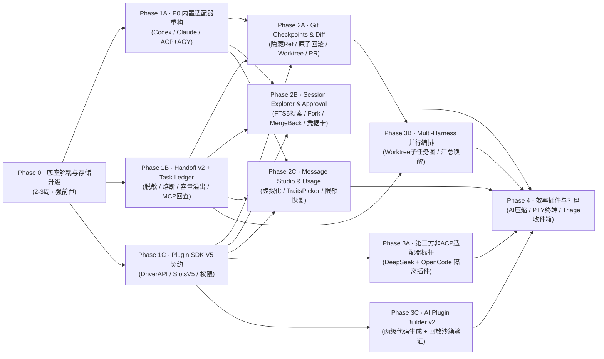

# 10 · HarnessMate Desktop 分阶段演进实施路线图

> **规划原则**：严格基于 `harnessmate_desktop` v0.6.0（Commit `970eafb`，36/36 测试通过）平滑演进，**绝不推倒重写**；坚持每个阶段独立可编译、可回归、可发布，清晰划分前置依赖与并行泳道。

---

## 一、阶段拓扑与依赖关系图

---

## 二、分阶段任务拆解、并行泳道与验收标准

### Phase 0 · 核心底座解耦与混合持久化升级（强烈建议串行优先落地）
**目标**：消除硬编码 4 枚举、落地 `TurnItem` 持久化投影 + Outbox + `CommandOutputHub`、上线 Instance-First 注册表，为后续并行开发铺平道路。

| 任务项 | 改动范围 | 依赖 | 验收标准（可执行验证） |
| --- | --- | --- | --- |
| **0.1 开放驱动 ID 与三层能力契约** | `packages/protocol/src/canonical.ts`、`packages/daemon/src/harnesses/types.ts` | 无 | `HarnessDriverId` 支持开放字符串且 100% 兼容旧 `codex/claude/agy/acp` 数据；`AdapterSessionHandle` 移除 `runCodexGoal` 与 `codexInjectItems` 泄漏；`pnpm contracts:check` 通过 |
| **0.2 SQLite 混合投影与 Outbox 迁移** | `packages/daemon/src/db/sqlite.ts`、`core/session-manager.ts` | 0.1 | 新增 `session_runs`、`session_turn_items`、`command_receipts`、`effect_outbox`、`session_handoffs`、`session_checkpoints`、`session_search_fts` 表；高频 delta 经 50ms Coalescer 合并，原始 stdout 走 `CommandOutputHub`；50 轮基准 SQLite 行数降幅 ≥ 10x、冷开耗时 < 5ms |
| **0.3 HarnessInstanceRegistry（多实例隔离）** | `packages/daemon/src/harnesses/registry.ts`、`config.ts` | 0.1 | 支持为同一 `driverId` 配置 2 个实例（如 `codex-work` / `codex-personal`），独立 `continuationKey` 与白名单环境变量；修改显示名不中断活跃会话 |
| **0.4 进程终态结算与 Outbox 崩溃恢复** | `packages/daemon/src/core/session-manager.ts` | 0.2 | 模拟 Daemon 强制重启或 CLI `SIGKILL`：所有悬挂工具调用/子 Agent 自动结算为 `interrupted`，`PROCESS_BOUND` 任务不重放，`REPLAY_SAFE` 任务正常续跑 |

### Phase 1 · P0 适配器重构、Handoff Protocol v2 与 SDK V5（三条泳道可并行）
- **泳道 1A（内置适配器插件化重构）**：
  - 将 `codex-adapter.ts`、`claude-adapter.ts`、`acp-adapter.ts` 升级为符合 `HarnessDriverV2` 规范的 `hm.adapter.codex`、`hm.adapter.claude`、`hm.adapter.acp`；
  - 修复 `probePassive()` 零副作用（严禁再调用 `session/new`）；接入 ACP Registry 动态发现；建立录制回放测试夹具体系。
- **泳道 1B（Context Handoff Protocol v2 + Task Ledger 升级）**：
  - 升级 `hm.plugin.task-ledger`（新增 `failedAttempts` 记录）与 `hm.plugin.context-handoff`（集成敏感脱敏、`delivery='pending'` 两阶段不确定投递熔断、容量感知预算 + 溢出自动切新原生会话、工作区文件陈旧度宣告、在内置 MCP 租约暴露 `hm_session_read` 按需分页回查）。
- **泳道 1C（Plugin SDK V5 增量发布）**：
  - 在 `@harnessmate/plugin-api`（v5.0 兼容 v4.0）与 `packages/daemon/src/plugin-host` 落地 `ctx.harnesses.registerDriver`、`ctx.runtime.spawnCli`、`sessions.listItems/getItem/fork`、`handoff.onRedact`、5 个 V5 UI 插槽、DAG 环依赖检测与 6 项新权限；更新 `pnpm contracts:generate`。
- **Phase 1 验收标准**：
  - 真实模拟 CLI 集成测试覆盖 Codex ↔ Claude ↔ AGY 往返交接、中途崩溃 `pending` 熔断、32k 窗口溢出自动开新会话 + `hm_session_read` 拉取被省略轮次、含 API Key 的输出 100% 脱敏；
  - 既有全部 36 项 V1–V4 回归测试零失败通过。

### Phase 2 · P1 核心体验插件与前端零硬编码适配（三条泳道可并行）
- **泳道 2A（`hm.plugin.git-checkpoints`）**：隐藏 Git Ref 检查点自动捕获、对话+文件原子回滚守卫（不支持对话回滚的引擎先拦截绝不触碰文件）、右侧统一 Diff 审阅抽屉、Worktree 生命周期与一键 Commit/Push/PR。
- **泳道 2B（`hm.plugin.session-explorer` + `hm.plugin.approval-center`）**：SQLite FTS5 全局全文检索、原生/便携 Fork 与 `merge_back`、流式原生历史导入增强（支持 `.jsonl.zst`）、全局待审批提醒条、结构化提问卡与 `secret_request` 私有凭据卡。
- **泳道 2C（`hm.plugin.message-studio` + `hm.plugin.usage-failover`）**：移除 `packages/web/src/lib/harness-meta.ts` 硬编码；上线 `TurnBlock` 通用渲染器 + `chat.block` 插槽 + 未知块降级卡；上线动态 `TraitsPicker`、虚拟化时间线 + Turn Minimap + 滚动锚定记忆；整合 `usage_limit` 精确限额分类与一键 Failover。
- **Phase 2 验收标准**：
  - `packages/web/src` 时间线与设置核心路径中，除默认回退样式外 `codex/claude/agy` 硬编码分支清零；
  - 1,500 轮长会话冷开首屏渲染 < 120ms，内存稳定无闭包泄漏；
  - 隐藏 Git Ref 检查点回滚在支持/不支持回滚的两类 Harness 上均正确执行或安全拒绝。

### Phase 3 · P2 开放生态标杆、多 Harness 并行协作与 AI Plugin Builder v2（三条泳道可并行）
- **泳道 3A（第三方非 ACP Adapter 插件标杆）**：独立开发并签名发布 `hm.adapter.deepseek`（隔离进程 + 自定义 `ext:deepseek.reasoning_budget` 沙箱块 UI）与 `hm.adapter.opencode`（HTTP + SSE 传输），实证**零修改主程序代码接入全新非 ACP 引擎**。
- **泳道 3B（`hm.plugin.multi-harness-orchestrator`）**：落地场景 D 并行协作——MCP `hm_delegate_task(isolation:'worktree')`、父会话完成队列唤醒、多引擎并行看板、文件冲突预检与 Worktree 归并工作流。
- **泳道 3C（AI Plugin Builder v2）**：自动生成 `ai-builder-context.md`、新增 `harness-adapter` 脚手架模板与 `@harnessmate/plugin-sdk/testing` 回放测试库、实现 Tier 2 代码生成 → 静态安全审计 → 自动沙箱测试修复 → 权限审阅热加载闭环。
- **Phase 3 验收标准**：
  - 安装 `hm.adapter.deepseek` / `hm.adapter.opencode` 插件后，无需重启/重编译主程序即可完成多轮流式对话、自定义块渲染及与 Claude 的跨引擎上下文交接；
  - 主会话可同时派生 Codex + Claude 两个隔离 Worktree 子任务并行修改不同模块并安全回收合并；
  - AI Plugin Builder v2 端到端自动生成 1 个带沙箱 UI 插槽的 V5 插件并通过测试安装运行。

### Phase 4 · P3 进阶效率插件与生态打磨（可按用户反馈延后排期）
- `hm.plugin.context-compression`（可选 LLM 滚动摘要 + 符号级代码索引）；
- `hm.plugin.terminal-workspace`（每会话/Worktree 持久化 PTY 抽屉 + 终端报错上下文芯片）；
- `hm.plugin.triage-inbox`（T3 Code 风格 Triage 收件箱、Snooze/Pin/Settled 治理、全局 `⌘K` 命令面板与快捷键系统）。

---

## 三、明确建议推迟（暂不做）的事项

| 暂缓事项 | 推迟理由 |
| --- | --- |
| 原生 iOS / Android React Native App | 现有 `HM-Remote v1` Web/PWA + Tailscale 已覆盖 90% 移动端审阅/审批需求，原生 App 维护成本极高 |
| 自建公网云中继基础设施（对标 T3 Connect） | 引入账号体系、服务端带宽与合规负担，现阶段应继续依托局域网 + Tailscale / Cloudflare Tunnel |
| 将后端重写为 Effect-TS | 现有 Node 24 + Zod + 36 项测试体系运转极佳，重写将停滞产品迭代数月且不直接产生用户价值 |
| 多机联邦编排（Peer Environment Linking） | 需先打牢单机多 Harness 与多 Worktree 并行稳定性，待远程节点成为强需求再按插件扩展 |
